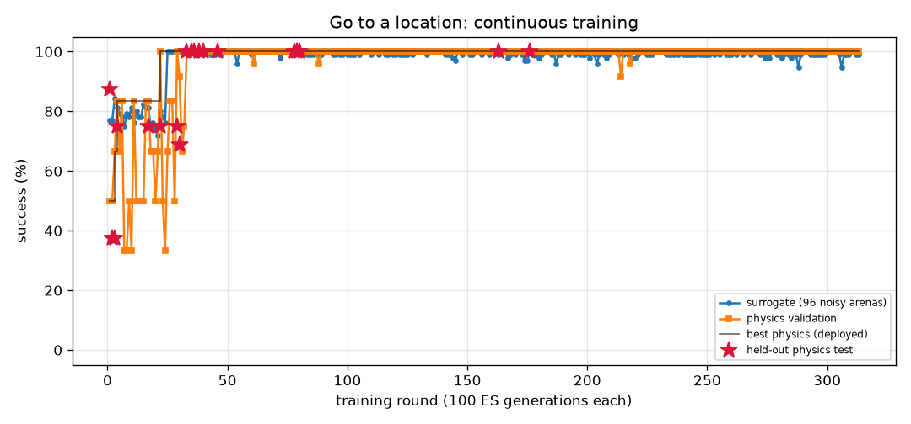

# Go to a location (`goto`) — training report

*Auto-generated by `train_brains.py`, last updated 2026-11-20T16:58:04.*

| | |
|---|---|
| rounds | 353 |
| ES generations | 35300 |
| physics runs | 8422 |
| status | **optimal** |
| best brain | round 176: physics validation **100%** on 24 arenas, surrogate 100% |
| held-out physics test | **100%** on 32 unseen arenas (95% CI 89%-100%) (errors: [0.2, 0.32, 0.19, 0.24, 0.18, 0.2, 0.19, 0.17, 0.22, 0.23, 0.23, 0.26, 0.2, 0.19, 0.24, 0.23, 0.22, 0.24, 0.2, 0.22, 0.2, 0.2, 0.26, 0.19, 0.22, 0.18, 0.26, 0.22, 0.2, 0.26, 0.23, 0.23]) |

Physics error per arena: mm from target at the end (< 1.5 and standing still = success).

| round | level | gens | sigma | surrogate | physics val | val errors | test | note |
|---:|---:|---:|---:|---:|---:|---|---:|---|
| 314 | 3 | 31400 | 0.025 | 99% | 100% | [0.68, 0.65, 0.54, 0.52, 0.53, 0.51, 0.67, 0.54, 0.54, 0.51, 0.49, 0.51, 0.63, 0.5, 0.55, 0.56, 0.66, 0.55, 0.51, 0.61, 0.55, 0.5, 0.63, 0.53] |  |  |
| 315 | 3 | 31500 | 0.025 | 99% | 100% | [0.53, 0.52, 0.37, 0.38, 0.4, 0.39, 0.48, 0.42, 0.45, 0.37, 0.37, 0.37, 0.48, 0.4, 0.43, 0.45, 0.52, 0.41, 0.37, 0.45, 0.41, 0.36, 0.5, 0.38] |  |  |
| 316 | 3 | 31600 | 0.025 | 100% | 100% | [0.56, 0.55, 0.43, 0.41, 0.44, 0.4, 0.57, 0.45, 0.44, 0.42, 0.43, 0.41, 0.5, 0.43, 0.47, 0.55, 0.54, 0.44, 0.43, 0.48, 0.5, 0.42, 0.49, 0.41] |  | restart from best |
| 317 | 3 | 31700 | 0.024 | 100% | 100% | [0.52, 0.57, 0.53, 0.57, 0.51, 0.53, 0.57, 0.56, 0.57, 0.53, 0.49, 0.55, 0.56, 0.53, 0.6, 0.58, 0.55, 0.52, 0.51, 0.6, 0.55, 0.56, 0.54, 0.55] |  |  |
| 318 | 3 | 31800 | 0.024 | 100% | 100% | [0.5, 0.46, 0.47, 0.37, 0.35, 0.35, 0.5, 0.4, 0.43, 0.33, 0.32, 0.37, 0.46, 0.35, 0.42, 0.41, 0.48, 0.36, 0.32, 0.42, 0.39, 0.34, 0.48, 0.35] |  |  |
| 319 | 3 | 31900 | 0.024 | 100% | 100% | [0.52, 0.54, 0.52, 0.48, 0.45, 0.46, 0.56, 0.49, 0.53, 0.44, 0.42, 0.47, 0.55, 0.42, 0.5, 0.49, 0.53, 0.48, 0.44, 0.52, 0.49, 0.46, 0.54, 0.47] |  |  |
| 320 | 3 | 32000 | 0.024 | 99% | 100% | [0.53, 0.5, 0.5, 0.43, 0.4, 0.4, 0.54, 0.42, 0.43, 0.4, 0.38, 0.41, 0.48, 0.4, 0.49, 0.46, 0.57, 0.43, 0.38, 0.47, 0.44, 0.41, 0.51, 0.4] |  | restart from best |
| 321 | 3 | 32100 | 0.024 | 99% | 100% | [0.53, 0.47, 0.37, 0.46, 0.37, 0.4, 0.55, 0.42, 0.51, 0.41, 0.38, 0.44, 0.54, 0.36, 0.46, 0.42, 0.55, 0.42, 0.39, 0.54, 0.4, 0.46, 0.52, 0.43] |  |  |
| 322 | 3 | 32200 | 0.025 | 99% | 100% | [0.6, 0.59, 0.58, 0.48, 0.45, 0.47, 0.59, 0.52, 0.51, 0.47, 0.45, 0.49, 0.58, 0.49, 0.52, 0.55, 0.5, 0.49, 0.45, 0.57, 0.51, 0.5, 0.59, 0.49] |  |  |
| 323 | 3 | 32300 | 0.025 | 100% | 100% | [0.36, 0.37, 0.34, 0.29, 0.27, 0.31, 0.35, 0.34, 0.29, 0.26, 0.27, 0.29, 0.34, 0.3, 0.32, 0.37, 0.3, 0.28, 0.27, 0.32, 0.33, 0.28, 0.35, 0.29] |  |  |
| 324 | 3 | 32400 | 0.024 | 98% | 100% | [0.35, 0.35, 0.25, 0.3, 0.25, 0.26, 0.4, 0.3, 0.31, 0.28, 0.25, 0.29, 0.33, 0.28, 0.37, 0.34, 0.37, 0.25, 0.25, 0.32, 0.3, 0.28, 0.35, 0.28] |  | restart from best |
| 325 | 3 | 32500 | 0.024 | 100% | 100% | [0.46, 0.45, 0.39, 0.46, 0.34, 0.43, 0.41, 0.46, 0.49, 0.34, 0.38, 0.44, 0.49, 0.39, 0.38, 0.37, 0.45, 0.44, 0.33, 0.46, 0.36, 0.35, 0.48, 0.48] |  |  |
| 326 | 3 | 32600 | 0.024 | 99% | 100% | [0.63, 0.61, 0.52, 0.56, 0.48, 0.53, 0.61, 0.59, 0.63, 0.49, 0.49, 0.52, 0.64, 0.53, 0.56, 0.57, 0.65, 0.53, 0.48, 0.62, 0.55, 0.51, 0.64, 0.56] |  |  |
| 327 | 3 | 32700 | 0.025 | 99% | 100% | [0.54, 0.49, 0.38, 0.48, 0.39, 0.43, 0.55, 0.47, 0.52, 0.42, 0.4, 0.46, 0.55, 0.39, 0.48, 0.46, 0.56, 0.41, 0.4, 0.5, 0.41, 0.43, 0.53, 0.45] |  |  |
| 328 | 3 | 32800 | 0.025 | 99% | 100% | [0.47, 0.4, 0.39, 0.34, 0.28, 0.32, 0.46, 0.34, 0.29, 0.3, 0.28, 0.32, 0.42, 0.26, 0.36, 0.31, 0.43, 0.35, 0.3, 0.38, 0.3, 0.3, 0.39, 0.34] |  | restart from best |
| 329 | 3 | 32900 | 0.024 | 100% | 100% | [0.47, 0.41, 0.37, 0.42, 0.35, 0.4, 0.47, 0.39, 0.44, 0.37, 0.35, 0.39, 0.46, 0.32, 0.46, 0.37, 0.49, 0.34, 0.37, 0.48, 0.35, 0.44, 0.43, 0.44] |  |  |
| 330 | 3 | 33000 | 0.024 | 99% | 100% | [0.33, 0.33, 0.36, 0.33, 0.25, 0.3, 0.33, 0.35, 0.36, 0.27, 0.27, 0.32, 0.34, 0.28, 0.31, 0.27, 0.36, 0.29, 0.25, 0.34, 0.26, 0.28, 0.36, 0.32] |  |  |
| 331 | 3 | 33100 | 0.025 | 99% | 100% | [0.29, 0.31, 0.32, 0.33, 0.3, 0.33, 0.31, 0.36, 0.35, 0.29, 0.28, 0.31, 0.33, 0.3, 0.29, 0.34, 0.32, 0.34, 0.3, 0.36, 0.36, 0.28, 0.31, 0.32] |  |  |
| 332 | 3 | 33200 | 0.025 | 99% | 100% | [0.67, 0.63, 0.57, 0.61, 0.53, 0.56, 0.67, 0.59, 0.63, 0.55, 0.54, 0.59, 0.68, 0.5, 0.61, 0.62, 0.71, 0.58, 0.56, 0.68, 0.59, 0.62, 0.68, 0.61] |  | restart from best |
| 333 | 3 | 33300 | 0.024 | 100% | 100% | [0.46, 0.45, 0.4, 0.45, 0.36, 0.42, 0.43, 0.43, 0.45, 0.37, 0.36, 0.43, 0.45, 0.4, 0.38, 0.44, 0.46, 0.43, 0.36, 0.46, 0.42, 0.38, 0.47, 0.44] |  |  |
| 334 | 3 | 33400 | 0.024 | 99% | 100% | [0.38, 0.4, 0.28, 0.29, 0.33, 0.27, 0.4, 0.31, 0.34, 0.3, 0.28, 0.31, 0.38, 0.3, 0.33, 0.37, 0.4, 0.3, 0.29, 0.35, 0.34, 0.32, 0.39, 0.29] |  |  |
| 335 | 3 | 33500 | 0.025 | 99% | 100% | [0.42, 0.43, 0.29, 0.32, 0.34, 0.31, 0.41, 0.38, 0.37, 0.31, 0.3, 0.33, 0.4, 0.34, 0.39, 0.39, 0.44, 0.34, 0.3, 0.37, 0.37, 0.31, 0.42, 0.31] |  |  |
| 336 | 3 | 33600 | 0.025 | 99% | 100% | [0.52, 0.52, 0.56, 0.49, 0.54, 0.49, 0.53, 0.55, 0.5, 0.49, 0.5, 0.49, 0.56, 0.5, 0.49, 0.55, 0.54, 0.51, 0.49, 0.55, 0.56, 0.49, 0.55, 0.5] |  | restart from best |
| 337 | 3 | 33700 | 0.024 | 100% | 100% | [0.56, 0.47, 0.5, 0.5, 0.39, 0.46, 0.54, 0.51, 0.53, 0.42, 0.41, 0.47, 0.55, 0.39, 0.48, 0.44, 0.55, 0.43, 0.41, 0.59, 0.41, 0.49, 0.53, 0.5] |  |  |
| 338 | 3 | 33800 | 0.024 | 100% | 100% | [0.68, 0.68, 0.58, 0.62, 0.59, 0.61, 0.69, 0.63, 0.64, 0.6, 0.57, 0.62, 0.66, 0.61, 0.64, 0.63, 0.7, 0.59, 0.59, 0.65, 0.63, 0.63, 0.69, 0.61] |  |  |
| 339 | 3 | 33900 | 0.024 | 98% | 100% | [0.34, 0.42, 0.26, 0.3, 0.28, 0.28, 0.34, 0.35, 0.35, 0.29, 0.27, 0.32, 0.35, 0.31, 0.41, 0.36, 0.43, 0.27, 0.25, 0.35, 0.33, 0.29, 0.41, 0.3] |  |  |
| 340 | 3 | 34000 | 0.025 | 100% | 100% | [0.43, 0.45, 0.33, 0.39, 0.31, 0.39, 0.41, 0.37, 0.46, 0.31, 0.32, 0.38, 0.44, 0.36, 0.41, 0.37, 0.46, 0.38, 0.31, 0.41, 0.36, 0.32, 0.46, 0.41] |  | restart from best |
| 341 | 3 | 34100 | 0.024 | 100% | 100% | [0.35, 0.37, 0.37, 0.32, 0.25, 0.32, 0.32, 0.38, 0.34, 0.26, 0.25, 0.29, 0.36, 0.29, 0.3, 0.32, 0.37, 0.32, 0.25, 0.34, 0.29, 0.26, 0.38, 0.33] |  |  |
| 342 | 3 | 34200 | 0.024 | 99% | 100% | [0.57, 0.51, 0.54, 0.5, 0.38, 0.45, 0.56, 0.49, 0.56, 0.4, 0.42, 0.48, 0.57, 0.38, 0.43, 0.46, 0.58, 0.44, 0.4, 0.53, 0.43, 0.42, 0.56, 0.48] |  |  |
| 343 | 3 | 34300 | 0.025 | 100% | 100% | [0.44, 0.42, 0.39, 0.37, 0.31, 0.36, 0.45, 0.36, 0.42, 0.32, 0.34, 0.36, 0.41, 0.28, 0.4, 0.36, 0.44, 0.36, 0.34, 0.4, 0.34, 0.31, 0.4, 0.37] |  |  |
| 344 | 3 | 34400 | 0.024 | 100% | 100% | [0.54, 0.52, 0.55, 0.51, 0.41, 0.48, 0.54, 0.51, 0.54, 0.42, 0.43, 0.48, 0.53, 0.41, 0.45, 0.48, 0.55, 0.49, 0.42, 0.52, 0.46, 0.44, 0.54, 0.5] |  | restart from best |
| 345 | 3 | 34500 | 0.024 | 100% | 100% | [0.44, 0.38, 0.25, 0.33, 0.26, 0.3, 0.42, 0.35, 0.35, 0.28, 0.28, 0.33, 0.38, 0.28, 0.34, 0.34, 0.43, 0.31, 0.27, 0.37, 0.31, 0.3, 0.41, 0.32] |  |  |
| 346 | 3 | 34600 | 0.024 | 99% | 100% | [0.52, 0.47, 0.53, 0.45, 0.34, 0.43, 0.45, 0.5, 0.49, 0.35, 0.36, 0.44, 0.52, 0.37, 0.38, 0.42, 0.53, 0.43, 0.34, 0.48, 0.4, 0.36, 0.53, 0.43] |  |  |
| 347 | 3 | 34700 | 0.025 | 100% | 100% | [0.43, 0.44, 0.45, 0.42, 0.32, 0.4, 0.4, 0.46, 0.46, 0.35, 0.34, 0.4, 0.46, 0.39, 0.39, 0.41, 0.47, 0.39, 0.33, 0.43, 0.37, 0.36, 0.46, 0.41] |  |  |
| 348 | 3 | 34800 | 0.024 | 99% | 100% | [0.65, 0.56, 0.6, 0.58, 0.46, 0.52, 0.66, 0.56, 0.58, 0.49, 0.51, 0.55, 0.66, 0.46, 0.54, 0.52, 0.67, 0.56, 0.48, 0.62, 0.48, 0.47, 0.64, 0.56] |  | restart from best |
| 349 | 3 | 34900 | 0.024 | 100% | 100% | [0.36, 0.38, 0.36, 0.36, 0.35, 0.37, 0.37, 0.37, 0.38, 0.33, 0.38, 0.36, 0.37, 0.35, 0.32, 0.32, 0.38, 0.37, 0.31, 0.36, 0.31, 0.37, 0.37, 0.35] |  |  |
| 350 | 3 | 35000 | 0.024 | 98% | 100% | [0.41, 0.37, 0.41, 0.41, 0.3, 0.37, 0.38, 0.42, 0.42, 0.32, 0.33, 0.4, 0.42, 0.32, 0.32, 0.33, 0.41, 0.37, 0.3, 0.41, 0.31, 0.32, 0.41, 0.39] |  |  |
| 351 | 3 | 35100 | 0.025 | 99% | 100% | [0.54, 0.55, 0.58, 0.49, 0.41, 0.49, 0.53, 0.53, 0.57, 0.4, 0.42, 0.47, 0.53, 0.36, 0.42, 0.47, 0.52, 0.52, 0.42, 0.48, 0.45, 0.39, 0.57, 0.47] |  |  |
| 352 | 3 | 35200 | 0.025 | 98% | 100% | [0.5, 0.46, 0.44, 0.34, 0.35, 0.33, 0.49, 0.35, 0.44, 0.34, 0.33, 0.34, 0.42, 0.34, 0.36, 0.41, 0.45, 0.37, 0.34, 0.4, 0.38, 0.34, 0.42, 0.34] |  | restart from best |
| 353 | 3 | 35300 | 0.024 | 99% | 100% | [0.53, 0.53, 0.46, 0.5, 0.43, 0.49, 0.58, 0.53, 0.56, 0.44, 0.45, 0.48, 0.53, 0.39, 0.48, 0.46, 0.56, 0.52, 0.46, 0.53, 0.45, 0.44, 0.5, 0.52] |  |  |
