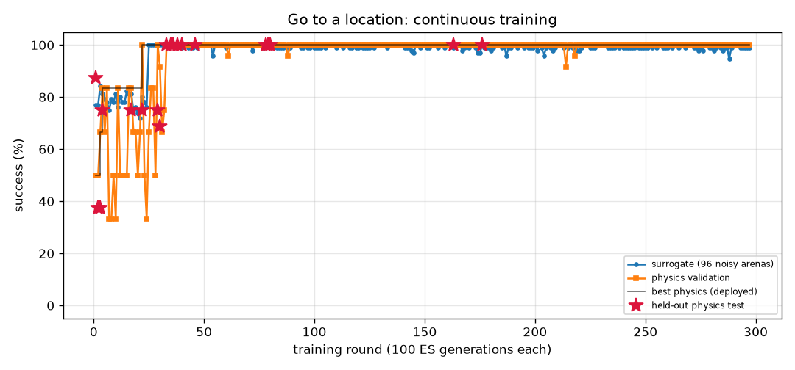

# Go to a location (`goto`) — training report

*Auto-generated by `train_brains.py`, last updated 2026-11-08T21:12:31.*

| | |
|---|---|
| rounds | 270 |
| ES generations | 27000 |
| physics runs | 6430 |
| status | **optimal** |
| best brain | round 176: physics validation **100%** on 24 arenas, surrogate 100% |
| held-out physics test | **100%** on 32 unseen arenas (95% CI 89%-100%) (errors: [0.2, 0.32, 0.19, 0.24, 0.18, 0.2, 0.19, 0.17, 0.22, 0.23, 0.23, 0.26, 0.2, 0.19, 0.24, 0.23, 0.22, 0.24, 0.2, 0.22, 0.2, 0.2, 0.26, 0.19, 0.22, 0.18, 0.26, 0.22, 0.2, 0.26, 0.23, 0.23]) |

Physics error per arena: mm from target at the end (< 1.5 and standing still = success).

| round | level | gens | sigma | surrogate | physics val | val errors | test | note |
|---:|---:|---:|---:|---:|---:|---|---:|---|
| 231 | 3 | 23100 | 0.024 | 100% | 100% | [0.57, 0.56, 0.59, 0.49, 0.5, 0.47, 0.57, 0.54, 0.54, 0.47, 0.46, 0.48, 0.6, 0.49, 0.55, 0.56, 0.6, 0.48, 0.47, 0.54, 0.56, 0.48, 0.6, 0.49] |  |  |
| 232 | 3 | 23200 | 0.024 | 100% | 100% | [0.54, 0.56, 0.57, 0.48, 0.42, 0.46, 0.52, 0.51, 0.47, 0.43, 0.42, 0.46, 0.55, 0.45, 0.51, 0.51, 0.58, 0.45, 0.41, 0.5, 0.48, 0.44, 0.57, 0.47] |  | restart from best |
| 233 | 3 | 23300 | 0.024 | 99% | 100% | [0.67, 0.6, 0.65, 0.57, 0.44, 0.53, 0.57, 0.6, 0.63, 0.46, 0.47, 0.56, 0.65, 0.48, 0.5, 0.54, 0.68, 0.6, 0.45, 0.62, 0.51, 0.5, 0.67, 0.56] |  |  |
| 234 | 3 | 23400 | 0.025 | 99% | 100% | [0.5, 0.43, 0.43, 0.33, 0.31, 0.32, 0.49, 0.32, 0.42, 0.32, 0.31, 0.31, 0.43, 0.28, 0.33, 0.33, 0.42, 0.42, 0.33, 0.39, 0.34, 0.3, 0.4, 0.36] |  |  |
| 235 | 3 | 23500 | 0.025 | 99% | 100% | [0.49, 0.48, 0.49, 0.39, 0.35, 0.37, 0.52, 0.4, 0.4, 0.35, 0.33, 0.37, 0.49, 0.34, 0.39, 0.4, 0.5, 0.45, 0.34, 0.46, 0.39, 0.35, 0.48, 0.4] |  |  |
| 236 | 3 | 23600 | 0.025 | 99% | 100% | [0.64, 0.56, 0.58, 0.5, 0.4, 0.48, 0.57, 0.5, 0.57, 0.41, 0.42, 0.46, 0.59, 0.36, 0.45, 0.47, 0.59, 0.53, 0.42, 0.52, 0.44, 0.4, 0.58, 0.49] |  | restart from best |
| 237 | 3 | 23700 | 0.024 | 100% | 100% | [0.6, 0.5, 0.53, 0.46, 0.39, 0.44, 0.55, 0.47, 0.49, 0.41, 0.42, 0.44, 0.54, 0.37, 0.46, 0.42, 0.55, 0.49, 0.42, 0.5, 0.42, 0.43, 0.54, 0.46] |  |  |
| 238 | 3 | 23800 | 0.024 | 99% | 100% | [0.61, 0.56, 0.53, 0.51, 0.44, 0.47, 0.57, 0.52, 0.61, 0.45, 0.44, 0.49, 0.59, 0.45, 0.51, 0.51, 0.6, 0.51, 0.43, 0.55, 0.47, 0.47, 0.61, 0.48] |  |  |
| 239 | 3 | 23900 | 0.025 | 100% | 100% | [0.66, 0.6, 0.62, 0.58, 0.48, 0.57, 0.68, 0.56, 0.63, 0.49, 0.52, 0.53, 0.65, 0.43, 0.56, 0.52, 0.67, 0.57, 0.5, 0.66, 0.51, 0.55, 0.63, 0.58] |  |  |
| 240 | 3 | 24000 | 0.024 | 99% | 100% | [0.56, 0.54, 0.56, 0.43, 0.42, 0.41, 0.55, 0.45, 0.46, 0.39, 0.37, 0.41, 0.54, 0.4, 0.42, 0.47, 0.57, 0.47, 0.38, 0.47, 0.45, 0.4, 0.54, 0.42] |  | restart from best |
| 241 | 3 | 24100 | 0.024 | 99% | 100% | [0.43, 0.49, 0.49, 0.47, 0.38, 0.43, 0.5, 0.47, 0.47, 0.39, 0.36, 0.45, 0.43, 0.39, 0.42, 0.45, 0.45, 0.43, 0.38, 0.51, 0.44, 0.39, 0.46, 0.44] |  |  |
| 242 | 3 | 24200 | 0.025 | 99% | 100% | [0.63, 0.56, 0.55, 0.48, 0.44, 0.44, 0.62, 0.5, 0.45, 0.44, 0.42, 0.47, 0.58, 0.42, 0.52, 0.49, 0.61, 0.47, 0.43, 0.55, 0.46, 0.45, 0.57, 0.47] |  |  |
| 243 | 3 | 24300 | 0.025 | 99% | 100% | [0.69, 0.66, 0.64, 0.55, 0.51, 0.54, 0.65, 0.62, 0.61, 0.51, 0.49, 0.54, 0.64, 0.53, 0.55, 0.57, 0.71, 0.56, 0.5, 0.6, 0.55, 0.53, 0.69, 0.56] |  |  |
| 244 | 3 | 24400 | 0.025 | 99% | 100% | [0.59, 0.55, 0.56, 0.42, 0.42, 0.41, 0.57, 0.51, 0.47, 0.4, 0.39, 0.43, 0.52, 0.4, 0.46, 0.5, 0.57, 0.46, 0.38, 0.47, 0.45, 0.4, 0.54, 0.41] |  | restart from best |
| 245 | 3 | 24500 | 0.024 | 99% | 100% | [0.66, 0.56, 0.54, 0.55, 0.47, 0.52, 0.64, 0.53, 0.58, 0.48, 0.48, 0.55, 0.63, 0.42, 0.56, 0.51, 0.67, 0.56, 0.48, 0.63, 0.48, 0.54, 0.59, 0.56] |  |  |
| 246 | 3 | 24600 | 0.025 | 100% | 100% | [0.28, 0.33, 0.26, 0.33, 0.28, 0.31, 0.31, 0.36, 0.36, 0.29, 0.28, 0.33, 0.31, 0.33, 0.3, 0.37, 0.3, 0.31, 0.28, 0.33, 0.35, 0.3, 0.3, 0.33] |  |  |
| 247 | 3 | 24700 | 0.024 | 99% | 100% | [0.51, 0.44, 0.45, 0.38, 0.34, 0.34, 0.51, 0.38, 0.41, 0.35, 0.34, 0.39, 0.44, 0.34, 0.43, 0.41, 0.49, 0.36, 0.34, 0.44, 0.38, 0.38, 0.46, 0.36] |  |  |
| 248 | 3 | 24800 | 0.025 | 99% | 100% | [0.52, 0.54, 0.55, 0.42, 0.42, 0.43, 0.49, 0.46, 0.46, 0.4, 0.39, 0.41, 0.5, 0.43, 0.46, 0.48, 0.51, 0.43, 0.39, 0.46, 0.47, 0.39, 0.53, 0.42] |  | restart from best |
| 249 | 3 | 24900 | 0.024 | 99% | 100% | [0.36, 0.39, 0.3, 0.36, 0.29, 0.36, 0.34, 0.38, 0.37, 0.33, 0.32, 0.35, 0.36, 0.38, 0.35, 0.35, 0.38, 0.35, 0.3, 0.32, 0.33, 0.33, 0.38, 0.4] |  |  |
| 250 | 3 | 25000 | 0.025 | 99% | 100% | [0.42, 0.45, 0.37, 0.42, 0.33, 0.39, 0.43, 0.44, 0.44, 0.36, 0.36, 0.4, 0.42, 0.38, 0.41, 0.37, 0.46, 0.38, 0.33, 0.38, 0.37, 0.39, 0.42, 0.42] |  |  |
| 251 | 3 | 25100 | 0.025 | 99% | 100% | [0.61, 0.61, 0.44, 0.49, 0.43, 0.47, 0.58, 0.52, 0.57, 0.45, 0.43, 0.46, 0.58, 0.45, 0.56, 0.5, 0.65, 0.49, 0.42, 0.57, 0.48, 0.45, 0.61, 0.5] |  |  |
| 252 | 3 | 25200 | 0.025 | 100% | 100% | [0.56, 0.61, 0.6, 0.55, 0.55, 0.5, 0.58, 0.54, 0.56, 0.55, 0.52, 0.55, 0.62, 0.49, 0.65, 0.59, 0.62, 0.55, 0.54, 0.6, 0.55, 0.53, 0.62, 0.54] |  | restart from best |
| 253 | 3 | 25300 | 0.024 | 99% | 100% | [0.7, 0.62, 0.51, 0.52, 0.45, 0.51, 0.62, 0.56, 0.59, 0.47, 0.49, 0.52, 0.64, 0.43, 0.53, 0.53, 0.66, 0.6, 0.47, 0.57, 0.5, 0.46, 0.63, 0.51] |  |  |
| 254 | 3 | 25400 | 0.025 | 100% | 100% | [0.35, 0.35, 0.34, 0.27, 0.27, 0.24, 0.37, 0.26, 0.35, 0.28, 0.26, 0.26, 0.32, 0.27, 0.34, 0.33, 0.36, 0.26, 0.25, 0.32, 0.3, 0.28, 0.33, 0.26] |  |  |
| 255 | 3 | 25500 | 0.024 | 99% | 100% | [0.58, 0.51, 0.52, 0.39, 0.37, 0.41, 0.55, 0.42, 0.38, 0.37, 0.35, 0.38, 0.5, 0.32, 0.42, 0.4, 0.52, 0.47, 0.37, 0.45, 0.4, 0.35, 0.48, 0.41] |  |  |
| 256 | 3 | 25600 | 0.025 | 100% | 100% | [0.32, 0.39, 0.37, 0.39, 0.37, 0.36, 0.37, 0.36, 0.36, 0.39, 0.35, 0.38, 0.35, 0.37, 0.43, 0.45, 0.37, 0.37, 0.39, 0.42, 0.41, 0.39, 0.35, 0.38] |  | restart from best |
| 257 | 3 | 25700 | 0.024 | 100% | 100% | [0.67, 0.68, 0.56, 0.61, 0.54, 0.59, 0.64, 0.63, 0.69, 0.58, 0.56, 0.61, 0.69, 0.59, 0.62, 0.64, 0.7, 0.59, 0.55, 0.67, 0.62, 0.58, 0.69, 0.61] |  |  |
| 258 | 3 | 25800 | 0.024 | 99% | 100% | [0.49, 0.47, 0.37, 0.44, 0.36, 0.4, 0.47, 0.47, 0.5, 0.38, 0.37, 0.44, 0.5, 0.38, 0.42, 0.43, 0.53, 0.42, 0.36, 0.5, 0.41, 0.41, 0.51, 0.44] |  |  |
| 259 | 3 | 25900 | 0.025 | 99% | 100% | [0.74, 0.66, 0.51, 0.63, 0.52, 0.58, 0.68, 0.68, 0.7, 0.54, 0.55, 0.61, 0.72, 0.52, 0.6, 0.62, 0.75, 0.61, 0.53, 0.69, 0.58, 0.61, 0.74, 0.61] |  |  |
| 260 | 3 | 26000 | 0.025 | 99% | 100% | [0.54, 0.57, 0.58, 0.46, 0.4, 0.46, 0.5, 0.54, 0.51, 0.4, 0.38, 0.43, 0.55, 0.44, 0.46, 0.46, 0.55, 0.46, 0.38, 0.52, 0.46, 0.39, 0.56, 0.48] |  | restart from best |
| 261 | 3 | 26100 | 0.024 | 100% | 100% | [0.56, 0.54, 0.59, 0.51, 0.41, 0.48, 0.56, 0.54, 0.55, 0.46, 0.43, 0.49, 0.56, 0.45, 0.54, 0.51, 0.6, 0.47, 0.42, 0.55, 0.48, 0.47, 0.6, 0.5] |  |  |
| 262 | 3 | 26200 | 0.024 | 99% | 100% | [0.43, 0.4, 0.37, 0.27, 0.3, 0.26, 0.41, 0.29, 0.39, 0.27, 0.27, 0.27, 0.37, 0.27, 0.35, 0.34, 0.4, 0.24, 0.26, 0.34, 0.31, 0.27, 0.37, 0.29] |  |  |
| 263 | 3 | 26300 | 0.025 | 100% | 100% | [0.62, 0.56, 0.43, 0.53, 0.43, 0.5, 0.59, 0.59, 0.6, 0.46, 0.45, 0.51, 0.6, 0.46, 0.51, 0.52, 0.61, 0.52, 0.44, 0.55, 0.5, 0.45, 0.61, 0.5] |  |  |
| 264 | 3 | 26400 | 0.024 | 100% | 100% | [0.56, 0.49, 0.49, 0.38, 0.37, 0.36, 0.52, 0.37, 0.42, 0.36, 0.33, 0.37, 0.47, 0.34, 0.43, 0.4, 0.49, 0.41, 0.36, 0.42, 0.38, 0.36, 0.45, 0.38] |  | restart from best |
| 265 | 3 | 26500 | 0.024 | 99% | 100% | [0.27, 0.3, 0.21, 0.25, 0.27, 0.25, 0.29, 0.3, 0.31, 0.22, 0.21, 0.23, 0.31, 0.25, 0.24, 0.31, 0.28, 0.27, 0.22, 0.3, 0.31, 0.21, 0.28, 0.26] |  |  |
| 266 | 3 | 26600 | 0.025 | 100% | 100% | [0.45, 0.41, 0.4, 0.34, 0.3, 0.33, 0.46, 0.32, 0.35, 0.32, 0.29, 0.32, 0.44, 0.3, 0.39, 0.36, 0.46, 0.33, 0.32, 0.4, 0.34, 0.33, 0.41, 0.36] |  |  |
| 267 | 3 | 26700 | 0.024 | 100% | 100% | [0.73, 0.71, 0.73, 0.63, 0.57, 0.63, 0.75, 0.64, 0.58, 0.59, 0.54, 0.59, 0.71, 0.55, 0.61, 0.63, 0.67, 0.65, 0.6, 0.66, 0.63, 0.58, 0.7, 0.63] |  |  |
| 268 | 3 | 26800 | 0.024 | 99% | 100% | [0.61, 0.59, 0.57, 0.46, 0.45, 0.46, 0.61, 0.48, 0.51, 0.46, 0.42, 0.43, 0.54, 0.45, 0.53, 0.5, 0.46, 0.47, 0.45, 0.53, 0.48, 0.45, 0.55, 0.46] |  | restart from best |
| 269 | 3 | 26900 | 0.024 | 100% | 100% | [0.36, 0.38, 0.3, 0.35, 0.28, 0.34, 0.32, 0.37, 0.38, 0.28, 0.29, 0.34, 0.37, 0.33, 0.32, 0.32, 0.38, 0.34, 0.27, 0.36, 0.32, 0.28, 0.39, 0.37] |  |  |
| 270 | 3 | 27000 | 0.024 | 100% | 100% | [0.67, 0.65, 0.57, 0.62, 0.55, 0.6, 0.61, 0.66, 0.65, 0.53, 0.55, 0.6, 0.69, 0.57, 0.55, 0.58, 0.68, 0.63, 0.56, 0.66, 0.59, 0.56, 0.69, 0.63] |  |  |
