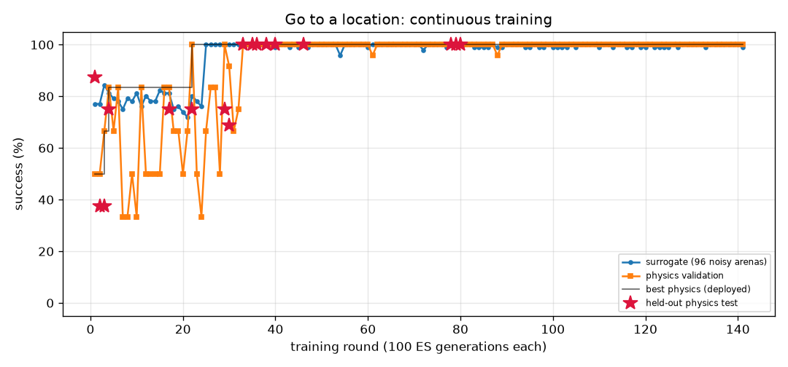

# Go to a location (`goto`) — training report

*Auto-generated by `train_brains.py`, last updated 2026-10-22T21:07:19.*

| | |
|---|---|
| rounds | 144 |
| ES generations | 14400 |
| physics runs | 3342 |
| status | **optimal** |
| best brain | round 80: physics validation **100%** on 24 arenas, surrogate 100% |
| held-out physics test | **100%** on 32 unseen arenas (95% CI 89%-100%) (errors: [0.36, 0.41, 0.3, 0.45, 0.32, 0.33, 0.33, 0.31, 0.35, 0.36, 0.39, 0.36, 0.28, 0.31, 0.4, 0.39, 0.34, 0.39, 0.3, 0.34, 0.36, 0.36, 0.44, 0.34, 0.3, 0.33, 0.4, 0.33, 0.29, 0.43, 0.43, 0.39]) |

Physics error per arena: mm from target at the end (< 1.5 and standing still = success).

| round | level | gens | sigma | surrogate | physics val | val errors | test | note |
|---:|---:|---:|---:|---:|---:|---|---:|---|
| 105 | 3 | 10500 | 0.024 | 99% | 100% | [0.66, 0.6, 0.47, 0.54, 0.46, 0.52, 0.62, 0.55, 0.6, 0.47, 0.48, 0.55, 0.62, 0.47, 0.48, 0.5, 0.65, 0.52, 0.45, 0.59, 0.48, 0.49, 0.66, 0.54] |  |  |
| 106 | 3 | 10600 | 0.025 | 100% | 100% | [0.51, 0.53, 0.36, 0.41, 0.37, 0.4, 0.47, 0.44, 0.46, 0.39, 0.36, 0.39, 0.47, 0.4, 0.47, 0.44, 0.53, 0.4, 0.37, 0.45, 0.42, 0.38, 0.5, 0.41] |  |  |
| 107 | 3 | 10700 | 0.024 | 100% | 100% | [0.77, 0.77, 0.61, 0.68, 0.62, 0.67, 0.75, 0.71, 0.76, 0.63, 0.61, 0.63, 0.76, 0.64, 0.68, 0.64, 0.77, 0.69, 0.61, 0.73, 0.65, 0.61, 0.78, 0.68] |  |  |
| 108 | 3 | 10800 | 0.024 | 100% | 100% | [0.49, 0.49, 0.37, 0.44, 0.34, 0.42, 0.45, 0.38, 0.5, 0.37, 0.36, 0.43, 0.5, 0.39, 0.42, 0.4, 0.52, 0.41, 0.35, 0.47, 0.4, 0.36, 0.52, 0.44] |  | restart from best |
| 109 | 3 | 10900 | 0.024 | 100% | 100% | [0.61, 0.52, 0.44, 0.49, 0.41, 0.46, 0.61, 0.48, 0.55, 0.43, 0.43, 0.48, 0.57, 0.38, 0.48, 0.46, 0.58, 0.46, 0.43, 0.55, 0.43, 0.47, 0.56, 0.49] |  |  |
| 110 | 3 | 11000 | 0.024 | 99% | 100% | [0.51, 0.47, 0.37, 0.47, 0.36, 0.41, 0.5, 0.45, 0.52, 0.39, 0.38, 0.46, 0.53, 0.39, 0.43, 0.43, 0.53, 0.42, 0.37, 0.51, 0.39, 0.41, 0.52, 0.46] |  |  |
| 111 | 3 | 11100 | 0.025 | 100% | 100% | [0.44, 0.45, 0.37, 0.42, 0.34, 0.41, 0.42, 0.45, 0.46, 0.34, 0.36, 0.41, 0.47, 0.39, 0.45, 0.39, 0.47, 0.39, 0.33, 0.44, 0.38, 0.34, 0.48, 0.45] |  |  |
| 112 | 3 | 11200 | 0.024 | 100% | 100% | [0.49, 0.46, 0.43, 0.37, 0.39, 0.34, 0.5, 0.37, 0.4, 0.37, 0.36, 0.37, 0.43, 0.35, 0.43, 0.43, 0.46, 0.34, 0.37, 0.4, 0.41, 0.36, 0.43, 0.36] |  | restart from best |
| 113 | 3 | 11300 | 0.024 | 99% | 100% | [0.44, 0.39, 0.28, 0.36, 0.29, 0.31, 0.39, 0.35, 0.37, 0.32, 0.31, 0.35, 0.39, 0.32, 0.37, 0.36, 0.46, 0.36, 0.3, 0.4, 0.33, 0.32, 0.43, 0.34] |  |  |
| 114 | 3 | 11400 | 0.025 | 100% | 100% | [0.46, 0.45, 0.37, 0.42, 0.33, 0.41, 0.42, 0.48, 0.46, 0.32, 0.34, 0.4, 0.48, 0.37, 0.36, 0.4, 0.48, 0.41, 0.33, 0.46, 0.39, 0.33, 0.49, 0.41] |  |  |
| 115 | 3 | 11500 | 0.024 | 100% | 100% | [0.42, 0.42, 0.27, 0.31, 0.29, 0.3, 0.39, 0.38, 0.35, 0.29, 0.28, 0.29, 0.37, 0.32, 0.39, 0.38, 0.43, 0.3, 0.27, 0.35, 0.35, 0.28, 0.4, 0.31] |  |  |
| 116 | 3 | 11600 | 0.024 | 99% | 100% | [0.71, 0.72, 0.59, 0.6, 0.56, 0.59, 0.71, 0.66, 0.68, 0.56, 0.53, 0.57, 0.69, 0.59, 0.65, 0.65, 0.75, 0.64, 0.53, 0.65, 0.61, 0.55, 0.75, 0.58] |  | restart from best |
| 117 | 3 | 11700 | 0.024 | 99% | 100% | [0.56, 0.54, 0.44, 0.51, 0.42, 0.48, 0.5, 0.5, 0.57, 0.43, 0.43, 0.5, 0.56, 0.46, 0.47, 0.45, 0.56, 0.49, 0.41, 0.54, 0.44, 0.42, 0.59, 0.53] |  |  |
| 118 | 3 | 11800 | 0.025 | 100% | 100% | [0.5, 0.51, 0.38, 0.49, 0.38, 0.47, 0.45, 0.36, 0.54, 0.41, 0.43, 0.47, 0.53, 0.44, 0.46, 0.43, 0.48, 0.45, 0.37, 0.51, 0.42, 0.39, 0.54, 0.53] |  |  |
| 119 | 3 | 11900 | 0.024 | 99% | 100% | [0.65, 0.62, 0.46, 0.57, 0.48, 0.55, 0.6, 0.5, 0.67, 0.48, 0.54, 0.56, 0.66, 0.52, 0.54, 0.54, 0.69, 0.56, 0.48, 0.65, 0.52, 0.49, 0.69, 0.6] |  |  |
| 120 | 3 | 12000 | 0.025 | 99% | 100% | [0.75, 0.75, 0.68, 0.69, 0.62, 0.64, 0.71, 0.67, 0.76, 0.67, 0.7, 0.68, 0.75, 0.65, 0.7, 0.71, 0.8, 0.66, 0.64, 0.73, 0.68, 0.7, 0.78, 0.68] |  | restart from best |
| 121 | 3 | 12100 | 0.024 | 100% | 100% | [0.5, 0.53, 0.37, 0.42, 0.39, 0.41, 0.48, 0.46, 0.47, 0.37, 0.37, 0.4, 0.47, 0.4, 0.44, 0.45, 0.53, 0.41, 0.37, 0.45, 0.44, 0.37, 0.51, 0.41] |  |  |
| 122 | 3 | 12200 | 0.024 | 99% | 100% | [0.68, 0.66, 0.48, 0.53, 0.66, 0.52, 0.64, 0.52, 0.57, 0.52, 0.66, 0.54, 0.61, 0.52, 0.57, 0.61, 0.71, 0.54, 0.5, 0.62, 0.58, 0.54, 0.67, 0.54] |  |  |
| 123 | 3 | 12300 | 0.025 | 99% | 100% | [0.62, 0.59, 0.42, 0.49, 0.44, 0.47, 0.61, 0.45, 0.55, 0.46, 0.54, 0.49, 0.58, 0.47, 0.51, 0.52, 0.66, 0.49, 0.43, 0.57, 0.5, 0.47, 0.61, 0.49] |  |  |
| 124 | 3 | 12400 | 0.025 | 99% | 100% | [0.38, 0.37, 0.23, 0.28, 0.25, 0.27, 0.33, 0.27, 0.33, 0.24, 0.23, 0.27, 0.34, 0.26, 0.29, 0.31, 0.39, 0.31, 0.23, 0.34, 0.29, 0.24, 0.37, 0.26] |  | restart from best |
| 125 | 3 | 12500 | 0.024 | 99% | 100% | [0.54, 0.52, 0.52, 0.4, 0.38, 0.39, 0.52, 0.46, 0.46, 0.38, 0.36, 0.41, 0.47, 0.39, 0.42, 0.45, 0.56, 0.44, 0.37, 0.47, 0.42, 0.39, 0.52, 0.4] |  |  |
| 126 | 3 | 12600 | 0.025 | 100% | 100% | [0.33, 0.35, 0.36, 0.32, 0.31, 0.32, 0.35, 0.35, 0.35, 0.31, 0.29, 0.32, 0.36, 0.32, 0.37, 0.38, 0.36, 0.29, 0.3, 0.35, 0.36, 0.31, 0.34, 0.32] |  |  |
| 127 | 3 | 12700 | 0.024 | 99% | 100% | [0.4, 0.39, 0.29, 0.33, 0.3, 0.3, 0.41, 0.34, 0.35, 0.31, 0.29, 0.33, 0.36, 0.3, 0.37, 0.36, 0.43, 0.32, 0.3, 0.36, 0.33, 0.31, 0.4, 0.33] |  |  |
| 128 | 3 | 12800 | 0.025 | 100% | 100% | [0.49, 0.45, 0.35, 0.4, 0.32, 0.37, 0.47, 0.39, 0.43, 0.38, 0.34, 0.38, 0.46, 0.35, 0.47, 0.42, 0.5, 0.36, 0.36, 0.46, 0.4, 0.39, 0.48, 0.38] |  | restart from best |
| 129 | 3 | 12900 | 0.024 | 100% | 100% | [0.49, 0.54, 0.52, 0.41, 0.37, 0.42, 0.47, 0.48, 0.48, 0.37, 0.36, 0.39, 0.48, 0.41, 0.44, 0.45, 0.51, 0.42, 0.36, 0.46, 0.43, 0.36, 0.52, 0.42] |  |  |
| 130 | 3 | 13000 | 0.024 | 100% | 100% | [0.5, 0.49, 0.47, 0.4, 0.38, 0.38, 0.48, 0.43, 0.42, 0.38, 0.38, 0.38, 0.45, 0.38, 0.45, 0.45, 0.51, 0.4, 0.37, 0.43, 0.42, 0.39, 0.48, 0.38] |  |  |
| 131 | 3 | 13100 | 0.024 | 100% | 100% | [0.32, 0.38, 0.35, 0.34, 0.28, 0.31, 0.38, 0.37, 0.38, 0.29, 0.28, 0.32, 0.36, 0.31, 0.31, 0.36, 0.34, 0.33, 0.28, 0.36, 0.33, 0.29, 0.32, 0.31] |  |  |
| 132 | 3 | 13200 | 0.024 | 100% | 100% | [0.52, 0.49, 0.38, 0.39, 0.36, 0.4, 0.53, 0.4, 0.44, 0.36, 0.35, 0.39, 0.47, 0.32, 0.4, 0.42, 0.47, 0.43, 0.37, 0.4, 0.39, 0.34, 0.46, 0.4] |  | restart from best |
| 133 | 3 | 13300 | 0.024 | 99% | 100% | [0.58, 0.56, 0.43, 0.49, 0.43, 0.48, 0.53, 0.55, 0.56, 0.41, 0.43, 0.46, 0.58, 0.45, 0.51, 0.48, 0.59, 0.48, 0.42, 0.53, 0.46, 0.41, 0.59, 0.51] |  |  |
| 134 | 3 | 13400 | 0.025 | 100% | 100% | [0.49, 0.49, 0.4, 0.44, 0.36, 0.42, 0.47, 0.37, 0.5, 0.39, 0.38, 0.44, 0.49, 0.41, 0.46, 0.4, 0.53, 0.41, 0.37, 0.47, 0.41, 0.38, 0.53, 0.44] |  |  |
| 135 | 3 | 13500 | 0.024 | 100% | 100% | [0.58, 0.55, 0.47, 0.56, 0.43, 0.52, 0.55, 0.51, 0.6, 0.48, 0.45, 0.56, 0.61, 0.49, 0.52, 0.52, 0.62, 0.5, 0.45, 0.6, 0.48, 0.48, 0.62, 0.56] |  |  |
| 136 | 3 | 13600 | 0.024 | 100% | 100% | [0.82, 0.81, 0.73, 0.76, 0.7, 0.74, 0.82, 0.72, 0.83, 0.72, 0.77, 0.74, 0.84, 0.73, 0.8, 0.77, 0.84, 0.75, 0.71, 0.8, 0.76, 0.74, 0.83, 0.76] |  | restart from best |
| 137 | 3 | 13700 | 0.024 | 100% | 100% | [0.49, 0.53, 0.36, 0.41, 0.38, 0.39, 0.47, 0.44, 0.45, 0.39, 0.37, 0.4, 0.45, 0.39, 0.47, 0.44, 0.48, 0.4, 0.36, 0.44, 0.41, 0.38, 0.48, 0.41] |  |  |
| 138 | 3 | 13800 | 0.024 | 100% | 100% | [0.5, 0.54, 0.49, 0.45, 0.41, 0.45, 0.48, 0.51, 0.47, 0.4, 0.4, 0.42, 0.49, 0.44, 0.49, 0.47, 0.51, 0.42, 0.39, 0.45, 0.46, 0.39, 0.5, 0.43] |  |  |
| 139 | 3 | 13900 | 0.024 | 100% | 100% | [0.49, 0.49, 0.51, 0.42, 0.37, 0.42, 0.44, 0.46, 0.44, 0.35, 0.37, 0.42, 0.48, 0.4, 0.45, 0.43, 0.48, 0.41, 0.35, 0.44, 0.42, 0.36, 0.49, 0.4] |  |  |
| 140 | 3 | 14000 | 0.024 | 100% | 100% | [0.52, 0.52, 0.51, 0.44, 0.4, 0.44, 0.45, 0.52, 0.44, 0.37, 0.4, 0.42, 0.51, 0.42, 0.43, 0.46, 0.54, 0.46, 0.4, 0.49, 0.44, 0.39, 0.52, 0.42] |  | restart from best |
| 141 | 3 | 14100 | 0.024 | 99% | 100% | [0.49, 0.51, 0.39, 0.45, 0.36, 0.43, 0.44, 0.51, 0.47, 0.37, 0.38, 0.43, 0.51, 0.41, 0.45, 0.41, 0.52, 0.43, 0.36, 0.46, 0.42, 0.36, 0.52, 0.46] |  |  |
| 142 | 3 | 14200 | 0.025 | 99% | 100% | [0.55, 0.51, 0.36, 0.47, 0.38, 0.41, 0.47, 0.51, 0.5, 0.42, 0.4, 0.46, 0.54, 0.41, 0.5, 0.48, 0.59, 0.44, 0.4, 0.53, 0.45, 0.43, 0.58, 0.45] |  |  |
| 143 | 3 | 14300 | 0.025 | 99% | 100% | [0.55, 0.54, 0.54, 0.44, 0.39, 0.41, 0.52, 0.47, 0.47, 0.41, 0.39, 0.42, 0.49, 0.41, 0.49, 0.5, 0.58, 0.44, 0.39, 0.45, 0.46, 0.43, 0.53, 0.42] |  |  |
| 144 | 3 | 14400 | 0.025 | 98% | 100% | [0.48, 0.49, 0.48, 0.38, 0.34, 0.36, 0.42, 0.43, 0.42, 0.35, 0.33, 0.38, 0.43, 0.37, 0.43, 0.42, 0.5, 0.37, 0.33, 0.41, 0.39, 0.36, 0.48, 0.38] |  | restart from best |
