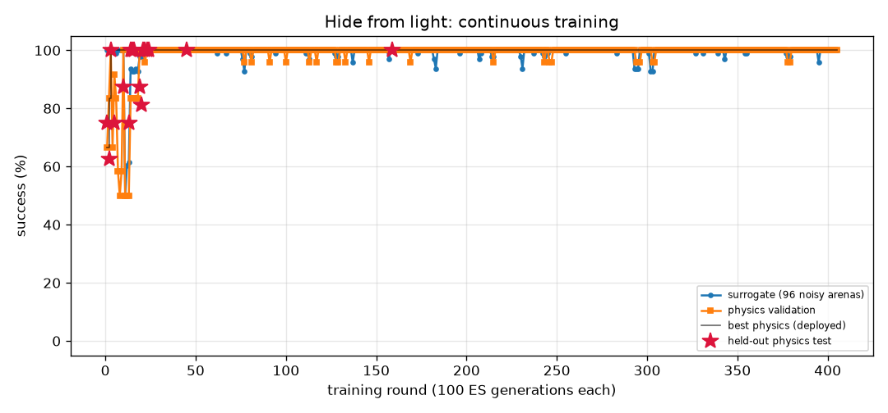

# Hide from light (`light_avoid`) — training report

*Auto-generated by `train_brains.py`, last updated 2026-10-22T20:21:47.*

| | |
|---|---|
| rounds | 317 |
| ES generations | 31700 |
| physics runs | 7880 |
| status | **optimal** |
| best brain | round 159: physics validation **100%** on 24 arenas, surrogate 100% |
| held-out physics test | **100%** on 32 unseen arenas (95% CI 89%-100%) (errors: [14.4, 56.1, 58.0, 57.9, 57.5, 14.0, 14.4, 56.6, 56.8, 13.3, 14.1, 56.6, 57.6, 13.1, 57.3, 55.9, 57.2, 55.0, 55.2, 53.9, 55.2, 12.4, 53.8, 53.7, 14.1, 13.7, 55.0, 57.8, 56.2, 13.1, 52.8, 56.5]) |

Physics error per arena: mm gained away from source (> 6 without first approaching it = success).

| round | level | gens | sigma | surrogate | physics val | val errors | test | note |
|---:|---:|---:|---:|---:|---:|---|---:|---|
| 278 | 3 | 27800 | 0.024 | 100% | 100% | [32.9, 27.5, 29.1, 34.3, 31.1, 33.0, 28.7, 14.5, 30.0, 13.2, 34.5, 32.5, 14.3, 31.2, 29.7, 31.4, 14.2, 30.9, 31.1, 14.4, 33.6, 34.6, 28.2, 32.3] |  |  |
| 279 | 3 | 27900 | 0.024 | 100% | 100% | [48.1, 48.4, 48.0, 49.1, 51.3, 48.5, 45.7, 14.5, 48.9, 13.2, 50.3, 51.4, 14.4, 50.1, 48.0, 49.9, 14.2, 51.4, 48.7, 14.4, 49.2, 50.8, 46.7, 51.0] |  | restart from best |
| 280 | 3 | 28000 | 0.024 | 100% | 100% | [46.0, 46.3, 46.3, 46.3, 49.6, 45.7, 44.0, 14.5, 48.2, 13.4, 50.9, 50.0, 14.4, 50.1, 46.0, 45.9, 14.2, 49.6, 45.9, 14.4, 46.5, 51.3, 44.4, 49.8] |  |  |
| 281 | 3 | 28100 | 0.024 | 100% | 100% | [54.0, 58.3, 58.0, 54.6, 59.4, 54.6, 56.1, 14.5, 55.1, 13.1, 58.1, 59.2, 14.3, 56.5, 58.3, 53.9, 14.2, 59.6, 58.7, 14.4, 57.0, 58.0, 55.8, 59.0] |  |  |
| 282 | 3 | 28200 | 0.024 | 100% | 100% | [53.0, 56.7, 56.3, 54.4, 58.2, 53.6, 54.7, 14.5, 47.9, 13.5, 57.1, 58.1, 14.4, 56.7, 56.6, 52.9, 14.2, 58.3, 57.3, 14.4, 55.9, 56.8, 54.8, 57.8] |  |  |
| 283 | 3 | 28300 | 0.024 | 99% | 100% | [58.0, 61.4, 61.1, 57.6, 60.8, 57.9, 59.9, 14.5, 38.1, 13.3, 59.4, 60.6, 14.4, 58.1, 61.2, 57.7, 14.2, 61.3, 61.6, 14.4, 55.4, 59.7, 59.7, 60.0] |  | restart from best |
| 284 | 3 | 28400 | 0.024 | 100% | 100% | [51.8, 52.8, 52.1, 51.5, 54.2, 51.4, 50.7, 14.5, 45.8, 13.5, 51.7, 54.0, 14.3, 52.4, 52.6, 53.1, 14.2, 54.4, 52.3, 14.4, 51.4, 51.6, 50.8, 53.7] |  |  |
| 285 | 3 | 28500 | 0.024 | 100% | 100% | [43.3, 46.2, 45.8, 44.3, 47.9, 43.6, 43.6, 14.5, 46.3, 13.3, 48.3, 48.4, 14.4, 47.4, 45.7, 45.1, 14.2, 47.9, 45.8, 14.4, 43.4, 48.0, 43.5, 47.9] |  |  |
| 286 | 3 | 28600 | 0.024 | 100% | 100% | [50.2, 54.7, 54.2, 51.5, 55.5, 51.7, 52.6, 14.5, 52.1, 13.2, 55.4, 55.8, 14.4, 54.1, 54.3, 54.8, 14.2, 56.0, 55.0, 14.4, 53.0, 55.2, 52.8, 55.6] |  |  |
| 287 | 3 | 28700 | 0.024 | 100% | 100% | [57.4, 61.9, 61.7, 58.0, 61.3, 58.7, 60.5, 14.5, 57.2, 13.0, 59.6, 61.1, 14.4, 60.4, 61.8, 57.9, 14.2, 61.9, 62.2, 14.4, 56.5, 59.3, 60.3, 60.5] |  | restart from best |
| 288 | 3 | 28800 | 0.024 | 100% | 100% | [51.7, 54.4, 54.1, 52.0, 54.6, 53.1, 52.3, 14.5, 47.5, 13.5, 52.8, 54.4, 14.4, 53.5, 54.3, 53.3, 14.2, 54.9, 54.4, 14.4, 52.7, 52.8, 52.2, 53.9] |  |  |
| 289 | 3 | 28900 | 0.024 | 100% | 100% | [54.9, 57.6, 57.2, 54.9, 55.3, 55.4, 56.4, 14.5, 50.8, 13.5, 54.8, 55.6, 14.4, 56.9, 57.3, 55.3, 14.2, 56.3, 57.3, 14.4, 54.1, 55.0, 56.1, 54.5] |  |  |
| 290 | 3 | 29000 | 0.024 | 100% | 100% | [55.4, 58.6, 58.4, 56.1, 57.6, 56.5, 57.3, 14.5, 54.1, 13.3, 56.8, 57.4, 14.4, 57.9, 58.5, 56.5, 14.2, 58.1, 58.9, 14.4, 54.9, 57.5, 57.1, 56.7] |  |  |
| 291 | 3 | 29100 | 0.024 | 100% | 100% | [58.4, 62.1, 62.0, 59.3, 60.4, 59.6, 61.5, 14.5, 57.4, 13.2, 61.0, 60.1, 14.4, 58.0, 62.1, 57.9, 14.2, 61.1, 62.3, 14.4, 58.0, 60.7, 61.1, 59.5] |  | restart from best |
| 292 | 3 | 29200 | 0.024 | 100% | 100% | [45.5, 44.8, 44.6, 43.3, 46.8, 43.2, 42.3, 14.5, 45.5, 13.4, 46.9, 47.1, 14.4, 47.3, 44.5, 42.7, 14.2, 46.8, 44.9, 14.4, 37.3, 47.2, 41.7, 46.9] |  |  |
| 293 | 3 | 29300 | 0.024 | 94% | 100% | [6.4, 41.3, 40.9, 6.9, 43.2, 8.6, 39.0, 14.5, 42.0, 13.2, 42.0, 42.5, 14.4, 42.4, 40.1, 9.1, 14.2, 42.6, 41.8, 14.4, 8.7, 43.6, 39.1, 42.4] |  |  |
| 294 | 3 | 29400 | 0.028 | 94% | 96% | [6.2, 54.4, 54.1, 7.3, 53.8, 4.1, 52.9, 14.5, 51.3, 13.3, 51.3, 53.6, 14.4, 53.0, 54.4, 9.0, 14.2, 54.3, 54.8, 14.4, 8.7, 53.1, 52.3, 53.1] |  |  |
| 295 | 3 | 29500 | 0.028 | 94% | 96% | [6.2, 46.1, 45.8, 7.3, 48.8, 4.4, 43.7, 14.5, 48.9, 13.5, 48.7, 49.0, 14.4, 49.3, 46.0, 9.0, 14.2, 49.0, 46.0, 14.4, 8.7, 49.5, 44.0, 48.9] |  | restart from best |
| 296 | 3 | 29600 | 0.024 | 100% | 96% | [37.7, 39.0, 38.4, 38.9, 42.1, 38.0, 35.2, 14.5, 40.7, 34.5, 42.3, 39.9, 14.4, 40.8, 38.3, 39.5, 14.2, 40.6, 38.7, 14.4, 38.7, 40.1, 35.2, 40.6] |  |  |
| 297 | 3 | 29700 | 0.024 | 100% | 100% | [56.0, 58.6, 58.4, 56.3, 57.6, 56.5, 57.4, 14.5, 34.5, 13.4, 57.8, 57.4, 14.4, 57.2, 58.6, 56.2, 14.2, 58.2, 58.9, 14.4, 54.6, 57.6, 57.1, 56.8] |  |  |
| 298 | 3 | 29800 | 0.024 | 100% | 100% | [53.9, 55.3, 55.1, 53.9, 55.2, 53.8, 53.8, 14.5, 51.0, 13.5, 54.7, 55.1, 14.4, 54.5, 55.2, 52.9, 14.2, 55.7, 55.5, 14.4, 52.8, 54.7, 53.3, 54.6] |  |  |
| 299 | 3 | 29900 | 0.024 | 100% | 100% | [53.0, 55.4, 55.3, 53.3, 56.8, 53.3, 53.1, 14.5, 39.7, 13.4, 53.5, 57.1, 14.4, 55.2, 55.4, 54.9, 14.2, 57.0, 56.3, 14.4, 53.8, 54.2, 53.7, 56.6] |  | restart from best |
| 300 | 3 | 30000 | 0.024 | 100% | 100% | [53.6, 57.8, 57.6, 54.3, 57.1, 54.7, 56.2, 14.5, 54.2, 12.8, 56.9, 56.9, 14.4, 56.8, 57.7, 53.3, 14.2, 57.7, 58.0, 14.4, 54.4, 56.9, 55.9, 56.3] |  |  |
| 301 | 3 | 30100 | 0.024 | 99% | 100% | [45.9, 45.2, 44.9, 44.9, 47.1, 43.1, 43.2, 14.5, 42.7, 13.4, 47.1, 47.2, 14.4, 46.5, 44.7, 44.3, 14.2, 47.4, 44.9, 14.4, 11.8, 47.3, 44.0, 47.0] |  |  |
| 302 | 3 | 30200 | 0.025 | 93% | 100% | [6.1, 55.7, 55.4, 7.4, 55.3, 50.6, 54.2, 14.5, 51.9, 13.3, 51.9, 55.1, 14.4, 53.5, 55.5, 9.1, 14.2, 55.7, 56.0, 14.4, 8.8, 53.7, 54.3, 54.3] |  |  |
| 303 | 3 | 30300 | 0.028 | 93% | 96% | [6.2, 43.9, 44.1, 7.3, 38.1, 4.3, 44.1, 14.5, 35.5, 13.4, 36.8, 38.5, 14.4, 37.8, 43.5, 9.0, 14.2, 39.6, 44.0, 14.4, 8.7, 39.1, 43.3, 37.0] |  | restart from best |
| 304 | 3 | 30400 | 0.024 | 100% | 96% | [33.1, 32.5, 33.3, 34.1, 34.9, 33.5, 32.0, 14.5, 26.7, 13.5, 34.3, 34.6, 14.4, 33.4, 33.9, 33.3, 14.2, 34.3, 33.5, 14.4, 33.6, 34.2, 30.3, 34.6] |  |  |
| 305 | 3 | 30500 | 0.024 | 100% | 100% | [55.6, 59.9, 59.5, 56.1, 60.1, 56.5, 58.3, 14.5, 56.7, 13.2, 59.3, 59.8, 14.4, 57.9, 59.6, 55.2, 14.2, 60.4, 60.3, 14.4, 52.7, 59.0, 58.3, 59.4] |  |  |
| 306 | 3 | 30600 | 0.024 | 100% | 100% | [51.0, 52.8, 52.6, 50.8, 51.3, 51.2, 51.8, 14.5, 40.3, 13.4, 47.4, 50.9, 14.4, 52.4, 52.8, 50.3, 14.2, 51.9, 53.2, 14.4, 49.2, 47.3, 51.5, 50.5] |  |  |
| 307 | 3 | 30700 | 0.024 | 100% | 100% | [56.3, 58.6, 58.5, 56.4, 55.3, 55.4, 58.1, 14.5, 45.9, 13.4, 56.2, 55.0, 14.4, 53.7, 58.6, 55.4, 14.2, 56.3, 58.5, 14.4, 55.7, 54.1, 58.1, 54.0] |  | restart from best |
| 308 | 3 | 30800 | 0.024 | 100% | 100% | [43.1, 44.9, 45.0, 43.1, 40.5, 42.4, 45.2, 14.5, 31.4, 13.4, 40.8, 40.4, 14.4, 43.4, 45.1, 43.0, 14.2, 41.4, 44.7, 14.4, 42.7, 41.2, 44.1, 39.0] |  |  |
| 309 | 3 | 30900 | 0.024 | 100% | 100% | [41.4, 42.4, 42.0, 40.6, 43.5, 40.8, 40.2, 14.5, 42.5, 13.4, 44.0, 44.0, 14.4, 43.3, 41.9, 42.1, 14.2, 43.7, 42.3, 14.4, 41.4, 44.7, 40.4, 43.9] |  |  |
| 310 | 3 | 31000 | 0.024 | 100% | 100% | [47.4, 50.1, 49.6, 49.1, 52.4, 48.1, 47.4, 14.5, 41.1, 13.4, 52.2, 52.3, 14.4, 51.9, 49.5, 48.2, 14.2, 52.1, 49.7, 14.4, 44.3, 52.6, 47.6, 52.1] |  |  |
| 311 | 3 | 31100 | 0.024 | 100% | 100% | [56.4, 60.8, 60.6, 57.2, 60.5, 57.2, 59.2, 14.5, 54.9, 13.4, 59.9, 60.4, 14.4, 58.3, 60.6, 56.1, 14.2, 61.0, 61.1, 14.4, 58.9, 60.2, 59.1, 59.8] |  | restart from best |
| 312 | 3 | 31200 | 0.024 | 100% | 100% | [53.6, 56.1, 55.8, 53.7, 54.0, 53.7, 55.0, 14.5, 51.8, 13.3, 55.0, 53.7, 14.4, 51.9, 55.9, 53.1, 14.2, 54.7, 56.1, 14.4, 52.3, 55.1, 54.7, 53.0] |  |  |
| 313 | 3 | 31300 | 0.024 | 100% | 100% | [42.7, 43.2, 43.0, 42.6, 42.2, 42.8, 42.0, 14.5, 38.7, 13.5, 42.9, 42.1, 14.4, 43.6, 43.1, 42.5, 14.2, 42.8, 43.5, 14.4, 42.1, 42.5, 41.7, 41.4] |  |  |
| 314 | 3 | 31400 | 0.024 | 100% | 100% | [42.4, 42.0, 42.0, 42.7, 37.3, 40.6, 42.7, 14.5, 36.7, 13.3, 40.2, 37.2, 14.4, 41.6, 41.8, 40.8, 14.2, 38.6, 41.2, 14.4, 40.9, 41.8, 42.5, 35.8] |  |  |
| 315 | 3 | 31500 | 0.024 | 100% | 100% | [41.8, 42.3, 41.8, 41.5, 44.8, 41.9, 39.8, 14.5, 38.9, 13.4, 43.2, 44.5, 14.4, 44.3, 41.9, 41.8, 14.2, 44.1, 42.9, 14.4, 41.7, 43.0, 39.7, 45.0] |  | restart from best |
| 316 | 3 | 31600 | 0.024 | 100% | 100% | [48.1, 50.1, 49.8, 49.4, 52.7, 48.2, 47.1, 14.5, 48.7, 13.3, 52.2, 52.7, 14.4, 52.1, 50.1, 48.4, 14.2, 52.8, 49.9, 14.4, 45.3, 52.3, 47.7, 52.8] |  |  |
| 317 | 3 | 31700 | 0.024 | 100% | 100% | [42.2, 43.9, 43.4, 43.7, 47.3, 44.1, 40.8, 14.5, 44.0, 13.4, 46.5, 47.5, 14.4, 46.9, 43.4, 44.2, 14.2, 47.1, 43.6, 14.4, 44.0, 46.4, 41.7, 47.2] |  |  |
