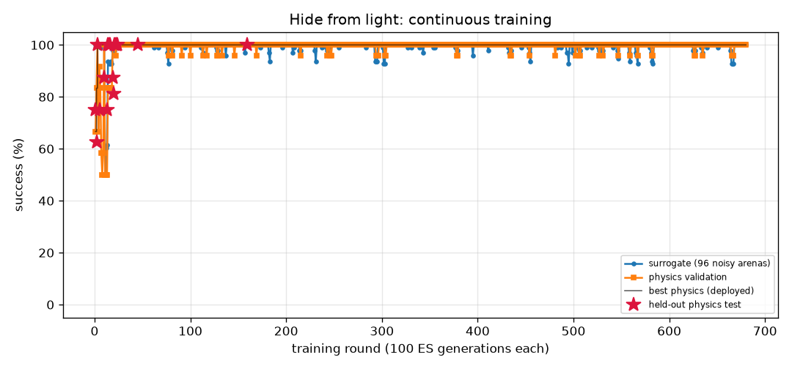

# Hide from light (`light_avoid`) — training report

*Auto-generated by `train_brains.py`, last updated 2026-11-20T15:18:47.*

| | |
|---|---|
| rounds | 743 |
| ES generations | 74300 |
| physics runs | 18104 |
| status | **optimal** |
| best brain | round 159: physics validation **100%** on 24 arenas, surrogate 100% |
| held-out physics test | **100%** on 32 unseen arenas (95% CI 89%-100%) (errors: [14.4, 56.1, 58.0, 57.9, 57.5, 14.0, 14.4, 56.6, 56.8, 13.3, 14.1, 56.6, 57.6, 13.1, 57.3, 55.9, 57.2, 55.0, 55.2, 53.9, 55.2, 12.4, 53.8, 53.7, 14.1, 13.7, 55.0, 57.8, 56.2, 13.1, 52.8, 56.5]) |

Physics error per arena: mm gained away from source (> 6 without first approaching it = success).

| round | level | gens | sigma | surrogate | physics val | val errors | test | note |
|---:|---:|---:|---:|---:|---:|---|---:|---|
| 704 | 3 | 70400 | 0.024 | 100% | 100% | [57.8, 60.5, 60.3, 57.5, 60.3, 56.6, 58.8, 14.5, 54.8, 13.4, 59.2, 60.1, 14.4, 57.3, 60.3, 56.8, 14.2, 60.8, 60.9, 14.4, 56.1, 59.0, 58.6, 59.5] |  |  |
| 705 | 3 | 70500 | 0.024 | 100% | 100% | [55.1, 57.9, 57.8, 55.3, 55.8, 55.2, 56.9, 14.5, 51.5, 13.3, 56.5, 56.0, 14.4, 53.8, 57.9, 54.6, 14.2, 56.7, 57.9, 14.4, 52.0, 56.2, 56.6, 54.8] |  |  |
| 706 | 3 | 70600 | 0.024 | 100% | 96% | [47.2, 47.6, 48.3, 47.6, 42.5, 46.7, 48.4, 14.5, 38.5, 13.6, 42.6, 42.3, 14.4, 43.1, 48.1, 46.9, 14.2, 44.0, 46.8, 14.4, 46.6, 45.3, 47.8, 41.0] |  |  |
| 707 | 3 | 70700 | 0.024 | 95% | 96% | [5.5, 39.2, 38.9, 32.1, 42.3, 37.3, 36.1, 14.5, 42.0, 13.4, 43.0, 42.6, 14.4, 43.6, 38.7, 9.2, 14.2, 42.5, 39.2, 14.4, 8.7, 43.8, 36.7, 42.6] |  | restart from best |
| 708 | 3 | 70800 | 0.024 | 100% | 100% | [41.4, 44.0, 43.2, 42.9, 45.7, 42.8, 40.6, 14.5, 45.1, 13.2, 46.7, 46.6, 14.4, 45.8, 43.1, 42.2, 14.2, 46.6, 42.9, 14.4, 41.5, 46.9, 42.1, 46.3] |  |  |
| 709 | 3 | 70900 | 0.024 | 100% | 100% | [37.6, 37.6, 37.2, 38.3, 41.0, 37.7, 35.3, 14.5, 38.1, 13.4, 40.2, 40.1, 14.4, 39.3, 37.6, 38.8, 14.2, 40.0, 36.9, 14.4, 39.0, 41.3, 34.1, 41.0] |  |  |
| 710 | 3 | 71000 | 0.024 | 100% | 100% | [47.0, 48.2, 47.3, 47.8, 51.2, 47.4, 45.5, 14.5, 41.4, 13.3, 49.4, 51.3, 14.4, 50.4, 47.3, 47.2, 14.2, 51.0, 47.5, 14.4, 44.4, 50.4, 45.6, 51.3] |  |  |
| 711 | 3 | 71100 | 0.024 | 100% | 100% | [55.0, 60.2, 59.7, 56.2, 60.6, 55.7, 58.4, 14.5, 10.6, 13.3, 59.7, 60.3, 14.4, 58.6, 59.9, 58.1, 14.2, 60.9, 60.2, 14.4, 56.5, 58.8, 57.8, 60.0] |  | restart from best |
| 712 | 3 | 71200 | 0.024 | 100% | 100% | [43.2, 44.2, 43.9, 44.5, 46.9, 43.7, 41.9, 14.5, 45.7, 13.2, 47.9, 47.2, 14.4, 46.6, 44.2, 46.3, 14.2, 47.2, 44.0, 14.4, 42.2, 48.1, 42.7, 47.1] |  |  |
| 713 | 3 | 71300 | 0.024 | 100% | 100% | [53.7, 55.5, 55.5, 53.3, 52.3, 53.1, 55.3, 14.5, 48.4, 13.5, 48.2, 51.9, 14.4, 51.3, 55.6, 53.2, 14.2, 53.2, 55.5, 14.4, 52.8, 50.0, 54.9, 51.1] |  |  |
| 714 | 3 | 71400 | 0.024 | 100% | 100% | [54.9, 59.2, 59.0, 55.9, 58.6, 56.2, 57.7, 14.5, 54.1, 13.3, 55.8, 58.5, 14.4, 55.9, 59.2, 54.6, 14.2, 59.2, 59.6, 14.4, 55.9, 56.7, 57.3, 57.8] |  |  |
| 715 | 3 | 71500 | 0.024 | 100% | 100% | [54.9, 59.0, 58.7, 55.8, 59.0, 55.4, 57.3, 14.5, 52.3, 13.2, 56.7, 58.9, 14.4, 57.1, 58.9, 54.2, 14.2, 59.4, 59.4, 14.4, 55.7, 56.4, 57.2, 58.4] |  | restart from best |
| 716 | 3 | 71600 | 0.024 | 100% | 100% | [50.2, 52.3, 52.5, 50.2, 48.6, 50.0, 52.4, 14.5, 42.1, 13.5, 51.2, 48.3, 14.4, 48.3, 52.5, 50.1, 14.2, 49.7, 52.2, 14.4, 49.7, 51.4, 51.9, 47.3] |  |  |
| 717 | 3 | 71700 | 0.024 | 100% | 100% | [46.1, 47.4, 47.3, 46.2, 45.7, 46.1, 46.6, 14.5, 45.9, 13.4, 48.1, 45.3, 14.4, 47.5, 47.4, 46.5, 14.2, 46.4, 47.6, 14.4, 46.1, 48.0, 46.2, 44.4] |  |  |
| 718 | 3 | 71800 | 0.024 | 100% | 100% | [41.9, 42.4, 42.2, 41.1, 36.7, 39.9, 42.4, 14.5, 38.0, 13.4, 41.9, 37.1, 14.4, 40.2, 43.1, 40.0, 14.2, 39.0, 42.5, 14.4, 39.9, 42.2, 42.5, 37.0] |  |  |
| 719 | 3 | 71900 | 0.024 | 100% | 100% | [37.4, 40.5, 39.6, 38.5, 35.9, 39.0, 40.8, 14.5, 36.3, 13.3, 38.5, 35.4, 14.4, 39.5, 39.6, 38.0, 14.2, 37.8, 39.7, 14.4, 35.9, 39.6, 41.4, 35.1] |  | restart from best |
| 720 | 3 | 72000 | 0.024 | 100% | 100% | [40.8, 37.6, 38.2, 39.3, 42.3, 38.2, 36.4, 14.5, 29.4, 13.3, 39.4, 41.6, 14.4, 40.2, 38.1, 40.3, 14.2, 40.8, 38.9, 14.4, 39.8, 40.0, 35.4, 42.0] |  |  |
| 721 | 3 | 72100 | 0.024 | 100% | 100% | [48.3, 49.8, 48.8, 51.3, 53.1, 50.9, 46.7, 14.5, 45.8, 13.5, 51.1, 53.2, 14.4, 51.0, 49.1, 52.7, 14.2, 52.4, 50.6, 14.4, 49.2, 50.6, 47.9, 53.3] |  |  |
| 722 | 3 | 72200 | 0.024 | 100% | 100% | [52.4, 53.0, 52.6, 52.5, 55.2, 51.4, 50.6, 14.5, 53.1, 13.1, 55.0, 55.5, 14.4, 53.6, 52.6, 51.4, 14.2, 55.3, 52.7, 14.4, 54.2, 55.4, 50.4, 55.1] |  |  |
| 723 | 3 | 72300 | 0.024 | 100% | 100% | [55.6, 57.9, 57.8, 55.5, 55.1, 55.3, 57.3, 14.5, 50.1, 13.3, 56.7, 54.8, 14.4, 53.8, 57.9, 54.9, 14.2, 56.0, 57.9, 14.4, 54.6, 56.4, 56.9, 53.9] |  | restart from best |
| 724 | 3 | 72400 | 0.024 | 100% | 100% | [43.8, 45.1, 43.6, 44.2, 45.9, 44.6, 41.1, 14.5, 44.1, 13.2, 46.0, 46.0, 14.4, 45.6, 44.6, 43.8, 14.2, 45.8, 43.9, 14.4, 40.4, 45.5, 42.6, 45.9] |  |  |
| 725 | 3 | 72500 | 0.024 | 100% | 100% | [42.4, 43.5, 42.9, 43.4, 45.5, 42.6, 41.2, 14.5, 43.0, 13.4, 46.3, 44.6, 14.4, 45.5, 43.0, 44.2, 14.2, 45.6, 43.3, 14.4, 43.0, 46.4, 40.1, 45.6] |  |  |
| 726 | 3 | 72600 | 0.024 | 100% | 100% | [52.1, 56.3, 56.0, 53.0, 55.9, 53.0, 54.6, 14.5, 50.3, 13.4, 56.2, 55.7, 14.4, 54.6, 56.2, 55.1, 14.2, 56.4, 56.5, 14.4, 53.6, 56.2, 54.6, 55.2] |  |  |
| 727 | 3 | 72700 | 0.024 | 100% | 100% | [57.2, 59.6, 59.5, 57.1, 56.9, 57.1, 58.8, 14.5, 53.8, 13.4, 58.4, 56.8, 14.4, 54.8, 59.5, 56.2, 14.2, 57.9, 59.5, 14.4, 55.3, 57.4, 58.6, 55.9] |  | restart from best |
| 728 | 3 | 72800 | 0.024 | 100% | 100% | [53.9, 58.9, 58.6, 55.0, 59.5, 55.6, 57.0, 14.5, 55.5, 13.4, 58.5, 59.5, 14.4, 56.8, 58.7, 54.3, 14.2, 59.9, 59.2, 14.4, 57.1, 58.4, 56.7, 59.0] |  |  |
| 729 | 3 | 72900 | 0.024 | 100% | 100% | [42.3, 46.2, 44.1, 43.6, 46.8, 43.4, 43.0, 14.5, 45.5, 13.3, 47.1, 46.9, 14.4, 46.7, 44.8, 46.2, 14.2, 46.5, 46.0, 14.4, 43.3, 47.0, 42.9, 47.2] |  |  |
| 730 | 3 | 73000 | 0.024 | 100% | 100% | [55.5, 59.2, 59.0, 55.8, 58.9, 55.8, 57.8, 14.5, 40.2, 13.3, 58.9, 58.7, 14.4, 56.9, 59.2, 54.6, 14.2, 59.4, 59.5, 14.4, 57.1, 58.7, 57.5, 58.2] |  |  |
| 731 | 3 | 73100 | 0.024 | 100% | 100% | [44.0, 46.9, 46.1, 45.9, 49.8, 44.9, 45.0, 14.5, 48.8, 13.4, 49.6, 50.2, 14.4, 49.4, 46.3, 46.8, 14.2, 49.4, 46.9, 14.4, 45.4, 49.9, 44.0, 49.9] |  | restart from best |
| 732 | 3 | 73200 | 0.024 | 100% | 100% | [51.5, 53.5, 53.6, 51.4, 49.6, 51.0, 53.9, 14.5, 45.5, 13.3, 50.4, 49.5, 14.4, 48.5, 53.9, 51.7, 14.2, 50.3, 53.7, 14.4, 49.5, 49.4, 53.2, 48.2] |  |  |
| 733 | 3 | 73300 | 0.024 | 100% | 100% | [40.9, 40.7, 40.7, 41.5, 44.3, 41.0, 38.3, 14.5, 40.6, 13.4, 43.8, 43.6, 14.4, 43.8, 40.3, 42.3, 14.2, 43.7, 42.1, 14.4, 41.7, 44.4, 38.9, 44.5] |  |  |
| 734 | 3 | 73400 | 0.024 | 100% | 100% | [35.6, 36.8, 35.3, 37.3, 37.8, 37.0, 34.2, 14.5, 37.4, 13.3, 37.3, 39.0, 14.4, 38.2, 36.1, 37.7, 14.2, 37.8, 35.6, 14.4, 38.1, 38.6, 33.7, 39.0] |  |  |
| 735 | 3 | 73500 | 0.024 | 100% | 100% | [56.6, 61.9, 61.7, 58.4, 61.6, 58.8, 60.2, 14.5, 57.5, 13.4, 60.5, 61.4, 14.4, 59.2, 61.7, 57.2, 14.2, 62.1, 62.2, 14.4, 59.1, 60.5, 60.0, 60.8] |  | restart from best |
| 736 | 3 | 73600 | 0.024 | 100% | 100% | [50.2, 51.9, 51.7, 50.3, 50.3, 50.5, 50.9, 14.5, 46.6, 13.5, 51.7, 49.9, 14.4, 49.1, 51.8, 50.3, 14.2, 50.8, 52.1, 14.4, 49.2, 51.5, 50.7, 49.3] |  |  |
| 737 | 3 | 73700 | 0.024 | 100% | 100% | [48.4, 48.8, 49.1, 48.4, 43.9, 47.8, 49.1, 14.5, 41.1, 13.5, 46.2, 43.6, 14.4, 44.8, 48.8, 48.7, 14.2, 45.7, 48.9, 14.4, 46.9, 45.8, 49.2, 42.6] |  |  |
| 738 | 3 | 73800 | 0.024 | 99% | 100% | [52.2, 53.9, 54.1, 52.0, 50.5, 51.7, 53.6, 14.5, 12.9, 13.4, 36.9, 50.3, 14.4, 49.9, 54.0, 51.9, 14.2, 51.8, 53.8, 14.4, 51.6, 39.9, 53.7, 49.0] |  |  |
| 739 | 3 | 73900 | 0.025 | 97% | 96% | [42.0, 40.6, 41.0, 42.4, 35.6, 41.8, 42.4, 14.5, 13.0, 13.4, 10.2, 34.5, 14.4, 7.9, 40.6, 42.4, 14.2, 37.0, 39.4, 14.4, 42.4, 11.3, 41.8, 34.2] |  | restart from best |
| 740 | 3 | 74000 | 0.024 | 100% | 96% | [47.4, 49.8, 49.2, 48.2, 51.9, 47.9, 46.7, 14.5, 43.2, 13.3, 52.1, 51.9, 14.4, 51.2, 49.5, 47.7, 14.2, 52.0, 49.4, 14.4, 47.6, 51.9, 47.5, 51.7] |  |  |
| 741 | 3 | 74100 | 0.024 | 100% | 100% | [51.5, 54.8, 54.4, 53.0, 56.8, 53.0, 52.4, 14.5, 53.4, 13.4, 56.6, 56.9, 14.4, 55.4, 54.2, 51.9, 14.2, 56.8, 55.0, 14.4, 54.2, 56.4, 52.9, 56.6] |  |  |
| 742 | 3 | 74200 | 0.024 | 100% | 100% | [51.2, 53.1, 52.7, 52.7, 55.9, 51.5, 50.6, 14.5, 52.5, 13.5, 55.9, 55.8, 14.4, 54.7, 52.5, 51.1, 14.2, 55.8, 53.2, 14.4, 51.2, 55.8, 50.4, 55.8] |  |  |
| 743 | 3 | 74300 | 0.024 | 100% | 100% | [46.5, 47.4, 47.2, 48.0, 51.2, 46.3, 44.8, 14.5, 48.9, 13.0, 49.4, 51.1, 14.4, 51.2, 46.7, 47.1, 14.2, 50.8, 47.3, 14.4, 44.9, 50.1, 45.1, 51.4] |  | restart from best |
