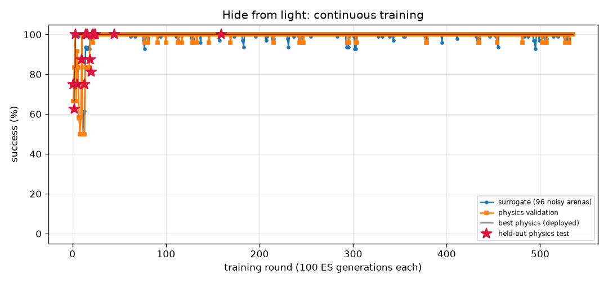

# Hide from light (`light_avoid`) — training report

*Auto-generated by `train_brains.py`, last updated 2026-11-13T21:48:42.*

| | |
|---|---|
| rounds | 639 |
| ES generations | 63900 |
| physics runs | 15608 |
| status | **optimal** |
| best brain | round 159: physics validation **100%** on 24 arenas, surrogate 100% |
| held-out physics test | **100%** on 32 unseen arenas (95% CI 89%-100%) (errors: [14.4, 56.1, 58.0, 57.9, 57.5, 14.0, 14.4, 56.6, 56.8, 13.3, 14.1, 56.6, 57.6, 13.1, 57.3, 55.9, 57.2, 55.0, 55.2, 53.9, 55.2, 12.4, 53.8, 53.7, 14.1, 13.7, 55.0, 57.8, 56.2, 13.1, 52.8, 56.5]) |

Physics error per arena: mm gained away from source (> 6 without first approaching it = success).

| round | level | gens | sigma | surrogate | physics val | val errors | test | note |
|---:|---:|---:|---:|---:|---:|---|---:|---|
| 600 | 3 | 60000 | 0.024 | 100% | 100% | [41.7, 44.5, 44.7, 43.3, 39.1, 41.3, 44.5, 14.5, 39.3, 13.3, 43.6, 40.0, 14.4, 41.0, 44.7, 42.8, 14.2, 40.4, 44.4, 14.4, 41.5, 42.5, 43.4, 39.1] |  |  |
| 601 | 3 | 60100 | 0.024 | 100% | 100% | [53.5, 58.1, 57.8, 54.3, 58.7, 54.1, 56.1, 14.5, 53.6, 13.4, 57.3, 58.6, 14.4, 55.9, 57.8, 53.0, 14.2, 59.0, 58.1, 14.4, 51.4, 57.4, 55.8, 58.2] |  |  |
| 602 | 3 | 60200 | 0.024 | 100% | 100% | [56.0, 60.2, 60.0, 56.5, 60.6, 57.3, 58.7, 14.5, 53.1, 13.5, 58.3, 60.4, 14.4, 59.4, 60.3, 55.4, 14.2, 60.9, 60.7, 14.4, 52.4, 58.4, 58.7, 60.0] |  |  |
| 603 | 3 | 60300 | 0.024 | 100% | 100% | [57.3, 61.3, 61.1, 57.8, 61.0, 58.3, 59.7, 14.5, 57.6, 13.3, 60.1, 60.9, 14.4, 60.3, 61.2, 56.8, 14.2, 61.6, 61.7, 14.4, 56.7, 60.2, 59.6, 60.3] |  | restart from best |
| 604 | 3 | 60400 | 0.024 | 100% | 100% | [54.7, 57.0, 56.8, 55.0, 56.3, 55.3, 55.4, 14.5, 45.3, 13.5, 55.2, 56.0, 14.4, 54.3, 56.9, 54.8, 14.2, 56.7, 57.2, 14.4, 53.4, 54.5, 55.2, 55.5] |  |  |
| 605 | 3 | 60500 | 0.024 | 100% | 100% | [45.8, 49.0, 49.0, 47.9, 50.3, 46.5, 47.3, 14.5, 42.0, 13.6, 50.1, 50.3, 14.4, 48.4, 48.7, 49.1, 14.2, 50.5, 49.1, 14.4, 49.4, 50.2, 47.2, 49.8] |  |  |
| 606 | 3 | 60600 | 0.024 | 100% | 100% | [45.4, 47.1, 46.4, 47.3, 50.2, 45.8, 44.1, 14.5, 47.1, 13.3, 50.1, 50.5, 14.4, 50.2, 46.5, 46.7, 14.2, 50.2, 46.9, 14.4, 43.2, 50.5, 44.5, 50.3] |  |  |
| 607 | 3 | 60700 | 0.024 | 100% | 100% | [50.7, 54.1, 53.7, 52.2, 56.0, 52.3, 51.7, 14.5, 42.3, 13.4, 54.1, 56.1, 14.4, 54.4, 53.6, 52.4, 14.2, 56.0, 54.4, 14.4, 52.4, 53.9, 51.6, 55.6] |  | restart from best |
| 608 | 3 | 60800 | 0.024 | 100% | 100% | [57.2, 61.2, 60.9, 58.1, 60.3, 58.0, 59.8, 14.5, 56.6, 13.3, 59.8, 60.1, 14.4, 59.9, 61.1, 57.7, 14.2, 60.9, 61.4, 14.4, 58.3, 59.8, 59.6, 59.5] |  |  |
| 609 | 3 | 60900 | 0.024 | 100% | 100% | [53.8, 55.8, 55.5, 54.2, 55.5, 54.3, 54.1, 14.5, 50.6, 13.2, 54.0, 55.3, 14.4, 55.1, 55.5, 54.5, 14.2, 55.9, 56.1, 14.4, 52.3, 54.2, 54.0, 54.8] |  |  |
| 610 | 3 | 61000 | 0.024 | 100% | 100% | [51.9, 56.6, 56.6, 52.9, 57.9, 53.8, 54.7, 14.5, 53.9, 13.3, 55.4, 57.7, 14.4, 56.3, 56.5, 55.7, 14.2, 58.1, 57.2, 14.4, 53.4, 56.2, 55.0, 57.3] |  |  |
| 611 | 3 | 61100 | 0.024 | 100% | 100% | [57.4, 59.2, 58.9, 54.8, 59.5, 55.0, 57.6, 14.5, 53.9, 13.5, 58.1, 59.4, 14.4, 58.0, 59.0, 53.8, 14.2, 59.8, 59.5, 14.4, 56.3, 57.9, 57.2, 58.9] |  | restart from best |
| 612 | 3 | 61200 | 0.024 | 100% | 100% | [50.8, 54.6, 54.1, 51.7, 56.0, 51.7, 52.7, 14.5, 51.2, 13.1, 55.1, 55.8, 14.3, 53.6, 54.5, 53.2, 14.2, 56.1, 55.1, 14.4, 52.7, 55.2, 52.9, 55.6] |  |  |
| 613 | 3 | 61300 | 0.024 | 100% | 100% | [55.9, 58.9, 58.6, 56.5, 58.2, 57.0, 57.5, 14.5, 47.5, 13.6, 57.7, 58.0, 14.4, 57.5, 58.8, 56.6, 14.2, 58.7, 59.2, 14.4, 55.0, 58.0, 57.0, 57.5] |  |  |
| 614 | 3 | 61400 | 0.024 | 100% | 100% | [48.9, 50.0, 49.7, 48.7, 49.4, 49.2, 48.6, 14.5, 45.7, 13.3, 48.5, 49.3, 14.4, 49.1, 49.9, 47.6, 14.2, 50.1, 50.4, 14.4, 47.8, 48.5, 48.5, 48.7] |  |  |
| 615 | 3 | 61500 | 0.024 | 100% | 100% | [43.6, 43.4, 44.3, 44.8, 45.4, 44.5, 39.4, 14.5, 42.8, 13.2, 43.2, 47.4, 14.4, 42.6, 43.0, 43.9, 14.2, 46.5, 44.0, 14.4, 44.6, 42.9, 41.4, 46.4] |  | restart from best |
| 616 | 3 | 61600 | 0.024 | 100% | 100% | [50.8, 51.5, 51.6, 51.0, 45.9, 50.7, 52.0, 14.5, 45.5, 13.5, 49.0, 46.0, 14.4, 48.3, 51.7, 50.6, 14.2, 48.2, 50.8, 14.4, 50.9, 49.8, 52.0, 44.8] |  |  |
| 617 | 3 | 61700 | 0.024 | 100% | 100% | [37.5, 36.6, 36.8, 37.8, 34.2, 37.2, 37.2, 14.5, 12.7, 13.4, 37.9, 32.8, 14.4, 37.6, 37.0, 37.7, 14.2, 34.0, 36.4, 14.4, 36.5, 37.7, 36.2, 32.5] |  |  |
| 618 | 3 | 61800 | 0.024 | 100% | 100% | [35.7, 35.6, 35.6, 36.1, 37.4, 36.4, 30.9, 14.5, 34.5, 13.5, 37.3, 36.9, 14.4, 37.3, 34.7, 36.4, 14.2, 36.8, 36.3, 14.4, 35.8, 36.7, 32.8, 37.2] |  |  |
| 619 | 3 | 61900 | 0.024 | 100% | 100% | [50.8, 51.1, 51.1, 51.2, 46.4, 49.9, 51.6, 14.5, 41.3, 13.4, 49.2, 46.3, 14.4, 46.5, 51.1, 50.9, 14.2, 47.4, 50.7, 14.4, 50.6, 50.3, 51.8, 44.7] |  | restart from best |
| 620 | 3 | 62000 | 0.024 | 100% | 100% | [43.2, 43.2, 42.4, 43.2, 45.4, 43.8, 40.9, 14.5, 42.0, 12.9, 45.6, 45.2, 14.4, 45.9, 42.9, 44.0, 14.2, 45.1, 43.3, 14.4, 41.8, 45.9, 42.0, 45.4] |  |  |
| 621 | 3 | 62100 | 0.024 | 100% | 100% | [38.0, 37.4, 37.2, 38.5, 40.0, 38.2, 35.1, 14.5, 37.4, 13.3, 40.1, 40.1, 14.4, 40.5, 36.9, 38.4, 14.2, 39.9, 37.8, 14.4, 38.3, 40.0, 34.4, 39.9] |  |  |
| 622 | 3 | 62200 | 0.024 | 100% | 100% | [42.7, 45.0, 43.8, 44.4, 47.8, 44.3, 42.5, 14.5, 40.3, 13.2, 44.0, 48.3, 14.4, 45.0, 45.1, 43.3, 14.2, 47.8, 45.5, 14.4, 45.4, 44.0, 42.2, 48.6] |  |  |
| 623 | 3 | 62300 | 0.024 | 100% | 100% | [57.4, 61.2, 61.0, 57.9, 60.4, 58.6, 59.8, 14.5, 56.8, 13.2, 60.0, 60.2, 14.4, 60.0, 61.2, 57.0, 14.2, 60.9, 61.5, 14.4, 58.8, 60.2, 59.7, 59.5] |  | restart from best |
| 624 | 3 | 62400 | 0.024 | 100% | 100% | [44.1, 45.8, 45.3, 46.1, 48.4, 44.4, 43.5, 14.5, 43.1, 13.4, 48.7, 48.7, 14.4, 48.8, 45.4, 44.5, 14.2, 48.4, 45.3, 14.4, 44.4, 49.0, 44.1, 48.7] |  |  |
| 625 | 3 | 62500 | 0.024 | 98% | 100% | [41.9, 42.4, 42.9, 43.5, 38.0, 43.2, 43.6, 14.5, 12.9, 13.5, 8.5, 37.9, 14.4, 37.9, 43.3, 42.8, 14.2, 39.2, 41.8, 14.4, 40.9, 9.0, 44.4, 36.5] |  |  |
| 626 | 3 | 62600 | 0.025 | 98% | 96% | [49.1, 52.7, 52.4, 49.9, 52.5, 49.1, 51.0, 14.5, 13.0, 13.4, 10.2, 52.4, 14.4, 7.9, 52.6, 48.9, 14.2, 52.9, 53.1, 14.4, 47.4, 11.3, 50.5, 51.8] |  |  |
| 627 | 3 | 62700 | 0.025 | 98% | 96% | [38.8, 40.4, 39.9, 40.1, 43.6, 38.2, 37.8, 14.5, 13.0, 13.4, 10.2, 43.7, 14.4, 8.0, 40.1, 39.9, 14.2, 43.4, 40.6, 14.4, 39.2, 11.3, 38.3, 43.8] |  | restart from best |
| 628 | 3 | 62800 | 0.024 | 100% | 100% | [39.2, 39.7, 39.6, 40.2, 42.4, 39.2, 37.0, 14.5, 38.3, 13.3, 43.0, 42.6, 14.3, 42.6, 39.8, 39.4, 14.2, 42.5, 39.8, 14.4, 40.9, 42.9, 37.1, 42.3] |  |  |
| 629 | 3 | 62900 | 0.024 | 100% | 100% | [43.8, 44.8, 44.2, 45.1, 48.0, 45.2, 42.3, 14.5, 12.7, 13.4, 43.4, 48.0, 14.4, 44.8, 44.9, 45.4, 14.2, 47.8, 44.3, 14.4, 44.4, 44.8, 42.5, 47.8] |  |  |
| 630 | 3 | 63000 | 0.024 | 100% | 100% | [39.6, 39.4, 39.5, 40.0, 34.3, 39.4, 40.1, 14.5, 13.0, 13.4, 37.6, 35.0, 14.4, 39.7, 38.9, 39.3, 14.2, 36.0, 39.5, 14.4, 39.7, 38.0, 39.3, 35.2] |  |  |
| 631 | 3 | 63100 | 0.024 | 100% | 100% | [55.5, 58.4, 58.4, 55.3, 55.2, 55.7, 58.0, 14.5, 49.2, 13.5, 56.6, 55.1, 14.4, 57.9, 58.4, 55.7, 14.2, 56.3, 58.4, 14.4, 54.1, 56.6, 57.5, 54.1] |  | restart from best |
| 632 | 3 | 63200 | 0.024 | 100% | 100% | [37.0, 34.3, 34.4, 36.8, 37.1, 36.5, 33.5, 14.5, 36.5, 13.6, 36.9, 37.2, 14.4, 37.5, 34.5, 36.2, 14.2, 36.7, 35.0, 14.4, 36.0, 38.0, 33.4, 39.1] |  |  |
| 633 | 3 | 63300 | 0.024 | 99% | 100% | [46.8, 46.2, 46.3, 46.5, 42.3, 46.0, 46.9, 14.5, 12.9, 13.4, 44.0, 42.0, 14.4, 42.0, 46.3, 46.5, 14.2, 43.4, 46.2, 14.4, 45.1, 45.6, 46.7, 42.2] |  |  |
| 634 | 3 | 63400 | 0.025 | 99% | 100% | [41.7, 41.5, 41.9, 42.1, 37.6, 40.9, 41.8, 14.5, 13.0, 13.4, 10.0, 37.2, 14.4, 38.7, 42.1, 42.3, 14.2, 38.7, 41.8, 14.4, 41.1, 11.1, 41.9, 36.0] |  |  |
| 635 | 3 | 63500 | 0.025 | 97% | 96% | [49.8, 51.0, 50.9, 48.6, 49.5, 48.7, 49.9, 14.5, 13.0, 13.4, 10.3, 49.2, 14.4, 8.0, 50.8, 49.3, 14.2, 49.9, 51.2, 14.4, 48.8, 11.3, 49.6, 48.4] |  | restart from best |
| 636 | 3 | 63600 | 0.024 | 100% | 100% | [51.2, 52.5, 52.3, 51.2, 52.4, 51.7, 50.6, 14.5, 48.7, 13.2, 52.0, 52.2, 14.4, 51.7, 52.4, 51.0, 14.2, 52.7, 52.8, 14.4, 49.6, 52.1, 50.5, 51.7] |  |  |
| 637 | 3 | 63700 | 0.024 | 100% | 100% | [43.7, 46.3, 46.3, 45.5, 48.5, 45.3, 43.8, 14.5, 48.1, 13.2, 48.7, 48.9, 14.4, 48.2, 46.2, 45.0, 14.2, 48.4, 46.4, 14.4, 44.8, 49.3, 44.1, 48.5] |  |  |
| 638 | 3 | 63800 | 0.024 | 100% | 100% | [33.4, 32.5, 31.0, 34.7, 34.6, 34.0, 30.7, 14.5, 12.6, 13.3, 38.2, 34.3, 14.4, 36.4, 32.7, 36.6, 14.2, 34.9, 32.5, 14.4, 35.9, 36.7, 29.7, 34.6] |  |  |
| 639 | 3 | 63900 | 0.024 | 99% | 100% | [38.8, 39.9, 38.9, 42.0, 42.7, 39.2, 36.6, 14.5, 13.0, 13.4, 43.0, 42.8, 14.4, 43.1, 39.8, 41.4, 14.2, 43.1, 38.8, 14.4, 37.9, 43.2, 37.8, 43.2] |  | restart from best |
