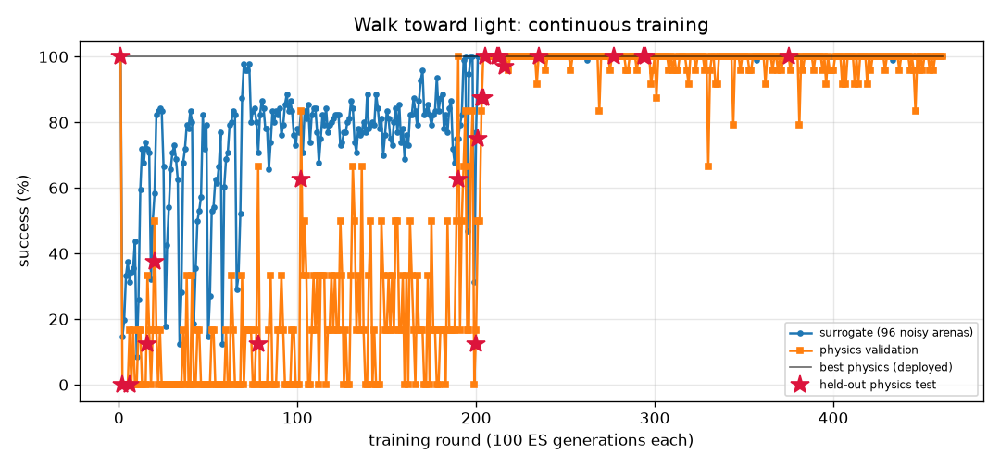

# Walk toward light (`light_seek`) — training report

*Auto-generated by `train_brains.py`, last updated 2026-11-03T20:43:52.*

| | |
|---|---|
| rounds | 426 |
| ES generations | 42600 |
| physics runs | 7104 |
| status | **optimal** |
| best brain | round 375: physics validation **100%** on 24 arenas, surrogate 100% |
| held-out physics test | **100%** on 32 unseen arenas (95% CI 89%-100%) (errors: [0.57, 0.54, 0.53, 0.57, 0.55, 0.56, 0.59, 0.56, 0.53, 0.56, 0.71, 0.56, 0.55, 0.54, 0.53, 0.54, 0.54, 0.55, 0.52, 0.65, 0.64, 0.7, 0.58, 0.57, 0.6, 0.62, 0.55, 0.88, 0.54, 0.52, 0.62, 0.57]) |

Physics error per arena: mm from target at the end (< 1.5 and standing still = success).

| round | level | gens | sigma | surrogate | physics val | val errors | test | note |
|---:|---:|---:|---:|---:|---:|---|---:|---|
| 387 | 3 | 38700 | 0.024 | 100% | 100% | [0.49, 0.63, 0.66, 0.49, 0.52, 0.54, 0.61, 0.5, 0.55, 0.62, 0.48, 0.63, 1.08, 0.51, 0.48, 0.71, 0.53, 0.62, 0.54, 0.49, 0.51, 0.55, 0.5, 0.98] |  | restart from best |
| 388 | 3 | 38800 | 0.024 | 100% | 100% | [0.44, 0.59, 0.49, 0.5, 0.5, 0.58, 0.6, 0.48, 0.45, 0.45, 0.49, 0.47, 0.55, 0.55, 0.55, 0.5, 0.46, 0.46, 0.62, 0.52, 0.62, 0.51, 0.45, 0.88] |  |  |
| 389 | 3 | 38900 | 0.024 | 100% | 96% | [0.63, 0.47, 0.46, 0.48, 0.49, 0.57, 0.54, 0.6, 0.58, 0.58, 0.55, 0.45, 0.55, 0.95, 0.92, 0.62, 0.56, 0.5, 0.55, 1.63, 0.62, 0.46, 0.51, 0.61] |  |  |
| 390 | 3 | 39000 | 0.024 | 100% | 100% | [0.57, 0.69, 0.46, 1.1, 0.48, 0.93, 0.91, 0.92, 0.71, 0.6, 0.46, 0.52, 0.58, 0.65, 0.54, 0.59, 0.61, 0.58, 0.55, 0.71, 0.98, 0.54, 0.62, 0.9] |  |  |
| 391 | 3 | 39100 | 0.024 | 100% | 100% | [0.59, 0.45, 0.51, 0.44, 0.51, 0.49, 0.97, 0.46, 0.51, 0.56, 0.44, 0.52, 0.54, 0.64, 0.43, 0.45, 0.58, 0.55, 0.49, 0.93, 0.42, 1.13, 0.47, 0.58] |  | restart from best |
| 392 | 3 | 39200 | 0.024 | 100% | 100% | [0.48, 0.6, 0.49, 0.51, 1.01, 0.5, 0.5, 0.58, 0.72, 0.68, 0.52, 0.58, 0.85, 0.73, 0.53, 0.59, 0.66, 0.52, 0.67, 0.67, 0.81, 0.84, 0.57, 0.54] |  |  |
| 393 | 3 | 39300 | 0.024 | 100% | 100% | [0.87, 0.51, 0.53, 0.52, 0.55, 0.5, 0.64, 0.57, 0.58, 0.48, 0.53, 0.55, 0.63, 0.56, 0.58, 0.51, 0.53, 0.51, 0.58, 0.58, 0.51, 0.5, 0.48, 0.76] |  |  |
| 394 | 3 | 39400 | 0.024 | 100% | 96% | [0.54, 0.54, 0.6, 0.54, 0.63, 0.56, 0.63, 0.65, 0.68, 0.59, 0.75, 0.58, 0.54, 0.69, 0.71, 0.69, 0.54, 0.62, 0.63, 0.65, 0.53, 2.19, 0.64, 0.55] |  |  |
| 395 | 3 | 39500 | 0.024 | 100% | 100% | [0.51, 0.54, 0.68, 0.64, 0.61, 0.54, 0.54, 0.55, 0.61, 0.51, 0.53, 0.51, 1.17, 0.53, 0.69, 0.67, 0.51, 0.6, 0.51, 0.62, 0.78, 0.78, 0.67, 0.55] |  | restart from best |
| 396 | 3 | 39600 | 0.024 | 100% | 92% | [0.61, 0.66, 0.7, 0.71, 0.56, 2.04, 0.53, 0.6, 0.96, 0.64, 0.64, 0.56, 0.81, 1.02, 0.58, 0.58, 0.58, 0.56, 0.61, 1.5, 0.79, 0.57, 0.64, 0.82] |  |  |
| 397 | 3 | 39700 | 0.024 | 100% | 100% | [0.57, 0.58, 0.6, 0.57, 0.55, 0.69, 0.76, 0.64, 0.64, 0.59, 0.61, 0.62, 0.68, 0.59, 0.6, 0.65, 0.59, 0.75, 0.59, 0.6, 0.58, 0.61, 0.56, 0.61] |  |  |
| 398 | 3 | 39800 | 0.024 | 100% | 96% | [0.61, 0.55, 0.76, 0.58, 0.55, 0.57, 0.54, 0.55, 0.67, 0.56, 0.71, 0.56, 0.68, 1.94, 0.77, 0.56, 0.55, 0.73, 0.56, 0.74, 0.74, 0.54, 0.85, 1.3] |  |  |
| 399 | 3 | 39900 | 0.024 | 100% | 96% | [0.68, 0.5, 0.61, 0.59, 0.5, 0.58, 0.59, 0.5, 0.53, 0.52, 0.5, 0.5, 0.52, 0.49, 0.68, 0.56, 0.55, 0.49, 0.5, 1.43, 1.26, 0.5, 0.55, 0.56] |  | restart from best |
| 400 | 3 | 40000 | 0.024 | 100% | 96% | [0.55, 0.54, 0.55, 0.56, 0.53, 0.57, 0.59, 0.58, 1.53, 0.52, 0.54, 0.54, 0.52, 0.59, 0.92, 0.48, 0.52, 0.57, 0.62, 0.58, 0.52, 0.55, 0.66, 0.66] |  |  |
| 401 | 3 | 40100 | 0.024 | 100% | 100% | [0.73, 0.63, 0.65, 0.64, 0.74, 0.74, 0.62, 0.68, 0.66, 0.63, 0.67, 0.6, 0.73, 0.71, 0.82, 0.64, 0.67, 0.75, 0.64, 0.71, 0.7, 0.55, 0.69, 0.81] |  |  |
| 402 | 3 | 40200 | 0.024 | 100% | 100% | [0.54, 0.56, 0.62, 0.57, 0.47, 0.58, 0.54, 0.5, 1.02, 0.55, 0.57, 0.47, 0.52, 0.53, 0.63, 0.5, 0.5, 0.49, 0.54, 0.71, 0.51, 0.51, 0.55, 0.47] |  |  |
| 403 | 3 | 40300 | 0.024 | 100% | 100% | [0.51, 0.5, 0.5, 1.0, 0.55, 0.54, 0.46, 0.65, 1.01, 0.63, 0.58, 0.63, 0.52, 0.76, 0.6, 0.45, 0.49, 0.58, 0.62, 0.5, 1.08, 0.99, 0.51, 0.47] |  | restart from best |
| 404 | 3 | 40400 | 0.024 | 100% | 100% | [0.75, 0.68, 0.69, 0.56, 0.67, 0.69, 0.63, 0.71, 0.62, 0.8, 0.53, 0.69, 0.57, 0.58, 0.58, 1.2, 0.67, 1.15, 0.69, 0.7, 0.73, 0.53, 0.58, 1.14] |  |  |
| 405 | 3 | 40500 | 0.024 | 100% | 92% | [1.78, 0.52, 0.49, 0.59, 0.58, 0.48, 0.56, 0.58, 1.91, 0.52, 0.51, 0.54, 0.5, 0.51, 0.67, 0.49, 0.58, 0.54, 0.47, 1.4, 0.58, 0.53, 0.51, 0.51] |  |  |
| 406 | 3 | 40600 | 0.024 | 100% | 100% | [0.62, 0.54, 0.55, 0.57, 0.64, 0.75, 0.63, 0.66, 0.82, 0.56, 0.56, 0.62, 0.58, 0.59, 0.56, 0.57, 0.54, 0.55, 0.6, 0.62, 0.61, 0.77, 0.57, 0.58] |  |  |
| 407 | 3 | 40700 | 0.024 | 100% | 92% | [0.68, 0.97, 0.6, 0.74, 0.69, 0.74, 0.68, 0.96, 0.68, 0.69, 0.62, 0.71, 0.73, 1.71, 0.62, 1.18, 0.64, 0.77, 0.7, 0.68, 2.61, 0.74, 0.6, 0.7] |  | restart from best |
| 408 | 3 | 40800 | 0.024 | 100% | 100% | [0.62, 0.61, 0.54, 0.55, 0.54, 0.67, 0.63, 0.61, 0.6, 0.49, 0.53, 0.68, 0.54, 0.63, 0.66, 0.6, 0.57, 0.52, 0.57, 0.71, 1.04, 0.67, 0.62, 0.67] |  |  |
| 409 | 3 | 40900 | 0.024 | 100% | 100% | [0.75, 0.51, 0.58, 0.81, 0.61, 0.62, 0.64, 0.7, 0.66, 0.79, 0.55, 0.61, 0.58, 0.64, 0.68, 0.62, 0.62, 0.56, 0.55, 0.6, 0.72, 0.69, 0.61, 0.74] |  |  |
| 410 | 3 | 41000 | 0.024 | 100% | 100% | [0.69, 0.61, 0.71, 0.69, 0.63, 0.71, 0.68, 0.69, 0.68, 0.61, 0.74, 0.67, 0.68, 0.68, 0.82, 0.6, 0.66, 0.69, 0.61, 0.75, 0.71, 0.74, 0.68, 0.68] |  |  |
| 411 | 3 | 41100 | 0.024 | 100% | 100% | [0.54, 0.62, 0.55, 1.15, 0.59, 0.58, 0.56, 0.63, 0.62, 0.6, 0.82, 0.6, 0.49, 0.57, 0.62, 0.51, 0.54, 0.53, 0.64, 0.52, 0.62, 0.69, 0.55, 0.75] |  | restart from best |
| 412 | 3 | 41200 | 0.024 | 100% | 92% | [0.63, 0.61, 0.93, 1.04, 0.59, 0.56, 0.54, 0.57, 0.56, 0.6, 1.97, 0.58, 0.67, 0.55, 1.62, 0.79, 0.67, 0.58, 0.56, 0.58, 0.56, 0.62, 0.54, 0.63] |  |  |
| 413 | 3 | 41300 | 0.024 | 100% | 100% | [0.53, 0.49, 0.51, 0.9, 0.5, 0.51, 0.52, 0.56, 0.6, 0.51, 0.88, 0.65, 0.6, 0.56, 0.91, 0.91, 0.57, 0.59, 0.52, 0.88, 0.61, 0.64, 0.58, 0.5] |  |  |
| 414 | 3 | 41400 | 0.024 | 100% | 92% | [0.58, 0.69, 0.5, 0.46, 0.57, 0.58, 1.39, 0.72, 0.64, 0.54, 0.64, 0.47, 1.16, 0.62, 1.09, 0.52, 0.58, 0.84, 0.6, 0.6, 0.48, 0.57, 0.62, 1.58] |  |  |
| 415 | 3 | 41500 | 0.024 | 100% | 100% | [1.04, 0.63, 0.75, 0.56, 0.59, 0.59, 0.62, 0.57, 0.73, 0.57, 0.52, 0.56, 0.65, 1.07, 0.99, 0.56, 0.66, 0.57, 0.68, 0.55, 1.11, 0.61, 0.72, 0.53] |  | restart from best |
| 416 | 3 | 41600 | 0.024 | 100% | 100% | [0.61, 0.61, 0.64, 1.18, 0.6, 0.68, 0.7, 0.64, 0.58, 0.6, 0.69, 0.58, 0.57, 0.65, 0.7, 0.57, 0.65, 0.65, 0.62, 0.63, 0.75, 0.61, 0.63, 0.64] |  |  |
| 417 | 3 | 41700 | 0.024 | 100% | 100% | [0.79, 0.75, 0.64, 0.79, 0.87, 0.73, 0.68, 0.65, 0.74, 0.78, 0.65, 0.54, 0.76, 0.71, 0.98, 0.69, 0.69, 0.67, 0.79, 0.67, 0.76, 0.53, 0.76, 0.73] |  |  |
| 418 | 3 | 41800 | 0.024 | 100% | 100% | [0.57, 0.82, 0.55, 0.86, 0.56, 0.57, 0.87, 0.58, 0.56, 0.87, 0.97, 0.83, 0.52, 0.6, 0.78, 0.9, 0.6, 0.56, 0.78, 0.65, 0.57, 0.99, 0.97, 0.92] |  |  |
| 419 | 3 | 41900 | 0.024 | 100% | 92% | [0.63, 0.61, 0.49, 0.57, 0.55, 0.54, 0.56, 1.38, 0.64, 0.68, 0.54, 1.61, 0.51, 1.16, 0.52, 0.58, 0.55, 0.54, 0.62, 2.03, 0.63, 1.26, 0.48, 1.01] |  | restart from best |
| 420 | 3 | 42000 | 0.024 | 100% | 100% | [0.62, 0.7, 0.6, 0.61, 0.56, 0.68, 0.62, 0.7, 0.54, 0.56, 0.57, 0.65, 0.64, 0.61, 0.56, 0.51, 1.37, 0.57, 0.61, 0.52, 0.67, 0.65, 0.6, 1.15] |  |  |
| 421 | 3 | 42100 | 0.024 | 100% | 96% | [0.46, 0.54, 0.56, 0.54, 0.45, 0.57, 0.54, 0.53, 0.57, 0.45, 0.6, 0.47, 0.51, 1.11, 0.97, 0.88, 1.26, 0.43, 0.5, 0.97, 0.87, 1.63, 0.53, 0.43] |  |  |
| 422 | 3 | 42200 | 0.024 | 100% | 100% | [0.68, 0.48, 0.53, 0.65, 0.48, 0.53, 0.57, 1.24, 0.48, 0.55, 0.54, 0.51, 0.52, 0.6, 0.47, 0.55, 0.5, 0.47, 0.49, 0.62, 0.61, 0.46, 0.89, 0.97] |  |  |
| 423 | 3 | 42300 | 0.024 | 100% | 100% | [0.46, 0.7, 0.58, 0.83, 0.52, 0.48, 0.53, 0.53, 0.5, 0.49, 0.64, 0.56, 1.18, 0.56, 0.55, 0.6, 0.59, 0.63, 0.48, 0.6, 0.62, 0.51, 0.47, 0.55] |  | restart from best |
| 424 | 3 | 42400 | 0.024 | 100% | 100% | [1.22, 0.52, 0.6, 0.53, 0.54, 0.59, 0.7, 0.53, 0.62, 0.53, 0.55, 0.55, 0.56, 0.67, 0.55, 0.56, 0.54, 0.53, 0.53, 0.59, 0.65, 0.63, 0.57, 0.54] |  |  |
| 425 | 3 | 42500 | 0.024 | 100% | 100% | [0.59, 0.66, 0.6, 0.56, 0.54, 0.63, 0.56, 0.6, 0.76, 0.65, 1.16, 0.55, 0.61, 0.66, 0.54, 0.61, 0.55, 0.56, 0.55, 0.66, 0.6, 0.58, 0.59, 0.58] |  |  |
| 426 | 3 | 42600 | 0.024 | 100% | 100% | [0.53, 0.51, 0.5, 0.9, 0.53, 0.52, 0.52, 1.16, 0.57, 0.52, 0.55, 0.5, 0.48, 0.58, 0.56, 0.6, 0.51, 0.52, 0.54, 0.5, 0.51, 0.59, 0.49, 0.56] |  |  |
