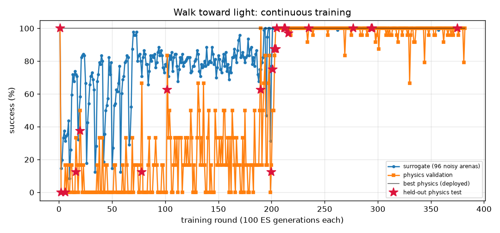

# Walk toward light (`light_seek`) — training report

*Auto-generated by `train_brains.py`, last updated 2026-10-20T13:55:07.*

| | |
|---|---|
| rounds | 311 |
| ES generations | 31100 |
| physics runs | 4312 |
| status | **optimal** |
| best brain | round 295: physics validation **100%** on 24 arenas, surrogate 100% |
| held-out physics test | **100%** on 32 unseen arenas (95% CI 89%-100%) (errors: [0.58, 0.62, 0.61, 0.63, 0.65, 0.65, 0.73, 0.55, 0.64, 0.59, 0.59, 0.58, 0.69, 0.61, 0.59, 0.6, 0.6, 0.63, 0.59, 0.64, 0.61, 1.11, 0.62, 0.58, 0.58, 0.58, 0.67, 0.63, 0.58, 0.66, 0.67, 0.59]) |

Physics error per arena: mm from target at the end (< 1.5 and standing still = success).

| round | level | gens | sigma | surrogate | physics val | val errors | test | note |
|---:|---:|---:|---:|---:|---:|---|---:|---|
| 272 | 3 | 27200 | 0.024 | 100% | 100% | [0.48, 0.45, 0.49, 0.5, 0.44, 0.46, 0.48, 0.47, 0.86, 0.51, 0.45, 0.45, 0.46, 0.46, 0.52, 0.49, 0.48, 0.44, 0.45, 0.44, 0.5, 0.47, 0.51, 0.5] |  |  |
| 273 | 3 | 27300 | 0.024 | 100% | 100% | [0.64, 0.47, 0.51, 0.66, 0.52, 0.65, 0.61, 0.6, 0.6, 0.57, 0.5, 0.56, 0.52, 1.03, 0.53, 0.5, 0.46, 0.49, 0.55, 0.56, 0.52, 0.5, 0.53, 0.87] |  |  |
| 274 | 3 | 27400 | 0.024 | 100% | 100% | [0.52, 0.46, 0.5, 0.46, 0.49, 0.59, 0.51, 0.53, 0.51, 0.49, 0.5, 0.48, 0.52, 0.52, 0.88, 0.51, 0.52, 0.48, 0.46, 0.51, 0.57, 0.47, 1.06, 0.46] |  |  |
| 275 | 3 | 27500 | 0.024 | 100% | 96% | [0.56, 0.69, 0.6, 0.58, 0.53, 0.51, 0.5, 1.16, 1.01, 0.57, 0.52, 0.52, 0.54, 3.85, 0.6, 0.58, 0.6, 0.49, 0.55, 0.58, 0.66, 0.61, 0.74, 0.46] |  | restart from best |
| 276 | 3 | 27600 | 0.024 | 100% | 100% | [0.44, 0.41, 0.46, 0.91, 0.43, 0.42, 0.42, 0.47, 0.58, 0.45, 0.41, 0.42, 0.42, 0.42, 0.67, 0.41, 0.43, 0.42, 0.42, 0.43, 0.78, 0.48, 0.42, 0.8] |  |  |
| 277 | 3 | 27700 | 0.024 | 100% | 100% | [0.51, 0.54, 0.5, 0.49, 0.49, 0.5, 0.48, 0.49, 0.54, 0.5, 0.48, 0.55, 0.51, 0.56, 0.47, 0.52, 0.54, 0.5, 0.52, 0.58, 0.53, 0.58, 0.55, 0.52] | 100% | new best |
| 278 | 3 | 27800 | 0.024 | 100% | 100% | [0.48, 0.56, 0.59, 0.58, 0.48, 0.47, 0.58, 0.59, 0.57, 0.63, 0.47, 0.65, 0.62, 0.47, 0.63, 0.61, 0.49, 0.48, 0.61, 0.98, 0.7, 0.6, 0.58, 0.59] |  |  |
| 279 | 3 | 27900 | 0.024 | 100% | 100% | [0.53, 0.56, 0.56, 0.54, 0.55, 0.53, 0.53, 0.56, 0.52, 0.61, 0.67, 0.56, 0.52, 0.52, 0.62, 0.57, 0.54, 0.59, 0.53, 0.59, 0.52, 0.63, 0.56, 0.58] |  |  |
| 280 | 3 | 28000 | 0.024 | 100% | 100% | [0.58, 0.53, 0.57, 0.54, 0.5, 0.49, 0.51, 0.52, 0.54, 0.51, 0.5, 0.5, 0.49, 0.49, 0.58, 0.5, 0.56, 0.62, 0.5, 0.55, 0.55, 0.52, 0.5, 0.51] |  |  |
| 281 | 3 | 28100 | 0.024 | 100% | 100% | [0.5, 0.59, 0.43, 0.53, 0.49, 0.88, 0.57, 0.56, 1.27, 0.53, 0.49, 0.5, 0.48, 0.51, 0.51, 0.56, 0.5, 0.54, 0.55, 0.45, 1.01, 1.3, 0.47, 0.48] |  | restart from best |
| 282 | 3 | 28200 | 0.024 | 100% | 100% | [0.42, 0.44, 0.43, 0.46, 0.42, 0.59, 0.47, 0.42, 0.42, 0.44, 0.42, 0.42, 0.43, 0.5, 0.47, 0.43, 0.42, 0.43, 0.41, 0.43, 0.41, 0.42, 0.42, 0.49] |  |  |
| 283 | 3 | 28300 | 0.024 | 100% | 100% | [0.44, 0.42, 0.45, 0.42, 0.46, 0.46, 0.44, 0.46, 0.42, 0.42, 0.46, 0.53, 0.44, 0.51, 0.47, 0.45, 0.44, 0.42, 0.44, 0.43, 0.45, 0.41, 0.56, 0.82] |  |  |
| 284 | 3 | 28400 | 0.024 | 100% | 96% | [0.48, 0.52, 0.5, 0.5, 0.51, 0.49, 0.47, 0.61, 0.49, 0.49, 0.63, 0.49, 0.57, 0.55, 0.5, 0.5, 0.49, 0.51, 0.5, 0.6, 0.48, 0.62, 0.59, 1.58] |  |  |
| 285 | 3 | 28500 | 0.024 | 100% | 96% | [0.67, 0.5, 0.52, 1.81, 0.55, 0.52, 0.49, 0.49, 0.53, 0.5, 0.63, 0.52, 0.88, 0.49, 0.53, 0.5, 0.51, 0.5, 0.55, 0.49, 0.49, 0.51, 0.5, 0.92] |  | restart from best |
| 286 | 3 | 28600 | 0.024 | 100% | 100% | [0.54, 0.48, 0.58, 0.58, 0.5, 0.48, 0.49, 0.69, 0.52, 0.55, 0.48, 0.54, 0.51, 0.52, 0.57, 0.49, 0.57, 0.56, 0.49, 0.6, 0.67, 0.81, 0.5, 0.54] |  |  |
| 287 | 3 | 28700 | 0.024 | 100% | 100% | [0.59, 0.53, 0.51, 0.55, 0.51, 0.48, 0.54, 0.61, 0.5, 0.51, 0.52, 0.49, 0.5, 0.5, 0.6, 0.49, 0.51, 0.5, 0.52, 0.5, 0.47, 0.5, 0.49, 0.52] |  |  |
| 288 | 3 | 28800 | 0.024 | 100% | 100% | [0.45, 0.58, 0.46, 0.45, 0.46, 0.58, 0.62, 0.46, 0.56, 0.52, 0.55, 0.45, 0.49, 0.48, 0.46, 0.51, 0.46, 0.48, 0.52, 0.48, 0.45, 0.85, 0.57, 0.63] |  |  |
| 289 | 3 | 28900 | 0.024 | 100% | 100% | [0.53, 0.56, 0.64, 0.49, 1.07, 0.5, 0.53, 0.56, 0.65, 0.52, 0.55, 0.52, 0.62, 0.57, 1.12, 0.52, 0.51, 0.56, 0.57, 1.31, 0.54, 0.51, 0.54, 0.95] |  | restart from best |
| 290 | 3 | 29000 | 0.024 | 100% | 96% | [0.46, 0.53, 0.57, 0.54, 8.54, 0.46, 0.47, 0.46, 0.54, 0.48, 0.51, 0.47, 0.48, 0.45, 0.46, 0.47, 0.45, 0.45, 0.59, 0.93, 0.45, 0.56, 0.53, 0.56] |  |  |
| 291 | 3 | 29100 | 0.024 | 100% | 100% | [0.54, 0.64, 0.57, 0.61, 0.53, 0.53, 0.56, 0.54, 0.54, 0.57, 0.52, 0.55, 0.52, 0.56, 0.53, 0.58, 0.64, 0.6, 0.53, 0.58, 0.58, 0.56, 0.53, 0.53] |  |  |
| 292 | 3 | 29200 | 0.024 | 100% | 100% | [0.57, 0.62, 0.49, 0.73, 0.54, 0.73, 0.58, 0.48, 0.63, 0.51, 0.5, 0.59, 0.58, 0.49, 0.49, 0.64, 0.95, 0.57, 0.54, 0.64, 0.51, 0.56, 0.49, 0.55] |  |  |
| 293 | 3 | 29300 | 0.024 | 100% | 100% | [0.51, 0.64, 0.57, 0.5, 0.52, 0.68, 0.5, 0.54, 1.11, 0.7, 0.52, 0.65, 0.6, 0.59, 0.56, 0.56, 0.5, 0.53, 0.58, 0.5, 0.49, 0.52, 0.59, 0.58] |  | restart from best |
| 294 | 3 | 29400 | 0.024 | 100% | 100% | [0.67, 0.65, 0.65, 0.67, 0.67, 0.62, 0.63, 0.59, 0.68, 0.58, 0.71, 0.69, 0.65, 0.74, 0.68, 0.61, 0.63, 0.66, 0.64, 0.67, 0.74, 0.68, 0.62, 0.73] | 100% | new best |
| 295 | 3 | 29500 | 0.024 | 100% | 100% | [0.53, 0.58, 0.65, 0.58, 0.68, 0.6, 0.63, 0.66, 0.69, 0.62, 0.63, 0.63, 0.6, 0.65, 0.61, 0.59, 0.67, 0.77, 0.62, 0.65, 0.61, 0.64, 0.64, 0.62] | 100% | new best |
| 296 | 3 | 29600 | 0.024 | 100% | 100% | [0.51, 0.5, 0.51, 0.65, 0.76, 0.5, 0.57, 0.53, 0.49, 0.83, 0.53, 0.49, 0.51, 0.53, 0.74, 0.49, 0.6, 0.81, 0.65, 0.7, 0.48, 0.72, 0.51, 0.56] |  |  |
| 297 | 3 | 29700 | 0.024 | 100% | 100% | [0.85, 0.79, 0.53, 0.58, 0.49, 0.59, 0.47, 0.52, 0.51, 0.59, 0.49, 0.51, 0.55, 0.55, 0.6, 0.54, 0.59, 0.47, 0.55, 0.52, 0.46, 0.86, 0.82, 0.6] |  |  |
| 298 | 3 | 29800 | 0.024 | 100% | 92% | [0.53, 0.56, 0.55, 0.52, 0.52, 0.56, 0.5, 0.58, 0.47, 0.62, 0.46, 1.1, 0.62, 1.01, 0.55, 0.54, 0.57, 0.46, 0.5, 0.56, 0.59, 0.69, 1.55, 2.07] |  |  |
| 299 | 3 | 29900 | 0.024 | 100% | 96% | [1.06, 0.49, 0.52, 0.48, 0.54, 1.17, 0.82, 0.52, 0.5, 0.53, 0.69, 0.74, 0.62, 1.69, 0.54, 0.51, 0.58, 1.2, 1.07, 0.6, 0.54, 0.72, 0.48, 1.12] |  | restart from best |
| 300 | 3 | 30000 | 0.024 | 100% | 100% | [1.21, 0.6, 0.54, 0.56, 0.63, 0.53, 0.57, 0.99, 0.58, 0.58, 0.57, 0.52, 0.67, 0.61, 1.14, 0.61, 0.56, 0.57, 0.55, 0.61, 1.26, 0.59, 0.65, 0.55] |  |  |
| 301 | 3 | 30100 | 0.024 | 100% | 88% | [1.71, 0.93, 0.7, 0.74, 0.62, 0.94, 0.62, 0.6, 0.74, 0.64, 1.89, 0.61, 0.69, 1.65, 0.7, 0.65, 0.65, 0.73, 0.59, 0.7, 1.43, 0.99, 1.03, 0.99] |  |  |
| 302 | 3 | 30200 | 0.024 | 100% | 100% | [0.76, 0.79, 0.91, 0.97, 0.82, 0.7, 0.71, 0.78, 0.93, 0.76, 0.79, 0.85, 0.9, 0.79, 0.7, 0.68, 0.71, 0.77, 0.72, 0.69, 0.77, 0.75, 0.85, 0.77] |  |  |
| 303 | 3 | 30300 | 0.024 | 100% | 100% | [0.74, 0.7, 0.65, 0.65, 0.64, 0.78, 0.75, 0.71, 0.74, 0.69, 0.87, 0.71, 0.77, 0.73, 0.63, 0.7, 0.65, 0.79, 0.67, 0.67, 0.99, 0.71, 0.61, 0.74] |  | restart from best |
| 304 | 3 | 30400 | 0.024 | 100% | 100% | [0.5, 0.55, 0.56, 0.57, 0.63, 0.93, 0.53, 0.55, 0.56, 0.65, 0.61, 0.54, 0.66, 0.58, 0.51, 0.54, 0.56, 0.54, 0.54, 0.62, 0.56, 0.53, 0.53, 0.94] |  |  |
| 305 | 3 | 30500 | 0.024 | 100% | 100% | [0.65, 0.61, 0.56, 0.79, 0.73, 0.73, 0.62, 0.69, 0.93, 0.81, 0.52, 0.72, 0.78, 0.64, 1.01, 0.76, 0.48, 0.64, 0.55, 0.61, 0.67, 0.65, 0.67, 0.56] |  |  |
| 306 | 3 | 30600 | 0.024 | 100% | 100% | [0.6, 0.6, 0.64, 0.6, 0.56, 0.67, 0.67, 0.63, 0.59, 0.65, 0.65, 0.71, 0.59, 0.61, 0.62, 0.67, 0.61, 0.56, 0.64, 0.58, 0.59, 0.57, 0.6, 0.64] |  |  |
| 307 | 3 | 30700 | 0.024 | 100% | 100% | [0.51, 0.51, 0.67, 0.45, 0.52, 0.6, 0.47, 0.52, 0.66, 0.49, 0.46, 0.53, 0.58, 0.63, 0.58, 0.5, 0.49, 0.52, 0.5, 0.48, 0.54, 0.47, 0.52, 0.46] |  | restart from best |
| 308 | 3 | 30800 | 0.024 | 100% | 96% | [1.05, 0.65, 0.63, 0.65, 0.66, 0.6, 0.55, 1.74, 0.58, 0.76, 0.59, 1.04, 0.62, 1.4, 0.71, 0.59, 0.79, 0.63, 0.75, 1.27, 0.71, 0.69, 0.57, 0.78] |  |  |
| 309 | 3 | 30900 | 0.024 | 100% | 100% | [0.69, 0.61, 0.79, 0.62, 0.62, 0.7, 0.74, 0.73, 0.72, 0.96, 0.73, 0.7, 0.65, 0.71, 0.8, 0.68, 0.7, 0.63, 0.77, 0.65, 0.86, 0.76, 0.69, 0.79] |  |  |
| 310 | 3 | 31000 | 0.024 | 100% | 96% | [0.91, 0.63, 0.61, 0.67, 0.73, 0.67, 0.67, 0.62, 0.7, 0.59, 0.58, 0.73, 0.72, 0.64, 0.59, 0.57, 0.67, 0.63, 0.53, 0.73, 0.71, 0.71, 0.6, 1.52] |  |  |
| 311 | 3 | 31100 | 0.024 | 100% | 100% | [0.79, 0.67, 0.68, 0.69, 0.66, 0.71, 0.69, 0.7, 0.66, 0.67, 0.76, 0.78, 0.78, 0.68, 0.75, 0.63, 0.66, 0.85, 0.68, 0.82, 0.73, 0.67, 0.73, 1.01] |  | restart from best |
