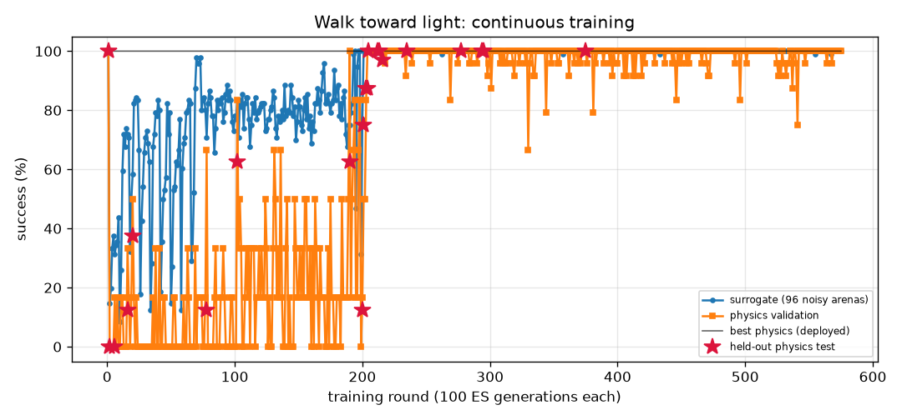

# Walk toward light (`light_seek`) — training report

*Auto-generated by `train_brains.py`, last updated 2026-11-22T01:09:05.*

| | |
|---|---|
| rounds | 578 |
| ES generations | 57800 |
| physics runs | 10752 |
| status | **optimal** |
| best brain | round 375: physics validation **100%** on 24 arenas, surrogate 100% |
| held-out physics test | **100%** on 32 unseen arenas (95% CI 89%-100%) (errors: [0.57, 0.54, 0.53, 0.57, 0.55, 0.56, 0.59, 0.56, 0.53, 0.56, 0.71, 0.56, 0.55, 0.54, 0.53, 0.54, 0.54, 0.55, 0.52, 0.65, 0.64, 0.7, 0.58, 0.57, 0.6, 0.62, 0.55, 0.88, 0.54, 0.52, 0.62, 0.57]) |

Physics error per arena: mm from target at the end (< 1.5 and standing still = success).

| round | level | gens | sigma | surrogate | physics val | val errors | test | note |
|---:|---:|---:|---:|---:|---:|---|---:|---|
| 539 | 3 | 53900 | 0.024 | 100% | 100% | [0.68, 0.61, 0.59, 0.66, 0.56, 0.75, 0.57, 0.57, 0.57, 0.58, 0.59, 0.62, 0.65, 0.62, 0.64, 0.52, 0.74, 0.57, 0.64, 0.52, 0.62, 0.66, 0.73, 0.58] |  | restart from best |
| 540 | 3 | 54000 | 0.024 | 100% | 96% | [0.52, 0.64, 0.53, 0.57, 0.58, 0.92, 0.51, 0.63, 0.55, 0.56, 0.62, 0.63, 0.59, 0.53, 0.53, 0.63, 0.59, 0.55, 0.5, 0.49, 0.52, 2.49, 0.62, 0.52] |  |  |
| 541 | 3 | 54100 | 0.024 | 100% | 75% | [3.93, 0.52, 0.64, 0.61, 0.55, 0.61, 1.59, 0.53, 1.85, 0.54, 0.57, 1.36, 0.62, 0.64, 2.12, 0.61, 0.87, 0.63, 0.56, 0.57, 2.53, 0.61, 0.57, 2.23] |  |  |
| 542 | 3 | 54200 | 0.024 | 100% | 100% | [0.51, 0.52, 0.51, 0.5, 0.57, 0.96, 0.49, 1.38, 0.66, 0.5, 0.51, 0.55, 0.5, 0.51, 0.51, 0.49, 0.56, 0.54, 0.51, 0.51, 0.52, 0.51, 0.52, 0.53] |  |  |
| 543 | 3 | 54300 | 0.024 | 100% | 100% | [0.45, 0.48, 0.44, 0.44, 0.46, 0.56, 0.66, 0.44, 0.46, 0.45, 0.51, 0.48, 0.46, 0.51, 0.49, 0.52, 0.47, 0.51, 0.56, 0.47, 0.5, 0.47, 0.45, 0.48] |  | restart from best |
| 544 | 3 | 54400 | 0.024 | 100% | 100% | [0.54, 0.55, 0.62, 0.54, 0.56, 0.56, 0.56, 0.6, 0.58, 0.53, 0.55, 0.55, 0.57, 0.54, 0.53, 0.61, 0.67, 0.53, 0.53, 0.6, 0.61, 0.54, 0.69, 0.68] |  |  |
| 545 | 3 | 54500 | 0.024 | 100% | 100% | [0.51, 0.73, 0.59, 0.62, 0.65, 0.48, 0.57, 0.48, 0.72, 0.48, 0.71, 0.59, 0.71, 0.53, 0.6, 0.58, 0.54, 0.5, 0.63, 0.56, 0.57, 0.56, 0.47, 0.62] |  |  |
| 546 | 3 | 54600 | 0.024 | 100% | 100% | [0.53, 0.57, 0.65, 0.65, 0.51, 0.92, 0.58, 0.57, 0.54, 0.53, 0.61, 0.57, 0.64, 0.69, 0.68, 1.1, 0.52, 0.6, 0.58, 0.52, 0.6, 0.6, 0.62, 0.53] |  |  |
| 547 | 3 | 54700 | 0.024 | 100% | 96% | [0.61, 0.49, 0.59, 0.69, 0.64, 0.56, 0.57, 0.57, 0.6, 0.78, 0.67, 0.55, 0.59, 1.52, 0.53, 0.63, 0.52, 0.6, 0.56, 0.53, 0.59, 0.65, 0.59, 0.59] |  | restart from best |
| 548 | 3 | 54800 | 0.024 | 100% | 100% | [0.99, 0.47, 0.53, 0.59, 0.46, 0.49, 0.44, 0.46, 0.48, 0.49, 0.55, 0.56, 0.44, 0.56, 0.53, 0.55, 0.46, 0.96, 0.53, 0.58, 0.44, 0.45, 0.55, 0.57] |  |  |
| 549 | 3 | 54900 | 0.024 | 100% | 100% | [0.51, 0.53, 0.54, 0.46, 0.55, 0.47, 0.48, 0.99, 0.47, 0.46, 0.49, 0.46, 0.5, 0.5, 0.53, 0.45, 0.48, 0.56, 0.48, 0.47, 0.55, 0.64, 0.57, 0.93] |  |  |
| 550 | 3 | 55000 | 0.024 | 100% | 100% | [0.44, 0.5, 0.55, 0.59, 0.65, 0.48, 0.56, 0.51, 0.58, 0.52, 0.56, 0.56, 0.6, 1.08, 0.72, 0.44, 0.49, 0.53, 0.49, 0.67, 0.52, 0.71, 1.27, 0.65] |  |  |
| 551 | 3 | 55100 | 0.024 | 100% | 100% | [0.42, 0.54, 0.52, 0.48, 0.46, 0.55, 0.5, 0.44, 0.66, 0.45, 0.89, 0.48, 0.54, 0.44, 0.65, 0.91, 0.42, 0.62, 0.42, 0.58, 0.44, 0.57, 0.5, 0.48] |  | restart from best |
| 552 | 3 | 55200 | 0.024 | 100% | 100% | [0.64, 0.96, 0.6, 0.64, 0.75, 0.67, 0.64, 0.64, 1.43, 0.66, 0.61, 0.62, 1.09, 1.05, 0.68, 0.59, 0.74, 0.62, 0.61, 0.61, 1.02, 0.61, 0.63, 0.63] |  |  |
| 553 | 3 | 55300 | 0.024 | 100% | 100% | [1.1, 0.9, 0.72, 0.99, 0.91, 0.71, 0.61, 0.97, 0.68, 0.58, 0.65, 0.59, 0.95, 0.64, 0.65, 0.99, 1.1, 0.64, 0.89, 0.94, 0.6, 0.59, 0.58, 0.63] |  |  |
| 554 | 3 | 55400 | 0.024 | 100% | 100% | [0.74, 0.69, 0.59, 0.77, 0.7, 0.61, 0.75, 0.7, 1.28, 0.63, 0.72, 0.68, 0.65, 0.68, 0.68, 0.73, 0.68, 0.65, 0.72, 0.74, 0.57, 0.67, 0.67, 1.02] |  |  |
| 555 | 3 | 55500 | 0.024 | 99% | 100% | [0.74, 0.76, 0.64, 0.68, 0.7, 0.65, 0.69, 0.62, 0.66, 0.68, 0.66, 0.57, 0.67, 0.67, 0.7, 0.6, 0.61, 0.66, 0.61, 0.66, 0.77, 0.6, 0.74, 0.82] |  | restart from best |
| 556 | 3 | 55600 | 0.024 | 100% | 100% | [0.57, 0.58, 0.58, 0.55, 0.63, 0.54, 0.49, 0.69, 0.64, 0.58, 0.59, 0.68, 0.55, 0.68, 1.07, 0.57, 0.61, 0.63, 0.53, 0.5, 0.66, 0.52, 0.58, 0.86] |  |  |
| 557 | 3 | 55700 | 0.024 | 100% | 100% | [1.1, 0.65, 0.57, 1.26, 0.62, 0.63, 1.15, 0.65, 0.78, 0.64, 0.74, 0.68, 0.59, 0.58, 0.58, 0.69, 0.6, 1.31, 0.73, 0.71, 0.62, 0.69, 0.68, 0.76] |  |  |
| 558 | 3 | 55800 | 0.024 | 100% | 100% | [0.64, 1.09, 0.67, 0.71, 0.52, 0.6, 0.67, 0.8, 0.65, 0.62, 0.62, 0.59, 0.89, 0.61, 0.64, 0.62, 0.58, 0.77, 0.58, 0.63, 0.63, 0.55, 0.7, 1.2] |  |  |
| 559 | 3 | 55900 | 0.024 | 100% | 100% | [0.43, 0.53, 0.46, 0.57, 0.53, 0.47, 0.52, 0.58, 1.17, 0.49, 0.41, 0.41, 0.67, 1.1, 0.65, 0.57, 0.47, 0.46, 0.42, 1.23, 0.61, 1.22, 0.45, 0.41] |  | restart from best |
| 560 | 3 | 56000 | 0.024 | 100% | 100% | [0.53, 0.51, 0.51, 0.62, 0.53, 0.63, 0.55, 0.57, 0.68, 0.54, 0.62, 0.57, 0.5, 0.51, 0.55, 0.51, 0.49, 0.62, 0.7, 1.02, 0.54, 0.62, 0.61, 0.48] |  |  |
| 561 | 3 | 56100 | 0.024 | 100% | 100% | [0.65, 0.68, 0.71, 0.71, 0.6, 0.7, 0.56, 0.58, 0.58, 0.58, 0.58, 0.57, 0.68, 0.59, 0.73, 0.63, 0.57, 0.76, 0.56, 0.59, 0.66, 0.74, 0.55, 0.55] |  |  |
| 562 | 3 | 56200 | 0.024 | 100% | 100% | [1.16, 0.53, 0.62, 0.54, 0.53, 0.58, 0.66, 0.65, 0.79, 0.58, 0.68, 0.6, 0.64, 0.65, 0.72, 0.58, 0.65, 0.71, 0.62, 0.92, 0.51, 1.09, 0.69, 0.93] |  |  |
| 563 | 3 | 56300 | 0.024 | 100% | 100% | [0.63, 0.52, 0.54, 0.5, 0.62, 0.78, 0.49, 0.59, 0.63, 0.52, 0.51, 0.58, 0.56, 0.55, 0.63, 0.55, 0.61, 0.47, 0.53, 0.49, 0.62, 0.54, 0.47, 0.53] |  | restart from best |
| 564 | 3 | 56400 | 0.024 | 100% | 96% | [0.55, 0.5, 0.64, 0.61, 0.54, 0.63, 0.57, 0.61, 0.63, 0.56, 0.61, 0.62, 0.6, 5.37, 0.66, 0.52, 0.59, 0.55, 0.53, 0.54, 0.94, 0.68, 0.58, 0.67] |  |  |
| 565 | 3 | 56500 | 0.024 | 100% | 100% | [0.65, 0.65, 0.62, 0.64, 0.61, 0.66, 0.69, 0.61, 0.6, 0.7, 0.63, 0.59, 0.62, 0.62, 0.8, 0.65, 0.62, 0.64, 0.6, 0.61, 0.61, 0.66, 0.63, 0.67] |  |  |
| 566 | 3 | 56600 | 0.024 | 100% | 100% | [0.58, 0.73, 0.56, 0.57, 0.62, 0.64, 0.64, 0.53, 0.63, 0.58, 0.58, 0.6, 0.57, 0.55, 0.76, 0.53, 0.58, 0.66, 0.63, 1.16, 0.57, 0.61, 0.66, 0.7] |  |  |
| 567 | 3 | 56700 | 0.024 | 99% | 100% | [0.58, 0.59, 0.57, 0.65, 0.59, 0.57, 0.7, 0.56, 0.55, 0.58, 0.61, 0.54, 0.56, 0.53, 0.59, 0.54, 0.61, 0.52, 0.53, 0.62, 0.73, 0.56, 0.62, 0.62] |  | restart from best |
| 568 | 3 | 56800 | 0.024 | 100% | 96% | [0.58, 0.63, 0.6, 0.59, 3.18, 0.69, 0.59, 0.61, 0.78, 0.58, 0.62, 0.58, 0.58, 0.59, 0.6, 0.6, 0.6, 0.62, 0.6, 0.6, 0.59, 0.68, 0.59, 1.18] |  |  |
| 569 | 3 | 56900 | 0.024 | 100% | 100% | [0.7, 0.63, 0.64, 0.59, 0.71, 0.6, 0.76, 0.65, 0.58, 0.77, 0.63, 0.67, 0.61, 0.63, 0.59, 0.8, 0.63, 0.6, 0.62, 0.61, 0.66, 0.69, 0.6, 0.66] |  |  |
| 570 | 3 | 57000 | 0.024 | 100% | 100% | [0.72, 0.65, 0.61, 0.58, 0.55, 0.6, 0.67, 0.55, 0.58, 0.68, 0.65, 0.64, 0.59, 0.63, 0.69, 0.67, 0.55, 0.73, 0.59, 0.54, 0.69, 0.6, 0.54, 0.57] |  |  |
| 571 | 3 | 57100 | 0.024 | 100% | 100% | [0.6, 0.55, 0.63, 0.63, 0.53, 0.57, 0.59, 0.51, 0.6, 0.51, 0.93, 0.6, 0.56, 0.97, 0.55, 0.59, 0.62, 0.59, 0.58, 0.55, 0.65, 0.59, 0.58, 0.62] |  | restart from best |
| 572 | 3 | 57200 | 0.024 | 100% | 100% | [0.58, 0.59, 0.59, 0.62, 0.58, 0.6, 0.59, 0.6, 0.59, 0.6, 0.58, 0.65, 0.59, 0.61, 0.67, 0.61, 0.6, 0.61, 0.6, 0.59, 0.61, 0.62, 0.6, 0.62] |  |  |
| 573 | 3 | 57300 | 0.024 | 100% | 100% | [0.57, 0.63, 0.51, 0.49, 0.5, 0.53, 0.58, 0.61, 0.54, 0.53, 1.08, 0.52, 0.55, 1.01, 0.6, 0.51, 0.46, 1.06, 0.46, 0.59, 0.61, 0.57, 0.48, 0.52] |  |  |
| 574 | 3 | 57400 | 0.024 | 100% | 100% | [0.61, 0.6, 0.62, 0.79, 0.6, 0.68, 0.6, 0.65, 0.7, 0.63, 0.61, 0.58, 0.65, 0.59, 0.6, 0.58, 0.59, 0.64, 0.59, 0.64, 0.62, 0.71, 0.67, 0.67] |  |  |
| 575 | 3 | 57500 | 0.024 | 100% | 100% | [0.72, 0.61, 0.53, 0.57, 0.56, 0.53, 0.51, 0.8, 0.54, 0.7, 0.67, 0.73, 0.51, 0.68, 0.55, 0.65, 0.53, 0.53, 0.64, 0.5, 0.63, 0.71, 0.58, 0.63] |  | restart from best |
| 576 | 3 | 57600 | 0.024 | 100% | 83% | [0.66, 0.6, 0.63, 0.71, 18.51, 0.63, 0.65, 0.62, 2.06, 0.59, 0.69, 0.65, 0.73, 1.83, 1.66, 0.63, 0.71, 1.04, 0.62, 0.55, 0.59, 0.74, 0.66, 0.69] |  |  |
| 577 | 3 | 57700 | 0.024 | 100% | 100% | [0.71, 0.65, 0.57, 0.62, 0.59, 0.63, 0.75, 0.53, 0.59, 0.74, 0.62, 0.67, 0.58, 0.62, 0.52, 0.58, 0.61, 0.71, 0.58, 0.66, 0.62, 0.67, 0.55, 0.61] |  |  |
| 578 | 3 | 57800 | 0.024 | 100% | 100% | [0.46, 0.46, 0.44, 0.5, 0.61, 0.43, 0.47, 0.86, 0.48, 0.46, 0.41, 0.43, 0.41, 0.41, 0.42, 0.51, 0.5, 0.5, 0.42, 0.59, 0.77, 0.56, 0.59, 0.4] |  |  |
