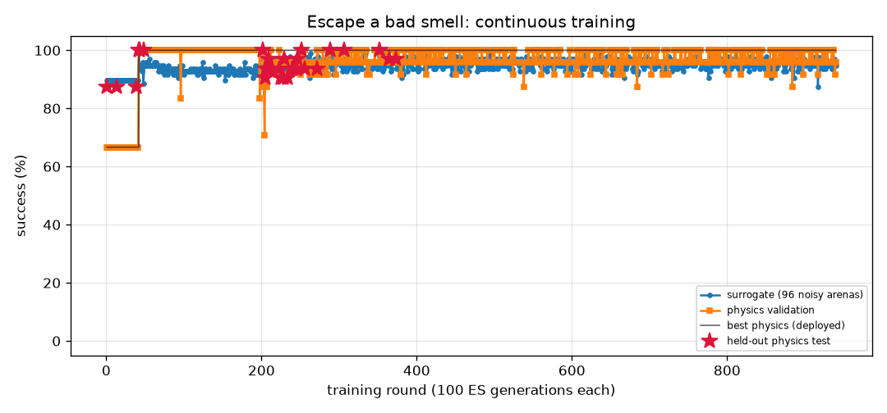

# Escape a bad smell (`odor_avoid`) — training report

*Auto-generated by `train_brains.py`, last updated 2026-11-27T23:35:00.*

| | |
|---|---|
| rounds | 1188 |
| ES generations | 118800 |
| physics runs | 25818 |
| status | **optimal** |
| best brain | round 373: physics validation **100%** on 24 arenas, surrogate 97% |
| held-out physics test | **97%** on 32 unseen arenas (95% CI 84%-99%) (errors: [62.0, 57.4, 62.6, 61.9, 59.0, 61.6, 56.5, 60.7, 31.7, 60.9, 63.1, 57.1, 61.1, 62.1, 61.5, 60.2, 62.2, 55.2, 62.1, 54.2, 61.3, 62.0, 58.0, 61.9, 59.8, 56.5, 56.3, 56.4, 56.3, 57.7, 61.9, 32.4]) |

Physics error per arena: mm gained away from source (> 6 without first approaching it = success).

| round | level | gens | sigma | surrogate | physics val | val errors | test | note |
|---:|---:|---:|---:|---:|---:|---|---:|---|
| 1149 | 3 | 114900 | 0.026 | 96% | 100% | [63.3, 60.7, 56.2, 61.5, 61.8, 62.7, 60.8, 62.1, 61.8, 61.4, 57.6, 61.9, 51.2, 54.4, 40.1, 62.4, 62.1, 62.5, 51.8, 58.2, 61.9, 62.8, 60.0, 62.8] |  | restart from best |
| 1150 | 3 | 115000 | 0.026 | 95% | 100% | [62.1, 57.0, 58.7, 59.7, 62.4, 61.7, 61.4, 57.1, 61.5, 62.0, 62.1, 60.8, 54.6, 58.6, 50.9, 62.3, 61.7, 61.5, 55.1, 56.8, 61.8, 61.3, 59.6, 60.5] |  |  |
| 1151 | 3 | 115100 | 0.027 | 95% | 96% | [62.5, 59.9, 56.2, 60.9, 62.5, 61.8, 61.7, 35.0, 62.2, 60.3, 61.9, 62.2, 52.5, 55.0, 40.3, 61.4, 62.0, 61.0, 54.9, 57.4, 62.2, 60.3, 60.1, 48.2] |  |  |
| 1152 | 3 | 115200 | 0.027 | 92% | 96% | [60.9, 59.9, 56.0, 59.1, 62.0, 61.0, 61.4, 59.6, 61.8, 59.9, 61.9, 61.7, 54.8, 56.2, 15.2, 61.1, 61.5, 61.8, 55.1, 56.9, 61.7, 60.3, 59.3, 60.0] |  |  |
| 1153 | 3 | 115300 | 0.029 | 96% | 96% | [60.3, 56.6, 55.7, 58.4, 57.9, 38.8, 59.5, 43.9, 59.0, 14.6, 11.2, 60.0, 51.2, 54.6, 37.4, 57.8, 60.0, 35.1, 51.4, 56.9, 59.9, 25.4, 58.4, 20.1] |  | restart from best |
| 1154 | 3 | 115400 | 0.026 | 95% | 100% | [62.9, 60.7, 58.0, 60.1, 60.8, 61.5, 61.7, 28.4, 61.8, 46.4, 59.5, 60.2, 52.2, 55.6, 46.1, 62.1, 61.0, 61.3, 53.5, 60.0, 60.3, 50.3, 57.7, 50.1] |  |  |
| 1155 | 3 | 115500 | 0.027 | 97% | 96% | [61.1, 60.1, 58.5, 60.3, 62.3, 61.3, 61.6, 38.2, 61.5, 59.6, 60.6, 61.0, 53.3, 58.4, 44.4, 61.9, 61.1, 60.8, 54.7, 57.0, 61.1, 62.3, 58.9, 55.2] |  |  |
| 1156 | 3 | 115600 | 0.026 | 96% | 100% | [62.2, 56.8, 56.9, 56.9, 62.3, 61.9, 61.2, 59.0, 61.7, 61.6, 62.3, 62.0, 54.7, 58.1, 50.3, 62.7, 61.8, 62.6, 55.1, 56.8, 62.1, 61.5, 58.7, 62.2] |  |  |
| 1157 | 3 | 115700 | 0.026 | 96% | 100% | [60.3, 55.5, 55.7, 57.5, 52.9, 56.3, 61.0, 58.8, 61.1, 58.4, 20.1, 61.0, 15.9, 51.6, 42.9, 60.9, 60.7, 59.9, 47.8, 58.4, 61.2, 60.8, 58.5, 60.9] |  | restart from best |
| 1158 | 3 | 115800 | 0.026 | 97% | 96% | [63.6, 61.4, 56.7, 61.1, 62.7, 62.7, 62.7, 61.4, 59.8, 62.3, 62.4, 62.2, 53.0, 56.5, 21.6, 61.9, 62.0, 61.8, 54.8, 58.2, 61.9, 62.9, 58.4, 61.3] |  |  |
| 1159 | 3 | 115900 | 0.026 | 97% | 92% | [63.4, 61.1, 56.7, 59.4, 62.5, 62.3, 62.0, 59.9, 60.8, 62.3, 62.3, 62.1, 53.5, 56.7, 48.3, 62.0, 62.2, 62.2, 50.5, 56.4, 62.2, 62.4, 59.0, 62.9] |  |  |
| 1160 | 3 | 116000 | 0.026 | 95% | 96% | [63.2, 58.2, 56.7, 61.1, 62.1, 61.8, 61.6, 35.0, 61.5, 60.7, 62.3, 62.4, 53.6, 56.7, 43.5, 62.1, 62.3, 61.1, 51.4, 56.0, 62.4, 62.1, 58.8, 60.0] |  |  |
| 1161 | 3 | 116100 | 0.027 | 96% | 96% | [63.0, 59.2, 56.6, 57.9, 62.4, 61.7, 61.2, 61.1, 60.5, 61.3, 62.5, 61.5, 54.4, 56.4, 52.1, 62.3, 62.4, 61.1, 54.1, 56.6, 61.8, 62.1, 57.6, 62.1] |  | restart from best |
| 1162 | 3 | 116200 | 0.026 | 97% | 96% | [62.8, 59.8, 56.4, 61.0, 61.5, 62.3, 61.7, 23.0, 61.5, 45.2, 35.8, 61.7, 51.3, 55.3, 14.5, 60.8, 62.0, 61.7, 55.1, 57.3, 62.0, 47.0, 59.6, 42.0] |  |  |
| 1163 | 3 | 116300 | 0.026 | 95% | 100% | [62.0, 60.2, 57.9, 59.4, 62.1, 61.7, 60.4, 43.2, 60.9, 61.2, 61.6, 61.5, 54.6, 58.1, 51.7, 61.5, 61.7, 61.3, 54.5, 59.2, 61.5, 61.5, 59.5, 60.8] |  |  |
| 1164 | 3 | 116400 | 0.027 | 94% | 96% | [60.1, 58.1, 55.5, 58.6, 60.4, 60.7, 61.0, 59.7, 60.4, 60.1, 39.1, 60.8, 45.1, 52.9, 28.4, 61.3, 60.5, 60.5, 48.9, 54.0, 60.5, 60.7, 57.2, 60.0] |  |  |
| 1165 | 3 | 116500 | 0.028 | 97% | 92% | [62.8, 59.3, 57.6, 60.2, 60.8, 62.1, 61.7, 59.7, 59.2, 60.3, 61.8, 61.0, 49.9, 57.7, 44.8, 62.0, 61.6, 61.9, 54.9, 59.4, 61.4, 61.2, 60.0, 59.0] |  | restart from best |
| 1166 | 3 | 116600 | 0.026 | 96% | 100% | [63.2, 61.0, 55.8, 61.2, 61.8, 62.4, 61.5, 56.7, 61.8, 61.9, 61.2, 62.0, 54.5, 57.8, 47.3, 62.3, 62.2, 62.5, 55.1, 61.4, 62.4, 60.3, 61.6, 62.9] |  |  |
| 1167 | 3 | 116700 | 0.026 | 93% | 100% | [62.0, 60.3, 57.0, 61.0, 61.9, 61.7, 62.2, 12.0, 62.3, 59.9, 61.0, 61.1, 51.6, 55.5, 45.1, 61.4, 61.7, 61.8, 54.7, 57.2, 61.6, 36.5, 60.0, 27.7] |  |  |
| 1168 | 3 | 116800 | 0.028 | 94% | 96% | [61.8, 59.8, 58.1, 57.9, 61.7, 61.9, 60.2, 58.4, 60.0, 61.8, 62.0, 61.4, 54.9, 58.5, 44.5, 60.9, 61.8, 61.8, 55.2, 56.9, 61.8, 61.6, 57.2, 60.5] |  |  |
| 1169 | 3 | 116900 | 0.028 | 97% | 100% | [63.1, 59.2, 55.8, 59.8, 61.9, 62.1, 61.4, 50.0, 61.1, 44.9, 61.2, 61.8, 48.0, 55.9, 34.8, 61.6, 62.1, 61.3, 51.9, 60.6, 61.8, 59.4, 59.3, 47.0] |  | restart from best |
| 1170 | 3 | 117000 | 0.026 | 94% | 96% | [62.0, 60.8, 56.2, 61.3, 61.2, 62.0, 60.2, 53.5, 62.4, 61.7, 61.2, 62.1, 51.5, 55.9, 43.6, 60.9, 61.8, 62.1, 55.1, 57.7, 61.7, 59.9, 60.3, 60.7] |  |  |
| 1171 | 3 | 117100 | 0.028 | 96% | 96% | [60.5, 55.8, 56.5, 56.3, 61.5, 60.9, 60.6, 34.5, 60.7, 24.3, 53.2, 61.1, 47.4, 55.3, 30.6, 61.0, 61.3, 60.6, 49.5, 55.2, 60.9, 51.2, 60.2, 34.6] |  |  |
| 1172 | 3 | 117200 | 0.026 | 94% | 100% | [62.4, 57.1, 56.6, 61.1, 62.6, 62.8, 60.7, 59.2, 62.0, 62.0, 62.8, 62.0, 54.9, 56.8, 52.3, 63.0, 62.2, 62.7, 53.2, 57.4, 62.1, 61.4, 59.7, 61.7] |  |  |
| 1173 | 3 | 117300 | 0.028 | 97% | 96% | [62.9, 61.5, 56.5, 61.5, 62.7, 61.7, 61.7, 54.5, 60.6, 62.2, 62.2, 62.1, 55.0, 56.3, 48.4, 61.7, 62.5, 61.5, 55.3, 60.0, 62.2, 62.4, 58.3, 60.1] |  | restart from best |
| 1174 | 3 | 117400 | 0.026 | 94% | 96% | [61.3, 60.8, 56.2, 60.9, 61.8, 62.1, 62.0, 61.5, 62.2, 60.4, 50.8, 61.5, 47.4, 53.5, 37.2, 62.2, 61.3, 61.7, 52.2, 60.0, 61.7, 61.8, 57.4, 61.9] |  |  |
| 1175 | 3 | 117500 | 0.028 | 96% | 100% | [59.8, 56.2, 55.8, 56.4, 60.9, 61.8, 60.9, 56.3, 60.9, 60.6, 59.5, 61.5, 52.3, 51.7, 43.3, 61.4, 61.1, 61.4, 52.5, 55.7, 61.6, 60.9, 56.6, 60.8] |  |  |
| 1176 | 3 | 117600 | 0.026 | 96% | 100% | [59.6, 55.6, 54.8, 57.9, 58.1, 58.6, 59.6, 56.4, 59.7, 50.5, 33.6, 58.9, 48.6, 55.2, 28.0, 59.5, 59.4, 58.9, 49.4, 53.1, 59.1, 57.2, 58.2, 57.2] |  |  |
| 1177 | 3 | 117700 | 0.026 | 97% | 100% | [59.3, 54.6, 54.6, 54.0, 58.4, 59.1, 59.1, 56.2, 60.0, 36.3, 53.5, 58.5, 49.4, 55.0, 32.1, 59.9, 59.2, 59.2, 50.3, 51.7, 58.5, 55.2, 56.0, 57.0] |  | restart from best |
| 1178 | 3 | 117800 | 0.026 | 94% | 96% | [62.8, 56.9, 56.5, 59.5, 62.6, 60.8, 61.2, 12.6, 61.4, 21.4, 60.6, 61.8, 50.5, 56.0, 37.5, 62.1, 61.9, 58.4, 55.1, 57.1, 62.0, 41.0, 59.8, 30.8] |  |  |
| 1179 | 3 | 117900 | 0.028 | 97% | 100% | [63.1, 56.2, 56.2, 61.2, 62.2, 62.2, 60.9, 34.7, 60.8, 61.7, 61.7, 62.2, 54.6, 56.0, 48.1, 61.7, 62.0, 60.6, 54.8, 61.2, 62.2, 61.6, 59.5, 61.9] |  |  |
| 1180 | 3 | 118000 | 0.026 | 97% | 92% | [60.5, 58.8, 55.9, 59.4, 60.3, 24.2, 60.7, 54.7, 60.7, 1.5, 49.7, 60.8, 49.3, 55.5, 41.1, 59.6, 60.8, 20.7, 50.3, 57.2, 60.9, 1.8, 59.3, 58.4] |  |  |
| 1181 | 3 | 118100 | 0.026 | 94% | 96% | [60.3, 59.1, 54.7, 59.4, 59.9, 59.1, 60.1, 38.3, 60.1, 47.1, 59.3, 60.1, 52.4, 53.3, 37.2, 58.9, 60.1, 58.7, 54.1, 58.7, 60.2, 59.1, 57.8, 60.4] |  | restart from best |
| 1182 | 3 | 118200 | 0.026 | 97% | 100% | [62.0, 57.2, 56.1, 59.2, 62.2, 61.6, 61.6, 31.9, 62.3, 53.0, 61.3, 61.9, 51.4, 56.0, 51.2, 61.5, 62.1, 61.1, 54.8, 56.7, 62.1, 62.1, 59.9, 58.5] |  |  |
| 1183 | 3 | 118300 | 0.026 | 98% | 96% | [61.6, 60.1, 55.9, 59.6, 61.4, 62.3, 61.9, 53.1, 62.0, 61.9, 50.7, 60.9, 50.6, 55.7, 31.9, 62.1, 61.7, 62.7, 51.1, 57.4, 61.5, 62.0, 59.4, 46.5] |  |  |
| 1184 | 3 | 118400 | 0.025 | 98% | 96% | [60.5, 55.0, 55.9, 58.5, 60.0, 59.9, 59.4, 31.2, 60.7, 39.4, 21.0, 60.6, 47.8, 54.7, 37.3, 52.0, 60.4, 55.3, 48.8, 54.6, 60.5, 44.9, 58.6, 54.0] |  |  |
| 1185 | 3 | 118500 | 0.025 | 96% | 96% | [62.2, 60.2, 56.4, 60.7, 61.3, 62.6, 61.8, 47.8, 62.3, 62.2, 57.9, 61.4, 54.6, 55.8, 40.8, 62.4, 61.9, 62.6, 55.0, 56.4, 61.6, 62.0, 59.7, 61.7] |  | restart from best |
| 1186 | 3 | 118600 | 0.026 | 92% | 96% | [62.3, 57.2, 57.8, 61.3, 61.3, 60.7, 61.5, 45.9, 62.1, 40.3, 60.9, 61.1, 52.2, 58.2, 37.7, 59.8, 61.1, 45.3, 54.6, 59.8, 61.3, 40.0, 60.3, 32.1] |  |  |
| 1187 | 3 | 118700 | 0.029 | 96% | 96% | [62.6, 57.0, 58.1, 59.7, 61.6, 61.9, 61.2, 60.9, 61.5, 61.0, 57.8, 60.1, 52.8, 57.6, 44.0, 62.0, 61.2, 61.6, 54.4, 59.5, 60.5, 61.9, 59.6, 62.8] |  |  |
| 1188 | 3 | 118800 | 0.026 | 94% | 96% | [62.9, 59.4, 58.9, 59.5, 61.7, 62.5, 60.4, 59.7, 61.6, 62.3, 61.4, 60.8, 55.1, 58.2, 49.9, 61.7, 61.4, 62.0, 55.3, 56.8, 61.2, 62.2, 59.6, 61.7] |  |  |
