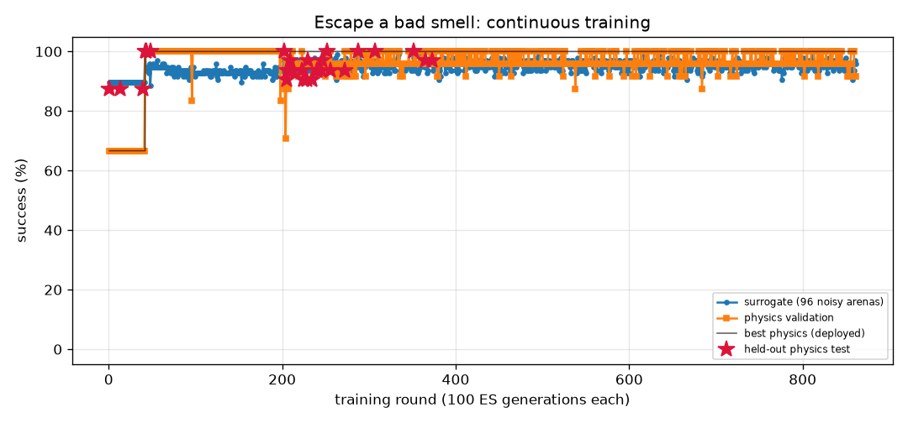

# Escape a bad smell (`odor_avoid`) — training report

*Auto-generated by `train_brains.py`, last updated 2026-11-07T22:00:12.*

| | |
|---|---|
| rounds | 825 |
| ES generations | 82500 |
| physics runs | 17106 |
| status | **optimal** |
| best brain | round 373: physics validation **100%** on 24 arenas, surrogate 97% |
| held-out physics test | **97%** on 32 unseen arenas (95% CI 84%-99%) (errors: [62.0, 57.4, 62.6, 61.9, 59.0, 61.6, 56.5, 60.7, 31.7, 60.9, 63.1, 57.1, 61.1, 62.1, 61.5, 60.2, 62.2, 55.2, 62.1, 54.2, 61.3, 62.0, 58.0, 61.9, 59.8, 56.5, 56.3, 56.4, 56.3, 57.7, 61.9, 32.4]) |

Physics error per arena: mm gained away from source (> 6 without first approaching it = success).

| round | level | gens | sigma | surrogate | physics val | val errors | test | note |
|---:|---:|---:|---:|---:|---:|---|---:|---|
| 786 | 3 | 78600 | 0.026 | 95% | 96% | [63.6, 61.2, 56.4, 55.9, 61.6, 61.9, 60.9, 55.4, 61.6, 58.3, 61.7, 62.0, 52.4, 55.9, 41.2, 60.8, 62.4, 62.1, 55.5, 59.1, 62.4, 59.6, 59.2, 44.6] |  |  |
| 787 | 3 | 78700 | 0.027 | 96% | 100% | [62.6, 61.3, 56.0, 61.2, 60.8, 60.7, 62.2, 61.4, 62.4, 55.7, 42.5, 62.0, 33.9, 55.0, 38.2, 61.6, 62.2, 60.7, 51.3, 59.8, 61.6, 56.4, 61.4, 62.5] |  |  |
| 788 | 3 | 78800 | 0.026 | 95% | 100% | [61.8, 59.5, 56.2, 59.6, 62.8, 61.3, 62.2, 60.0, 62.2, 60.1, 61.4, 62.6, 54.9, 57.6, 51.6, 62.7, 62.2, 62.9, 55.3, 57.3, 62.1, 62.2, 60.7, 62.2] |  |  |
| 789 | 3 | 78900 | 0.027 | 98% | 96% | [60.6, 57.0, 56.2, 57.0, 61.6, 61.1, 60.5, 56.0, 60.6, 58.9, 60.3, 60.8, 50.0, 55.9, 42.0, 61.6, 60.9, 61.1, 53.0, 53.2, 61.0, 57.0, 57.9, 59.4] |  | restart from best |
| 790 | 3 | 79000 | 0.026 | 97% | 96% | [63.2, 61.6, 56.2, 58.8, 62.6, 62.0, 61.8, 50.7, 60.9, 29.8, 61.4, 62.1, 52.2, 52.1, 36.5, 60.4, 62.5, 61.8, 55.5, 60.5, 62.1, 60.3, 55.8, 36.2] |  |  |
| 791 | 3 | 79100 | 0.026 | 96% | 100% | [62.5, 60.9, 56.4, 61.4, 61.5, 62.2, 62.3, 61.4, 62.5, 43.8, 34.5, 61.7, 48.8, 54.3, 34.0, 62.2, 61.8, 62.5, 50.0, 60.8, 61.7, 49.1, 61.1, 62.5] |  |  |
| 792 | 3 | 79200 | 0.026 | 96% | 96% | [63.2, 61.3, 56.5, 61.3, 62.2, 61.8, 62.0, 55.2, 61.8, 61.8, 61.1, 62.0, 54.9, 56.1, 27.5, 61.8, 62.3, 60.3, 55.4, 57.1, 62.1, 62.3, 59.8, 60.2] |  |  |
| 793 | 3 | 79300 | 0.026 | 97% | 96% | [63.0, 59.1, 56.6, 61.5, 61.9, 62.2, 61.1, 41.3, 61.2, 61.8, 61.0, 61.8, 52.7, 56.4, 45.2, 62.0, 62.4, 62.3, 55.8, 57.3, 62.6, 61.4, 59.6, 62.1] |  | restart from best |
| 794 | 3 | 79400 | 0.026 | 96% | 96% | [63.4, 61.1, 57.1, 58.2, 61.4, 62.3, 62.0, 33.1, 60.4, 60.4, 62.0, 61.2, 52.3, 56.2, 38.2, 61.0, 61.7, 61.1, 55.0, 57.3, 61.4, 59.5, 55.9, 42.3] |  |  |
| 795 | 3 | 79500 | 0.026 | 95% | 96% | [62.9, 54.0, 57.9, 57.7, 61.7, 61.4, 61.5, 59.0, 59.8, 60.7, 62.1, 61.0, 54.6, 58.1, 40.3, 62.0, 61.4, 61.9, 55.4, 54.7, 61.3, 61.0, 57.5, 59.2] |  |  |
| 796 | 3 | 79600 | 0.027 | 95% | 100% | [63.4, 59.1, 58.1, 56.6, 62.1, 62.4, 62.1, 59.2, 60.1, 60.9, 58.9, 59.8, 52.6, 55.0, 43.2, 62.8, 60.4, 62.6, 53.9, 54.4, 60.2, 63.2, 57.4, 62.8] |  |  |
| 797 | 3 | 79700 | 0.027 | 96% | 96% | [63.4, 61.6, 55.9, 58.5, 62.4, 62.8, 62.1, 63.1, 60.7, 63.0, 60.0, 61.6, 53.0, 56.7, 33.4, 62.6, 61.4, 62.7, 55.1, 56.0, 61.5, 63.2, 58.5, 63.5] |  | restart from best |
| 798 | 3 | 79800 | 0.026 | 93% | 96% | [59.9, 56.1, 55.6, 59.1, 58.0, 38.2, 60.6, 55.9, 60.7, 28.1, 2.4, 60.5, 39.8, 53.3, 14.5, 41.2, 60.5, 35.2, 48.9, 58.4, 60.6, 24.3, 59.3, 27.5] |  |  |
| 799 | 3 | 79900 | 0.028 | 94% | 100% | [62.2, 57.1, 56.4, 60.7, 62.3, 62.1, 60.8, 60.2, 62.2, 62.3, 62.2, 61.8, 54.8, 53.6, 50.6, 62.5, 62.2, 62.1, 55.0, 57.1, 61.9, 61.9, 60.7, 60.1] |  |  |
| 800 | 3 | 80000 | 0.028 | 97% | 96% | [57.9, 55.3, 53.6, 51.8, 59.3, 57.1, 57.9, 47.9, 57.7, 47.9, 28.9, 58.6, 46.6, 53.0, 0.0, 56.3, 59.3, 54.5, 47.7, 55.1, 58.7, 56.2, 55.3, 56.6] |  |  |
| 801 | 3 | 80100 | 0.026 | 98% | 96% | [60.0, 59.7, 55.9, 56.3, 61.2, 61.1, 60.6, 40.3, 60.7, 60.1, 39.4, 60.9, 48.4, 55.7, 36.2, 59.7, 60.7, 60.0, 51.2, 57.9, 60.7, 60.7, 58.9, 60.0] |  | restart from best |
| 802 | 3 | 80200 | 0.026 | 96% | 92% | [62.8, 61.2, 56.4, 61.6, 60.5, 43.3, 61.7, 2.9, 61.0, 35.4, 3.0, 62.0, 52.3, 56.7, 24.3, 60.1, 62.1, 43.9, 52.1, 61.3, 62.1, 29.7, 61.6, 62.0] |  |  |
| 803 | 3 | 80300 | 0.026 | 94% | 96% | [63.7, 61.5, 57.9, 61.6, 61.2, 60.7, 61.7, 63.1, 60.9, 61.8, 43.5, 60.5, 10.7, 55.2, 47.2, 59.9, 60.9, 60.3, 48.8, 61.1, 60.0, 63.1, 61.7, 63.5] |  |  |
| 804 | 3 | 80400 | 0.028 | 95% | 96% | [62.8, 60.9, 57.5, 61.1, 61.1, 61.5, 61.1, 60.7, 61.4, 54.7, 46.2, 60.9, 33.0, 53.9, 23.5, 62.4, 59.7, 61.3, 50.5, 60.3, 60.8, 62.4, 61.2, 62.9] |  |  |
| 805 | 3 | 80500 | 0.027 | 94% | 100% | [62.5, 58.8, 57.6, 60.3, 60.4, 60.9, 60.7, 53.8, 60.9, 59.5, 60.6, 60.8, 52.3, 56.6, 50.5, 61.2, 60.5, 61.7, 52.7, 56.2, 60.5, 62.5, 59.0, 61.9] |  | restart from best |
| 806 | 3 | 80600 | 0.026 | 96% | 96% | [61.9, 60.7, 56.4, 59.9, 62.2, 61.3, 62.2, 15.9, 61.6, 23.6, 12.7, 61.7, 49.4, 55.9, 38.4, 59.2, 61.5, 59.3, 54.2, 60.3, 61.6, 38.5, 59.8, 45.1] |  |  |
| 807 | 3 | 80700 | 0.026 | 97% | 96% | [60.0, 55.8, 55.7, 59.0, 61.0, 62.0, 61.6, 33.5, 61.1, 42.5, 59.8, 60.8, 51.7, 55.2, 41.7, 61.4, 61.7, 61.9, 54.2, 54.9, 61.4, 57.0, 59.8, 57.2] |  |  |
| 808 | 3 | 80800 | 0.026 | 95% | 96% | [61.9, 60.7, 58.0, 60.7, 61.7, 62.4, 62.3, 58.0, 61.9, 61.3, 60.1, 61.1, 53.0, 55.4, 43.5, 62.2, 61.5, 62.1, 54.5, 58.0, 61.0, 61.1, 56.7, 62.6] |  |  |
| 809 | 3 | 80900 | 0.027 | 95% | 96% | [58.2, 55.8, 54.9, 54.3, 58.6, 59.2, 56.8, 48.2, 55.8, 56.6, 54.9, 58.7, 47.1, 54.1, 37.4, 59.0, 59.4, 59.1, 50.1, 54.2, 59.2, 56.5, 51.3, 54.0] |  | restart from best |
| 810 | 3 | 81000 | 0.026 | 97% | 100% | [62.4, 60.9, 56.5, 59.8, 62.3, 62.2, 61.7, 52.7, 61.7, 42.3, 33.5, 61.8, 50.8, 55.6, 7.4, 60.2, 61.7, 61.6, 54.9, 55.8, 61.8, 58.6, 59.8, 60.1] |  |  |
| 811 | 3 | 81100 | 0.026 | 100% | 100% | [61.2, 60.6, 56.1, 59.1, 60.9, 61.6, 60.4, 30.3, 61.5, 57.8, 26.6, 61.5, 48.2, 56.1, 40.7, 60.6, 61.7, 61.7, 50.4, 59.0, 61.2, 40.7, 59.5, 61.2] |  |  |
| 812 | 3 | 81200 | 0.024 | 95% | 100% | [61.9, 60.8, 55.9, 59.7, 62.0, 61.7, 60.4, 58.2, 61.6, 44.9, 47.3, 61.6, 49.6, 55.8, 13.0, 60.9, 61.9, 60.4, 50.0, 59.6, 61.9, 61.0, 59.4, 48.8] |  |  |
| 813 | 3 | 81300 | 0.027 | 95% | 100% | [61.1, 57.5, 55.5, 57.8, 59.9, 61.4, 61.4, 58.3, 61.2, 53.1, 46.7, 61.1, 44.2, 52.9, 32.0, 59.2, 60.7, 61.1, 45.3, 53.9, 60.7, 60.8, 58.4, 61.0] |  | restart from best |
| 814 | 3 | 81400 | 0.026 | 94% | 96% | [62.5, 61.0, 55.9, 60.7, 60.4, 62.4, 62.3, 60.2, 62.1, 60.6, 53.8, 62.1, 52.2, 57.2, 43.1, 62.3, 62.1, 62.5, 55.0, 59.3, 62.3, 49.7, 61.0, 61.6] |  |  |
| 815 | 3 | 81500 | 0.028 | 94% | 96% | [62.8, 60.6, 55.9, 61.6, 62.9, 62.7, 60.9, 43.3, 61.0, 60.4, 62.4, 62.2, 55.4, 57.8, 42.4, 62.0, 62.2, 61.9, 55.2, 57.3, 61.5, 62.0, 61.1, 60.7] |  |  |
| 816 | 3 | 81600 | 0.028 | 94% | 96% | [62.1, 59.3, 58.5, 59.5, 60.6, 60.3, 59.6, 38.7, 60.3, 45.4, 58.2, 60.9, 53.0, 55.4, 38.1, 60.4, 61.4, 60.4, 54.1, 56.7, 61.1, 35.9, 60.0, 43.7] |  |  |
| 817 | 3 | 81700 | 0.028 | 93% | 100% | [60.7, 59.9, 56.4, 60.0, 60.2, 60.8, 62.0, 39.6, 61.6, 52.0, 20.1, 61.1, 51.5, 55.5, 17.1, 60.4, 61.7, 60.5, 51.6, 58.8, 61.1, 56.4, 57.3, 60.4] |  | restart from best |
| 818 | 3 | 81800 | 0.026 | 94% | 92% | [62.3, 55.5, 56.0, 61.0, 61.4, 61.6, 61.5, 2.7, 60.6, 54.0, 61.3, 61.2, 52.0, 54.6, 32.6, 61.4, 62.0, 61.8, 54.9, 55.2, 61.9, 23.1, 61.0, 14.4] |  |  |
| 819 | 3 | 81900 | 0.028 | 94% | 100% | [63.4, 61.2, 56.1, 61.6, 60.8, 61.7, 61.9, 55.5, 60.2, 54.7, 61.7, 61.7, 52.1, 54.5, 44.3, 60.7, 62.2, 61.7, 54.8, 60.9, 61.8, 57.3, 61.1, 62.7] |  |  |
| 820 | 3 | 82000 | 0.028 | 95% | 96% | [63.1, 55.0, 56.3, 61.3, 60.6, 40.0, 60.6, 35.8, 60.5, 17.5, 59.8, 61.3, 50.8, 54.1, 30.1, 59.1, 61.4, 57.7, 55.0, 58.3, 61.4, 25.4, 60.9, 36.5] |  |  |
| 821 | 3 | 82100 | 0.027 | 97% | 96% | [62.6, 56.2, 56.3, 56.3, 61.4, 61.6, 60.2, 49.4, 60.2, 61.2, 61.7, 61.3, 55.0, 56.0, 42.2, 60.9, 61.6, 61.8, 54.8, 58.0, 61.3, 60.4, 60.9, 62.0] |  | restart from best |
| 822 | 3 | 82200 | 0.026 | 97% | 100% | [63.3, 61.1, 57.4, 57.0, 62.3, 60.7, 61.8, 55.7, 60.8, 60.3, 62.1, 61.6, 55.2, 57.7, 45.1, 62.0, 62.4, 61.8, 54.9, 58.4, 62.4, 60.6, 58.4, 57.4] |  |  |
| 823 | 3 | 82300 | 0.026 | 96% | 100% | [63.1, 61.0, 56.3, 59.4, 60.6, 60.8, 61.8, 24.9, 61.2, 52.4, 57.1, 61.5, 49.1, 55.6, 33.1, 61.4, 61.6, 59.3, 52.4, 56.1, 61.4, 51.7, 59.0, 62.5] |  |  |
| 824 | 3 | 82400 | 0.026 | 95% | 96% | [62.5, 59.9, 57.7, 60.9, 61.7, 60.0, 61.3, 51.8, 60.5, 57.2, 61.6, 61.2, 53.9, 55.5, 41.3, 62.1, 61.4, 61.6, 54.9, 56.8, 61.4, 59.7, 58.2, 47.3] |  |  |
| 825 | 3 | 82500 | 0.027 | 97% | 96% | [62.9, 60.4, 58.1, 58.6, 61.7, 60.8, 60.4, 17.3, 60.5, 53.6, 60.8, 61.1, 51.8, 55.2, 45.6, 60.3, 61.2, 60.0, 54.8, 56.7, 61.6, 48.2, 58.2, 26.8] |  | restart from best |
