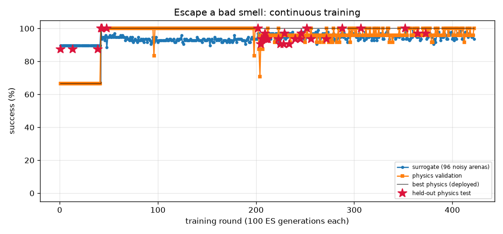

# Escape a bad smell (`odor_avoid`) — training report

*Auto-generated by `train_brains.py`, last updated 2026-10-15T21:32:44.*

| | |
|---|---|
| rounds | 484 |
| ES generations | 48400 |
| physics runs | 8922 |
| status | **optimal** |
| best brain | round 373: physics validation **100%** on 24 arenas, surrogate 97% |
| held-out physics test | **97%** on 32 unseen arenas (95% CI 84%-99%) (errors: [62.0, 57.4, 62.6, 61.9, 59.0, 61.6, 56.5, 60.7, 31.7, 60.9, 63.1, 57.1, 61.1, 62.1, 61.5, 60.2, 62.2, 55.2, 62.1, 54.2, 61.3, 62.0, 58.0, 61.9, 59.8, 56.5, 56.3, 56.4, 56.3, 57.7, 61.9, 32.4]) |

Physics error per arena: mm gained away from source (> 6 without first approaching it = success).

| round | level | gens | sigma | surrogate | physics val | val errors | test | note |
|---:|---:|---:|---:|---:|---:|---|---:|---|
| 445 | 3 | 44500 | 0.025 | 92% | 100% | [60.1, 55.8, 57.2, 59.3, 61.0, 60.9, 59.9, 59.0, 59.3, 60.9, 61.6, 60.8, 54.8, 58.0, 50.8, 61.2, 60.9, 60.6, 55.1, 55.8, 60.9, 61.4, 56.8, 60.3] |  | restart from best |
| 446 | 3 | 44600 | 0.026 | 94% | 96% | [63.4, 57.3, 57.8, 61.3, 62.1, 60.8, 60.7, 40.6, 61.1, 55.9, 61.9, 60.6, 51.9, 58.7, 41.4, 60.9, 61.5, 60.4, 55.3, 59.5, 61.4, 58.6, 59.7, 51.7] |  |  |
| 447 | 3 | 44700 | 0.028 | 95% | 96% | [63.5, 61.7, 57.3, 56.3, 61.2, 61.6, 60.8, 52.9, 61.1, 59.8, 62.0, 61.1, 52.1, 56.3, 45.0, 62.6, 61.6, 62.5, 55.0, 58.9, 61.7, 61.6, 59.4, 62.6] |  |  |
| 448 | 3 | 44800 | 0.027 | 98% | 100% | [63.0, 58.1, 58.4, 58.7, 61.8, 62.4, 61.5, 57.1, 60.0, 61.3, 62.0, 61.3, 54.6, 55.9, 43.4, 61.5, 61.6, 62.5, 55.3, 54.8, 61.1, 61.7, 57.7, 60.7] |  |  |
| 449 | 3 | 44900 | 0.025 | 96% | 100% | [63.6, 59.6, 57.8, 59.4, 61.9, 63.0, 61.0, 59.1, 61.2, 62.6, 62.4, 61.8, 54.7, 58.8, 46.4, 62.5, 61.5, 62.4, 55.5, 58.4, 61.5, 62.9, 59.3, 60.8] |  | restart from best |
| 450 | 3 | 45000 | 0.026 | 98% | 92% | [62.9, 57.3, 55.8, 58.5, 61.6, 57.3, 61.2, 2.8, 60.6, 9.6, 61.7, 61.8, 54.8, 55.7, 27.0, 61.5, 61.6, 60.6, 55.2, 55.6, 61.5, 42.2, 57.9, 4.8] |  |  |
| 451 | 3 | 45100 | 0.025 | 94% | 96% | [63.1, 61.5, 55.8, 61.2, 61.7, 61.1, 61.6, 63.1, 61.0, 55.4, 47.3, 62.1, 47.3, 53.9, 31.0, 61.0, 61.6, 60.3, 53.7, 61.4, 62.1, 63.0, 59.7, 63.1] |  |  |
| 452 | 3 | 45200 | 0.028 | 94% | 96% | [62.6, 55.9, 57.7, 56.7, 60.9, 61.2, 60.7, 52.1, 59.4, 50.4, 60.1, 59.9, 52.7, 55.4, 25.3, 60.6, 60.8, 60.5, 54.1, 57.2, 60.1, 44.3, 58.0, 51.8] |  |  |
| 453 | 3 | 45300 | 0.028 | 93% | 96% | [63.4, 60.4, 58.4, 57.9, 60.6, 62.2, 61.4, 58.0, 60.4, 57.7, 58.7, 59.7, 50.8, 57.6, 40.3, 62.1, 60.5, 61.8, 54.8, 57.5, 59.9, 59.0, 57.6, 61.7] |  | restart from best |
| 454 | 3 | 45400 | 0.026 | 97% | 96% | [64.0, 61.2, 56.3, 58.7, 62.2, 62.7, 62.9, 60.5, 60.9, 61.9, 62.2, 62.1, 55.0, 56.3, 38.5, 62.0, 62.3, 61.9, 56.0, 57.5, 62.5, 62.2, 56.7, 60.7] |  |  |
| 455 | 3 | 45500 | 0.026 | 98% | 96% | [62.9, 60.6, 56.2, 58.8, 61.8, 61.1, 61.4, 32.2, 60.8, 45.0, 61.7, 62.2, 55.0, 55.8, 46.2, 62.2, 62.1, 39.5, 55.1, 60.4, 61.8, 36.3, 58.5, 45.2] |  |  |
| 456 | 3 | 45600 | 0.025 | 96% | 100% | [62.2, 60.1, 56.7, 60.6, 62.0, 60.1, 61.6, 54.4, 62.0, 37.0, 61.1, 61.9, 55.0, 56.5, 50.4, 62.5, 62.1, 62.2, 55.4, 56.8, 62.3, 62.2, 60.7, 61.8] |  |  |
| 457 | 3 | 45700 | 0.026 | 93% | 100% | [60.8, 59.3, 52.1, 58.4, 60.1, 60.8, 61.0, 59.1, 61.4, 59.3, 55.1, 59.1, 24.3, 49.3, 40.9, 56.9, 37.9, 55.6, 44.1, 59.1, 54.9, 60.5, 58.7, 59.2] |  | restart from best |
| 458 | 3 | 45800 | 0.026 | 95% | 100% | [61.6, 60.3, 56.8, 60.7, 61.6, 60.4, 60.5, 59.8, 61.6, 52.8, 60.5, 61.3, 54.6, 57.6, 50.6, 61.5, 61.6, 61.7, 54.9, 60.0, 61.9, 61.5, 56.9, 61.9] |  |  |
| 459 | 3 | 45900 | 0.027 | 97% | 100% | [63.2, 61.4, 57.9, 61.7, 61.6, 60.8, 62.0, 53.1, 60.7, 61.1, 62.4, 62.1, 54.8, 55.8, 42.5, 61.8, 62.2, 62.5, 55.1, 60.1, 62.0, 60.0, 61.5, 59.5] |  |  |
| 460 | 3 | 46000 | 0.026 | 96% | 100% | [62.5, 61.1, 56.2, 57.1, 62.4, 62.2, 61.5, 54.2, 62.2, 52.5, 57.8, 61.4, 51.1, 55.0, 39.3, 60.9, 62.2, 61.5, 54.7, 59.6, 61.8, 62.1, 61.4, 56.7] |  |  |
| 461 | 3 | 46100 | 0.026 | 95% | 96% | [62.2, 60.1, 56.0, 61.3, 62.5, 61.7, 61.8, 60.8, 62.2, 61.7, 61.9, 62.5, 55.0, 56.0, 48.9, 63.0, 62.5, 62.8, 55.5, 56.6, 62.5, 61.6, 60.4, 62.5] |  | restart from best |
| 462 | 3 | 46200 | 0.026 | 95% | 100% | [60.6, 56.2, 57.7, 59.7, 61.9, 59.6, 60.5, 39.5, 61.0, 61.1, 60.1, 61.2, 54.4, 57.9, 48.0, 61.0, 61.9, 61.7, 54.2, 55.9, 60.6, 60.8, 58.3, 38.7] |  |  |
| 463 | 3 | 46300 | 0.027 | 94% | 100% | [60.4, 53.3, 55.8, 53.7, 59.2, 59.5, 60.1, 56.7, 60.1, 59.7, 56.5, 60.6, 49.2, 53.2, 29.4, 56.1, 60.8, 58.4, 48.9, 52.4, 61.0, 58.4, 57.8, 57.1] |  |  |
| 464 | 3 | 46400 | 0.028 | 97% | 92% | [60.3, 59.0, 55.9, 59.6, 60.7, 62.1, 61.1, 39.1, 60.9, 61.5, 60.2, 61.0, 50.5, 56.0, 44.0, 61.9, 61.5, 62.1, 54.6, 57.9, 61.3, 60.4, 56.8, 60.4] |  |  |
| 465 | 3 | 46500 | 0.026 | 95% | 100% | [60.1, 58.1, 55.3, 56.4, 58.2, 57.5, 60.5, 58.8, 60.2, 55.7, 27.3, 60.4, 46.1, 52.8, 35.9, 60.1, 60.2, 56.4, 49.0, 56.9, 60.5, 58.3, 55.0, 58.5] |  | restart from best |
| 466 | 3 | 46600 | 0.026 | 95% | 96% | [62.6, 61.2, 55.8, 61.5, 61.8, 60.4, 60.8, 43.0, 61.1, 44.4, 61.9, 61.9, 54.9, 56.0, 41.0, 61.8, 61.9, 61.7, 55.1, 60.1, 62.0, 50.5, 59.3, 35.0] |  |  |
| 467 | 3 | 46700 | 0.027 | 93% | 100% | [62.7, 58.2, 55.9, 60.5, 62.3, 61.6, 61.2, 60.9, 60.5, 60.9, 62.0, 62.0, 55.0, 56.6, 52.3, 61.8, 62.3, 61.3, 55.6, 56.7, 62.3, 60.9, 57.9, 61.7] |  |  |
| 468 | 3 | 46800 | 0.028 | 97% | 100% | [63.7, 61.2, 56.2, 61.4, 62.2, 59.4, 62.0, 34.0, 59.9, 56.5, 61.4, 62.1, 52.4, 53.8, 46.1, 60.6, 61.9, 59.0, 54.9, 59.8, 62.3, 36.1, 58.5, 50.6] |  |  |
| 469 | 3 | 46900 | 0.026 | 96% | 96% | [63.4, 58.4, 58.6, 61.2, 62.0, 60.6, 61.8, 55.5, 59.9, 58.6, 61.8, 61.0, 54.3, 55.5, 41.1, 60.8, 61.6, 60.6, 55.1, 60.0, 61.1, 59.9, 60.9, 54.7] |  | restart from best |
| 470 | 3 | 47000 | 0.026 | 95% | 100% | [63.5, 59.0, 56.1, 59.1, 61.9, 62.1, 61.7, 47.9, 60.7, 58.0, 62.0, 62.4, 54.2, 56.7, 43.4, 60.7, 62.4, 60.7, 55.4, 60.0, 62.0, 46.6, 56.0, 38.0] |  |  |
| 471 | 3 | 47100 | 0.027 | 98% | 100% | [63.7, 61.2, 56.0, 58.7, 61.6, 62.1, 62.2, 57.3, 60.8, 60.6, 62.6, 61.9, 55.1, 58.1, 41.3, 62.5, 61.8, 62.2, 55.3, 56.0, 61.9, 60.6, 58.8, 54.7] |  |  |
| 472 | 3 | 47200 | 0.025 | 97% | 96% | [63.1, 61.7, 53.0, 61.4, 62.1, 62.8, 61.8, 63.5, 61.6, 62.9, 31.6, 61.4, 50.5, 54.9, 40.4, 62.4, 61.7, 62.5, 53.3, 61.1, 61.3, 63.3, 61.6, 63.6] |  |  |
| 473 | 3 | 47300 | 0.026 | 97% | 100% | [62.5, 61.0, 55.6, 60.5, 61.9, 62.6, 62.3, 63.2, 62.4, 62.5, 53.8, 61.6, 47.0, 55.8, 34.8, 62.2, 61.9, 57.3, 50.3, 60.8, 61.8, 62.8, 60.5, 63.1] |  | restart from best |
| 474 | 3 | 47400 | 0.026 | 96% | 96% | [63.0, 61.4, 55.2, 61.0, 61.0, 61.9, 61.0, 62.4, 61.6, 61.0, 50.9, 61.0, 49.1, 54.9, 33.6, 60.1, 61.3, 60.6, 52.8, 61.2, 61.2, 62.8, 59.6, 62.8] |  |  |
| 475 | 3 | 47500 | 0.026 | 96% | 96% | [63.2, 60.9, 52.0, 58.3, 60.2, 59.1, 61.7, 62.6, 60.0, 42.4, 53.6, 60.9, 50.2, 55.1, 40.6, 59.4, 61.0, 58.5, 47.8, 58.3, 61.0, 62.2, 58.5, 62.9] |  |  |
| 476 | 3 | 47600 | 0.026 | 97% | 100% | [63.6, 61.0, 56.2, 58.1, 62.0, 62.3, 62.1, 58.9, 60.0, 61.4, 61.7, 62.1, 55.1, 56.0, 45.8, 61.7, 62.0, 61.3, 55.7, 59.6, 62.2, 61.6, 56.0, 59.5] |  |  |
| 477 | 3 | 47700 | 0.026 | 96% | 100% | [62.6, 59.3, 55.9, 59.2, 61.5, 60.6, 60.8, 37.9, 61.3, 57.5, 61.5, 60.7, 52.8, 55.8, 48.5, 60.7, 61.0, 60.2, 55.2, 59.9, 61.1, 60.9, 59.4, 61.0] |  | restart from best |
| 478 | 3 | 47800 | 0.026 | 93% | 100% | [63.6, 55.7, 55.9, 57.1, 61.0, 60.4, 61.5, 41.5, 59.9, 40.7, 50.3, 61.7, 47.5, 55.5, 34.5, 62.0, 62.0, 60.5, 51.6, 57.5, 61.8, 54.6, 58.5, 62.5] |  |  |
| 479 | 3 | 47900 | 0.028 | 95% | 96% | [63.1, 57.6, 55.7, 57.8, 62.1, 60.8, 61.5, 20.1, 60.3, 55.7, 61.6, 61.5, 52.2, 56.1, 32.3, 60.3, 61.7, 60.8, 55.3, 57.5, 61.6, 59.2, 55.8, 54.6] |  |  |
| 480 | 3 | 48000 | 0.027 | 95% | 96% | [62.6, 60.6, 56.4, 61.4, 61.8, 60.7, 61.7, 58.3, 61.7, 60.5, 61.9, 62.2, 54.5, 55.4, 36.6, 62.2, 61.9, 61.8, 54.9, 59.7, 62.0, 62.1, 61.3, 60.4] |  |  |
| 481 | 3 | 48100 | 0.027 | 97% | 96% | [61.3, 59.8, 55.7, 59.3, 61.8, 60.9, 61.6, 40.0, 61.9, 60.2, 61.1, 61.7, 54.1, 56.0, 45.0, 62.0, 61.6, 61.3, 55.2, 56.6, 61.6, 53.5, 60.5, 41.9] |  | restart from best |
| 482 | 3 | 48200 | 0.026 | 94% | 96% | [63.4, 61.1, 56.0, 58.7, 61.3, 59.2, 61.9, 13.6, 60.2, 42.4, 60.9, 62.1, 52.5, 56.2, 39.1, 60.5, 62.5, 58.3, 55.3, 60.0, 62.2, 59.3, 58.9, 44.1] |  |  |
| 483 | 3 | 48300 | 0.028 | 94% | 96% | [63.6, 61.5, 56.4, 61.3, 60.5, 60.9, 62.2, 52.1, 60.5, 57.5, 61.8, 61.8, 52.9, 51.5, 39.2, 61.1, 62.2, 61.0, 55.2, 56.4, 62.4, 58.4, 58.7, 62.7] |  |  |
| 484 | 3 | 48400 | 0.028 | 95% | 100% | [62.8, 57.8, 56.3, 59.9, 61.9, 61.1, 60.9, 48.8, 61.7, 58.6, 61.9, 61.9, 54.7, 56.1, 45.0, 61.5, 61.8, 61.0, 55.0, 59.3, 61.7, 57.4, 59.7, 56.6] |  |  |
