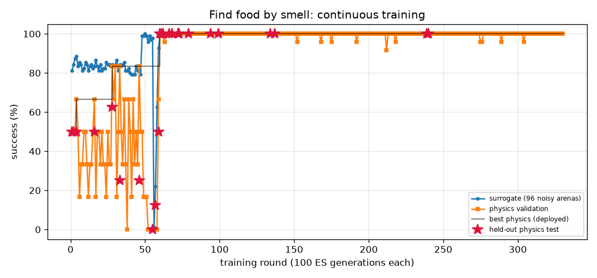

# Find food by smell (`odor_seek`) — training report

*Auto-generated by `train_brains.py`, last updated 2026-11-23T00:07:42.*

| | |
|---|---|
| rounds | 314 |
| ES generations | 31400 |
| physics runs | 7030 |
| status | **optimal** |
| best brain | round 240: physics validation **100%** on 24 arenas, surrogate 100% |
| held-out physics test | **100%** on 32 unseen arenas (95% CI 89%-100%) (errors: [0.02, 0.03, 0.03, 0.05, 0.04, 0.05, 0.06, 0.07, 0.09, 0.05, 0.05, 0.01, 0.12, 0.03, 0.07, 0.08, 0.02, 0.06, 0.03, 0.04, 0.0, 0.01, 0.09, 0.05, 0.04, 0.01, 0.07, 0.05, 0.08, 0.05, 0.05, 0.02]) |

Physics error per arena: mm from target at the end (< 1.5 and standing still = success).

| round | level | gens | sigma | surrogate | physics val | val errors | test | note |
|---:|---:|---:|---:|---:|---:|---|---:|---|
| 275 | 3 | 27500 | 0.024 | 100% | 96% | [0.15, 0.14, 0.14, 0.2, 0.21, 0.19, 0.15, 0.14, 0.13, 0.14, 18.03, 0.14, 0.19, 0.14, 0.14, 0.17, 0.18, 0.16, 0.18, 0.2, 0.1, 0.15, 0.15, 0.16] |  |  |
| 276 | 3 | 27600 | 0.024 | 100% | 96% | [0.07, 0.1, 0.16, 0.11, 0.08, 0.06, 0.12, 0.08, 0.17, 0.15, 23.03, 0.18, 0.18, 0.12, 0.14, 0.17, 0.06, 0.07, 0.12, 0.11, 0.1, 0.17, 0.03, 0.17] |  | restart from best |
| 277 | 3 | 27700 | 0.024 | 100% | 100% | [0.18, 0.15, 0.14, 0.2, 0.14, 0.11, 0.17, 0.2, 0.19, 0.2, 0.15, 0.11, 0.2, 0.17, 0.09, 0.17, 0.25, 0.15, 0.13, 0.23, 0.18, 0.14, 0.11, 0.11] |  |  |
| 278 | 3 | 27800 | 0.024 | 100% | 100% | [0.19, 0.15, 0.17, 0.19, 0.15, 0.12, 0.17, 0.26, 0.19, 0.23, 0.23, 0.16, 0.19, 0.26, 0.22, 0.15, 0.19, 0.16, 0.18, 0.19, 0.17, 0.25, 0.24, 0.16] |  |  |
| 279 | 3 | 27900 | 0.024 | 100% | 100% | [0.23, 0.22, 0.19, 0.22, 0.17, 0.16, 0.21, 0.19, 0.29, 0.19, 0.26, 0.27, 0.16, 0.24, 0.19, 0.24, 0.2, 0.3, 0.17, 0.2, 0.3, 0.24, 0.2, 0.16] |  |  |
| 280 | 3 | 28000 | 0.024 | 100% | 100% | [0.19, 0.24, 0.19, 0.24, 0.21, 0.17, 0.21, 0.12, 0.21, 0.24, 0.24, 0.23, 0.19, 0.2, 0.24, 0.25, 0.19, 0.28, 0.21, 0.22, 0.17, 0.23, 0.17, 0.19] |  | restart from best |
| 281 | 3 | 28100 | 0.024 | 100% | 100% | [0.1, 0.04, 0.08, 0.1, 0.09, 0.07, 0.11, 0.2, 0.21, 0.05, 0.06, 0.04, 0.09, 0.11, 0.15, 0.07, 0.06, 0.1, 0.09, 0.12, 0.03, 0.08, 0.05, 0.13] |  |  |
| 282 | 3 | 28200 | 0.024 | 100% | 100% | [0.24, 0.19, 0.2, 0.11, 0.18, 0.21, 0.23, 0.15, 0.12, 0.11, 0.21, 0.23, 0.2, 0.19, 0.29, 0.19, 0.17, 0.23, 0.13, 0.18, 0.12, 0.11, 0.19, 0.23] |  |  |
| 283 | 3 | 28300 | 0.024 | 100% | 100% | [0.22, 0.18, 0.16, 0.12, 0.18, 0.22, 0.15, 0.16, 0.16, 0.19, 0.22, 0.13, 0.16, 0.2, 0.16, 0.13, 0.15, 0.16, 0.14, 0.15, 0.2, 0.17, 0.21, 0.18] |  |  |
| 284 | 3 | 28400 | 0.024 | 100% | 100% | [0.09, 0.15, 0.15, 0.15, 0.11, 0.2, 0.22, 0.11, 0.06, 0.22, 0.04, 0.07, 0.2, 0.13, 0.09, 0.11, 0.07, 0.18, 0.13, 0.12, 0.06, 0.13, 0.15, 0.13] |  | restart from best |
| 285 | 3 | 28500 | 0.024 | 100% | 100% | [0.15, 0.15, 0.17, 0.19, 0.15, 0.13, 0.14, 0.18, 0.17, 0.14, 0.14, 0.14, 0.1, 0.12, 0.13, 0.13, 0.19, 0.17, 0.13, 0.16, 0.12, 0.07, 0.18, 0.15] |  |  |
| 286 | 3 | 28600 | 0.024 | 100% | 100% | [0.15, 0.15, 0.15, 0.15, 0.16, 0.17, 0.21, 0.17, 0.12, 0.19, 0.07, 0.13, 0.21, 0.11, 0.14, 0.19, 0.14, 0.12, 0.11, 0.15, 0.2, 0.21, 0.21, 0.11] |  |  |
| 287 | 3 | 28700 | 0.024 | 100% | 100% | [0.18, 0.25, 0.18, 0.2, 0.24, 0.22, 0.18, 0.21, 0.19, 0.24, 0.22, 0.18, 0.18, 0.19, 0.2, 0.27, 0.22, 0.22, 0.23, 0.22, 0.19, 0.16, 0.25, 0.24] |  |  |
| 288 | 3 | 28800 | 0.024 | 100% | 100% | [0.19, 0.17, 0.17, 0.2, 0.17, 0.22, 0.17, 0.17, 0.15, 0.2, 0.17, 0.22, 0.17, 0.17, 0.21, 0.19, 0.15, 0.19, 0.19, 0.23, 0.16, 0.18, 0.22, 0.14] |  | restart from best |
| 289 | 3 | 28900 | 0.024 | 100% | 96% | [0.11, 0.11, 0.1, 0.11, 0.09, 0.18, 0.06, 0.21, 0.12, 0.07, 13.19, 0.11, 0.04, 0.17, 0.16, 0.14, 0.06, 0.13, 0.14, 0.17, 0.05, 0.08, 0.09, 0.05] |  |  |
| 290 | 3 | 29000 | 0.024 | 100% | 100% | [0.05, 0.12, 0.15, 0.18, 0.33, 0.06, 0.14, 0.18, 0.08, 0.01, 0.15, 0.06, 0.07, 0.25, 0.1, 0.07, 0.13, 0.32, 0.18, 0.13, 0.15, 0.14, 0.06, 0.08] |  |  |
| 291 | 3 | 29100 | 0.024 | 100% | 100% | [0.18, 0.14, 0.12, 0.09, 0.09, 0.11, 0.14, 0.23, 0.14, 0.18, 0.17, 0.15, 0.16, 0.11, 0.13, 0.16, 0.13, 0.1, 0.18, 0.24, 0.13, 0.2, 0.09, 0.13] |  |  |
| 292 | 3 | 29200 | 0.024 | 100% | 100% | [0.06, 0.08, 0.07, 0.17, 0.18, 0.14, 0.07, 0.06, 0.05, 0.1, 0.18, 0.15, 0.15, 0.16, 0.08, 0.16, 0.05, 0.12, 0.06, 0.14, 0.12, 0.05, 0.13, 0.05] |  | restart from best |
| 293 | 3 | 29300 | 0.024 | 100% | 100% | [0.19, 0.09, 0.15, 0.21, 0.17, 0.17, 0.17, 0.19, 0.18, 0.1, 0.17, 0.15, 0.26, 0.18, 0.11, 0.11, 0.19, 0.14, 0.16, 0.13, 0.13, 0.06, 0.2, 0.14] |  |  |
| 294 | 3 | 29400 | 0.024 | 100% | 100% | [0.21, 0.13, 0.13, 0.17, 0.23, 0.1, 0.16, 0.24, 0.28, 0.18, 0.15, 0.13, 0.17, 0.19, 0.22, 0.12, 0.15, 0.19, 0.15, 0.18, 0.17, 0.12, 0.29, 0.13] |  |  |
| 295 | 3 | 29500 | 0.024 | 100% | 100% | [0.2, 0.19, 0.16, 0.21, 0.25, 0.19, 0.28, 0.21, 0.17, 0.18, 0.19, 0.28, 0.18, 0.15, 0.18, 0.19, 0.2, 0.26, 0.22, 0.18, 0.2, 0.16, 0.2, 0.15] |  |  |
| 296 | 3 | 29600 | 0.024 | 100% | 100% | [0.15, 0.26, 0.21, 0.2, 0.14, 0.14, 0.06, 0.21, 0.11, 0.13, 0.13, 0.1, 0.13, 0.2, 0.04, 0.12, 0.14, 0.11, 0.14, 0.21, 0.21, 0.06, 0.19, 0.25] |  | restart from best |
| 297 | 3 | 29700 | 0.024 | 100% | 100% | [0.24, 0.23, 0.15, 0.17, 0.19, 0.18, 0.21, 0.15, 0.2, 0.16, 0.2, 0.18, 0.17, 0.18, 0.26, 0.19, 0.19, 0.15, 0.18, 0.23, 0.2, 0.19, 0.24, 0.25] |  |  |
| 298 | 3 | 29800 | 0.024 | 100% | 100% | [0.13, 0.18, 0.19, 0.15, 0.07, 0.16, 0.19, 0.14, 0.09, 0.16, 0.15, 0.06, 0.12, 0.19, 0.21, 0.16, 0.12, 0.2, 0.08, 0.23, 0.18, 0.18, 0.18, 0.05] |  |  |
| 299 | 3 | 29900 | 0.024 | 100% | 100% | [0.11, 0.02, 0.11, 0.22, 0.13, 0.1, 0.13, 0.2, 0.12, 0.14, 0.15, 0.02, 0.04, 0.07, 0.07, 0.11, 0.12, 0.11, 0.1, 0.13, 0.13, 0.19, 0.14, 0.13] |  |  |
| 300 | 3 | 30000 | 0.024 | 100% | 100% | [0.2, 0.12, 0.04, 0.13, 0.25, 0.05, 0.2, 0.13, 0.08, 0.11, 0.1, 0.11, 0.18, 0.08, 0.17, 0.11, 0.11, 0.11, 0.12, 0.12, 0.18, 0.18, 0.18, 0.21] |  | restart from best |
| 301 | 3 | 30100 | 0.024 | 100% | 100% | [0.09, 0.09, 0.14, 0.07, 0.09, 0.09, 0.04, 0.17, 0.11, 0.06, 0.04, 0.09, 0.08, 0.11, 0.07, 0.05, 0.08, 0.11, 0.11, 0.13, 0.12, 0.09, 0.12, 0.14] |  |  |
| 302 | 3 | 30200 | 0.024 | 100% | 100% | [0.18, 0.14, 0.15, 0.12, 0.2, 0.13, 0.07, 0.1, 0.13, 0.11, 0.23, 0.13, 0.13, 0.12, 0.14, 0.15, 0.19, 0.12, 0.12, 0.22, 0.1, 0.14, 0.13, 0.13] |  |  |
| 303 | 3 | 30300 | 0.024 | 100% | 100% | [0.12, 0.15, 0.12, 0.12, 0.21, 0.14, 0.24, 0.12, 0.14, 0.12, 0.09, 0.14, 0.19, 0.12, 0.15, 0.14, 0.12, 0.12, 0.13, 0.05, 0.14, 0.1, 0.15, 0.13] |  |  |
| 304 | 3 | 30400 | 0.024 | 100% | 96% | [0.24, 0.19, 0.22, 0.15, 0.26, 0.22, 0.21, 0.2, 0.22, 0.13, 17.17, 0.2, 0.17, 0.15, 0.19, 0.24, 0.14, 0.21, 0.23, 0.26, 0.26, 0.28, 0.27, 0.22] |  | restart from best |
| 305 | 3 | 30500 | 0.024 | 100% | 100% | [0.08, 0.17, 0.15, 0.04, 0.06, 0.12, 0.26, 0.08, 0.11, 0.07, 0.15, 0.15, 0.07, 0.16, 0.17, 0.13, 0.17, 0.1, 0.19, 0.2, 0.18, 0.17, 0.16, 0.13] |  |  |
| 306 | 3 | 30600 | 0.024 | 100% | 100% | [0.17, 0.17, 0.12, 0.23, 0.09, 0.09, 0.06, 0.08, 0.17, 0.1, 0.16, 0.11, 0.15, 0.09, 0.14, 0.11, 0.06, 0.1, 0.11, 0.13, 0.09, 0.13, 0.12, 0.12] |  |  |
| 307 | 3 | 30700 | 0.024 | 100% | 100% | [0.07, 0.2, 0.13, 0.09, 0.05, 0.11, 0.13, 0.07, 0.16, 0.22, 0.05, 0.07, 0.17, 0.05, 0.11, 0.04, 0.17, 0.16, 0.21, 0.06, 0.08, 0.17, 0.05, 0.11] |  |  |
| 308 | 3 | 30800 | 0.024 | 100% | 100% | [0.07, 0.18, 0.1, 0.14, 0.11, 0.1, 0.1, 0.12, 0.15, 0.14, 0.13, 0.09, 0.21, 0.09, 0.15, 0.08, 0.13, 0.12, 0.12, 0.26, 0.14, 0.15, 0.1, 0.1] |  | restart from best |
| 309 | 3 | 30900 | 0.024 | 100% | 100% | [0.05, 0.08, 0.03, 0.02, 0.06, 0.04, 0.05, 0.1, 0.08, 0.06, 0.11, 0.19, 0.06, 0.01, 0.04, 0.06, 0.13, 0.12, 0.08, 0.07, 0.02, 0.1, 0.09, 0.04] |  |  |
| 310 | 3 | 31000 | 0.024 | 100% | 100% | [0.08, 0.12, 0.18, 0.14, 0.16, 0.18, 0.18, 0.14, 0.11, 0.11, 0.17, 0.2, 0.12, 0.12, 0.06, 0.16, 0.09, 0.14, 0.13, 0.11, 0.13, 0.05, 0.14, 0.11] |  |  |
| 311 | 3 | 31100 | 0.024 | 100% | 100% | [0.17, 0.24, 0.18, 0.13, 0.13, 0.16, 0.17, 0.17, 0.2, 0.14, 0.15, 0.15, 0.16, 0.18, 0.17, 0.1, 0.09, 0.14, 0.16, 0.1, 0.09, 0.12, 0.05, 0.12] |  |  |
| 312 | 3 | 31200 | 0.024 | 100% | 100% | [0.12, 0.08, 0.11, 0.18, 0.13, 0.07, 0.1, 0.1, 0.14, 0.1, 0.06, 0.16, 0.13, 0.1, 0.09, 0.12, 0.08, 0.07, 0.13, 0.1, 0.13, 0.05, 0.12, 0.15] |  | restart from best |
| 313 | 3 | 31300 | 0.024 | 100% | 100% | [0.03, 0.05, 0.02, 0.1, 0.04, 0.09, 0.01, 0.04, 0.04, 0.05, 0.03, 0.02, 0.04, 0.04, 0.05, 0.05, 0.14, 0.07, 0.05, 0.05, 0.07, 0.03, 0.06, 0.09] |  |  |
| 314 | 3 | 31400 | 0.024 | 100% | 100% | [0.15, 0.13, 0.22, 0.14, 0.16, 0.14, 0.12, 0.15, 0.14, 0.14, 0.13, 0.18, 0.14, 0.2, 0.15, 0.16, 0.18, 0.12, 0.17, 0.22, 0.16, 0.21, 0.15, 0.17] |  |  |
