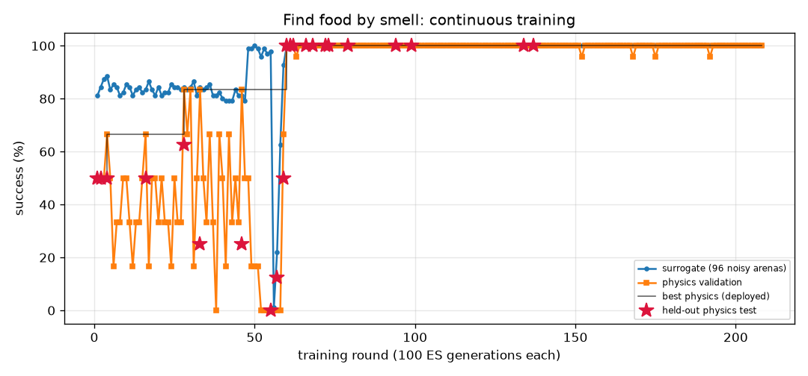

# Find food by smell (`odor_seek`) — training report

*Auto-generated by `train_brains.py`, last updated 2026-11-12T23:10:42.*

| | |
|---|---|
| rounds | 239 |
| ES generations | 23900 |
| physics runs | 5198 |
| status | **optimal** |
| best brain | round 239: physics validation **100%** on 24 arenas, surrogate 100% |
| held-out physics test | **100%** on 32 unseen arenas (95% CI 89%-100%) (errors: [0.11, 0.05, 0.04, 0.18, 0.06, 0.14, 0.1, 0.06, 0.07, 0.13, 0.12, 0.09, 0.14, 0.02, 0.04, 0.03, 0.1, 0.03, 0.04, 0.05, 0.03, 0.1, 0.07, 0.02, 0.07, 0.04, 0.02, 0.16, 0.1, 0.05, 0.05, 0.12]) |

Physics error per arena: mm from target at the end (< 1.5 and standing still = success).

| round | level | gens | sigma | surrogate | physics val | val errors | test | note |
|---:|---:|---:|---:|---:|---:|---|---:|---|
| 200 | 3 | 20000 | 0.024 | 100% | 100% | [0.12, 0.12, 0.09, 0.16, 0.14, 0.2, 0.14, 0.17, 0.23, 0.23, 0.14, 0.16, 0.18, 0.14, 0.12, 0.17, 0.08, 0.17, 0.15, 0.14, 0.15, 0.18, 0.13, 0.13] |  |  |
| 201 | 3 | 20100 | 0.024 | 100% | 100% | [0.16, 0.14, 0.19, 0.12, 0.24, 0.17, 0.13, 0.15, 0.12, 0.18, 0.22, 0.17, 0.12, 0.12, 0.12, 0.16, 0.19, 0.16, 0.2, 0.17, 0.17, 0.21, 0.16, 0.18] |  | restart from best |
| 202 | 3 | 20200 | 0.024 | 100% | 100% | [0.17, 0.15, 0.12, 0.26, 0.18, 0.22, 0.19, 0.09, 0.24, 0.18, 0.14, 0.15, 0.17, 0.15, 0.08, 0.16, 0.19, 0.12, 0.11, 0.13, 0.12, 0.15, 0.14, 0.08] |  |  |
| 203 | 3 | 20300 | 0.024 | 100% | 100% | [0.14, 0.18, 0.21, 0.17, 0.18, 0.18, 0.26, 0.2, 0.17, 0.19, 0.18, 0.19, 0.19, 0.23, 0.24, 0.23, 0.15, 0.19, 0.22, 0.22, 0.17, 0.28, 0.14, 0.2] |  |  |
| 204 | 3 | 20400 | 0.024 | 100% | 100% | [0.09, 0.14, 0.09, 0.09, 0.09, 0.06, 0.05, 0.12, 0.08, 0.18, 0.14, 0.05, 0.07, 0.09, 0.08, 0.07, 0.11, 0.12, 0.12, 0.2, 0.05, 0.1, 0.09, 0.07] |  |  |
| 205 | 3 | 20500 | 0.024 | 100% | 100% | [0.05, 0.16, 0.09, 0.08, 0.14, 0.04, 0.12, 0.11, 0.14, 0.08, 0.13, 0.16, 0.07, 0.09, 0.06, 0.09, 0.18, 0.13, 0.05, 0.07, 0.16, 0.14, 0.08, 0.16] |  | restart from best |
| 206 | 3 | 20600 | 0.024 | 100% | 100% | [0.13, 0.11, 0.14, 0.14, 0.17, 0.09, 0.13, 0.09, 0.14, 0.09, 0.17, 0.12, 0.1, 0.06, 0.14, 0.14, 0.05, 0.14, 0.12, 0.14, 0.1, 0.17, 0.09, 0.16] |  |  |
| 207 | 3 | 20700 | 0.024 | 100% | 100% | [0.11, 0.19, 0.14, 0.17, 0.11, 0.15, 0.21, 0.13, 0.2, 0.16, 0.13, 0.2, 0.14, 0.22, 0.1, 0.2, 0.18, 0.15, 0.15, 0.12, 0.16, 0.13, 0.13, 0.12] |  |  |
| 208 | 3 | 20800 | 0.024 | 100% | 100% | [0.16, 0.17, 0.16, 0.14, 0.16, 0.16, 0.12, 0.21, 0.17, 0.16, 0.16, 0.13, 0.13, 0.18, 0.14, 0.19, 0.14, 0.16, 0.19, 0.12, 0.17, 0.17, 0.15, 0.13] |  |  |
| 209 | 3 | 20900 | 0.024 | 100% | 100% | [0.21, 0.19, 0.2, 0.22, 0.27, 0.21, 0.21, 0.24, 0.26, 0.19, 0.21, 0.24, 0.23, 0.19, 0.19, 0.24, 0.2, 0.26, 0.22, 0.25, 0.23, 0.18, 0.24, 0.22] |  | restart from best |
| 210 | 3 | 21000 | 0.024 | 100% | 100% | [0.16, 0.19, 0.24, 0.17, 0.27, 0.21, 0.2, 0.22, 0.24, 0.2, 0.28, 0.15, 0.19, 0.17, 0.18, 0.21, 0.16, 0.21, 0.16, 0.24, 0.25, 0.21, 0.21, 0.2] |  |  |
| 211 | 3 | 21100 | 0.024 | 100% | 100% | [0.2, 0.12, 0.12, 0.15, 0.14, 0.05, 0.21, 0.22, 0.13, 0.2, 0.19, 0.14, 0.19, 0.2, 0.22, 0.18, 0.17, 0.15, 0.14, 0.2, 0.17, 0.18, 0.22, 0.2] |  |  |
| 212 | 3 | 21200 | 0.024 | 100% | 92% | [0.13, 0.18, 0.15, 0.18, 0.18, 0.18, 0.17, 0.23, 0.19, 0.21, 0.14, 0.14, 0.19, 4.9, 0.13, 0.15, 0.11, 0.19, 0.15, 0.11, 0.15, 0.12, 0.19, 11.67] |  |  |
| 213 | 3 | 21300 | 0.024 | 100% | 100% | [0.19, 0.17, 0.17, 0.18, 0.16, 0.21, 0.2, 0.17, 0.16, 0.17, 0.18, 0.13, 0.15, 0.19, 0.16, 0.09, 0.13, 0.16, 0.18, 0.19, 0.14, 0.17, 0.23, 0.16] |  | restart from best |
| 214 | 3 | 21400 | 0.024 | 100% | 100% | [0.06, 0.12, 0.12, 0.17, 0.08, 0.13, 0.13, 0.08, 0.18, 0.04, 0.08, 0.12, 0.12, 0.09, 0.15, 0.23, 0.08, 0.08, 0.17, 0.07, 0.14, 0.02, 0.03, 0.12] |  |  |
| 215 | 3 | 21500 | 0.024 | 100% | 100% | [0.14, 0.19, 0.12, 0.07, 0.12, 0.17, 0.09, 0.09, 0.14, 0.11, 0.07, 0.1, 0.09, 0.1, 0.17, 0.07, 0.15, 0.13, 0.05, 0.1, 0.07, 0.17, 0.07, 0.14] |  |  |
| 216 | 3 | 21600 | 0.024 | 100% | 100% | [0.14, 0.14, 0.13, 0.21, 0.13, 0.09, 0.12, 0.12, 0.11, 0.16, 0.13, 0.15, 0.16, 0.13, 0.18, 0.17, 0.18, 0.11, 0.18, 0.16, 0.24, 0.13, 0.12, 0.06] |  |  |
| 217 | 3 | 21700 | 0.024 | 100% | 100% | [0.21, 0.18, 0.06, 0.18, 0.12, 0.16, 0.06, 0.14, 0.16, 0.12, 0.11, 0.16, 0.16, 0.14, 0.21, 0.17, 0.16, 0.07, 0.13, 0.15, 0.13, 0.14, 0.2, 0.12] |  | restart from best |
| 218 | 3 | 21800 | 0.024 | 100% | 96% | [0.16, 0.04, 0.06, 0.03, 0.05, 0.14, 0.11, 0.13, 0.04, 0.06, 0.09, 0.06, 0.05, 15.35, 0.08, 0.13, 0.22, 0.03, 0.07, 0.07, 0.07, 0.06, 0.08, 0.03] |  |  |
| 219 | 3 | 21900 | 0.024 | 100% | 100% | [0.16, 0.28, 0.18, 0.2, 0.24, 0.22, 0.19, 0.19, 0.19, 0.19, 0.21, 0.26, 0.21, 0.2, 0.12, 0.16, 0.17, 0.26, 0.22, 0.17, 0.24, 0.16, 0.13, 0.23] |  |  |
| 220 | 3 | 22000 | 0.024 | 100% | 100% | [0.19, 0.22, 0.14, 0.17, 0.24, 0.2, 0.3, 0.19, 0.17, 0.18, 0.13, 0.28, 0.19, 0.21, 0.26, 0.28, 0.18, 0.18, 0.21, 0.26, 0.18, 0.2, 0.21, 0.27] |  |  |
| 221 | 3 | 22100 | 0.024 | 100% | 100% | [0.16, 0.15, 0.13, 0.14, 0.14, 0.12, 0.15, 0.12, 0.15, 0.23, 0.23, 0.15, 0.19, 0.19, 0.17, 0.14, 0.16, 0.13, 0.19, 0.19, 0.17, 0.12, 0.23, 0.14] |  | restart from best |
| 222 | 3 | 22200 | 0.024 | 100% | 100% | [0.15, 0.12, 0.22, 0.12, 0.09, 0.15, 0.06, 0.14, 0.06, 0.1, 0.18, 0.11, 0.12, 0.06, 0.07, 0.13, 0.12, 0.08, 0.08, 0.21, 0.06, 0.1, 0.09, 0.04] |  |  |
| 223 | 3 | 22300 | 0.024 | 100% | 100% | [0.13, 0.17, 0.08, 0.16, 0.1, 0.1, 0.07, 0.2, 0.16, 0.07, 0.07, 0.12, 0.18, 0.11, 0.14, 0.09, 0.12, 0.05, 0.18, 0.13, 0.11, 0.14, 0.09, 0.15] |  |  |
| 224 | 3 | 22400 | 0.024 | 100% | 100% | [0.13, 0.14, 0.08, 0.15, 0.18, 0.12, 0.08, 0.17, 0.08, 0.1, 0.12, 0.08, 0.09, 0.17, 0.18, 0.13, 0.08, 0.14, 0.2, 0.13, 0.16, 0.08, 0.11, 0.09] |  |  |
| 225 | 3 | 22500 | 0.024 | 100% | 100% | [0.04, 0.13, 0.1, 0.09, 0.05, 0.09, 0.07, 0.11, 0.04, 0.13, 0.04, 0.09, 0.15, 0.09, 0.09, 0.13, 0.09, 0.06, 0.11, 0.07, 0.09, 0.16, 0.08, 0.09] |  | restart from best |
| 226 | 3 | 22600 | 0.024 | 100% | 100% | [0.13, 0.1, 0.03, 0.11, 0.07, 0.1, 0.02, 0.11, 0.06, 0.05, 0.02, 0.11, 0.02, 0.13, 0.04, 0.08, 0.04, 0.07, 0.06, 0.12, 0.16, 0.15, 0.02, 0.1] |  |  |
| 227 | 3 | 22700 | 0.024 | 100% | 100% | [0.13, 0.15, 0.15, 0.11, 0.04, 0.12, 0.16, 0.14, 0.21, 0.08, 0.18, 0.16, 0.2, 0.14, 0.18, 0.07, 0.09, 0.12, 0.15, 0.15, 0.19, 0.2, 0.23, 0.15] |  |  |
| 228 | 3 | 22800 | 0.024 | 100% | 100% | [0.16, 0.21, 0.12, 0.13, 0.16, 0.19, 0.13, 0.27, 0.22, 0.12, 0.13, 0.14, 0.09, 0.11, 0.16, 0.11, 0.13, 0.13, 0.19, 0.18, 0.12, 0.11, 0.2, 0.1] |  |  |
| 229 | 3 | 22900 | 0.024 | 100% | 100% | [0.11, 0.19, 0.14, 0.21, 0.17, 0.09, 0.18, 0.19, 0.14, 0.11, 0.23, 0.16, 0.09, 0.19, 0.17, 0.24, 0.18, 0.12, 0.11, 0.17, 0.25, 0.08, 0.15, 0.11] |  | restart from best |
| 230 | 3 | 23000 | 0.024 | 100% | 100% | [0.23, 0.22, 0.22, 0.19, 0.21, 0.21, 0.24, 0.17, 0.17, 0.25, 0.22, 0.22, 0.28, 0.19, 0.22, 0.21, 0.15, 0.18, 0.27, 0.33, 0.23, 0.24, 0.18, 0.22] |  |  |
| 231 | 3 | 23100 | 0.024 | 100% | 100% | [0.14, 0.17, 0.22, 0.24, 0.18, 0.19, 0.17, 0.23, 0.17, 0.17, 0.22, 0.21, 0.22, 0.22, 0.15, 0.18, 0.15, 0.17, 0.13, 0.3, 0.18, 0.15, 0.14, 0.25] |  |  |
| 232 | 3 | 23200 | 0.024 | 100% | 100% | [0.23, 0.14, 0.16, 0.19, 0.16, 0.19, 0.17, 0.22, 0.19, 0.17, 0.19, 0.2, 0.16, 0.21, 0.16, 0.22, 0.14, 0.18, 0.19, 0.14, 0.16, 0.17, 0.13, 0.18] |  |  |
| 233 | 3 | 23300 | 0.024 | 100% | 100% | [0.18, 0.17, 0.25, 0.23, 0.29, 0.22, 0.18, 0.23, 0.25, 0.18, 0.18, 0.15, 0.31, 0.2, 0.17, 0.19, 0.2, 0.17, 0.23, 0.24, 0.18, 0.27, 0.15, 0.22] |  | restart from best |
| 234 | 3 | 23400 | 0.024 | 100% | 100% | [0.1, 0.12, 0.16, 0.2, 0.14, 0.2, 0.15, 0.11, 0.13, 0.11, 0.14, 0.12, 0.16, 0.14, 0.15, 0.14, 0.11, 0.19, 0.17, 0.21, 0.17, 0.14, 0.13, 0.14] |  |  |
| 235 | 3 | 23500 | 0.024 | 100% | 100% | [0.11, 0.17, 0.14, 0.2, 0.21, 0.09, 0.25, 0.12, 0.14, 0.14, 0.14, 0.2, 0.19, 0.17, 0.2, 0.13, 0.18, 0.15, 0.19, 0.14, 0.15, 0.15, 0.18, 0.23] |  |  |
| 236 | 3 | 23600 | 0.024 | 100% | 100% | [0.1, 0.16, 0.11, 0.22, 0.09, 0.09, 0.09, 0.19, 0.14, 0.14, 0.12, 0.14, 0.15, 0.22, 0.18, 0.15, 0.1, 0.12, 0.11, 0.14, 0.08, 0.08, 0.15, 0.14] |  |  |
| 237 | 3 | 23700 | 0.024 | 100% | 100% | [0.26, 0.18, 0.17, 0.11, 0.16, 0.13, 0.19, 0.12, 0.15, 0.24, 0.25, 0.26, 0.17, 0.12, 0.17, 0.2, 0.13, 0.18, 0.2, 0.2, 0.13, 0.19, 0.12, 0.16] |  | restart from best |
| 238 | 3 | 23800 | 0.024 | 100% | 100% | [0.21, 0.14, 0.15, 0.17, 0.11, 0.1, 0.19, 0.17, 0.14, 0.16, 0.09, 0.13, 0.19, 0.16, 0.23, 0.19, 0.13, 0.19, 0.21, 0.14, 0.18, 0.15, 0.17, 0.15] |  |  |
| 239 | 3 | 23900 | 0.024 | 100% | 100% | [0.08, 0.08, 0.04, 0.06, 0.07, 0.03, 0.1, 0.14, 0.05, 0.12, 0.15, 0.03, 0.05, 0.06, 0.05, 0.1, 0.09, 0.04, 0.11, 0.12, 0.13, 0.06, 0.08, 0.1] | 100% | new best |
