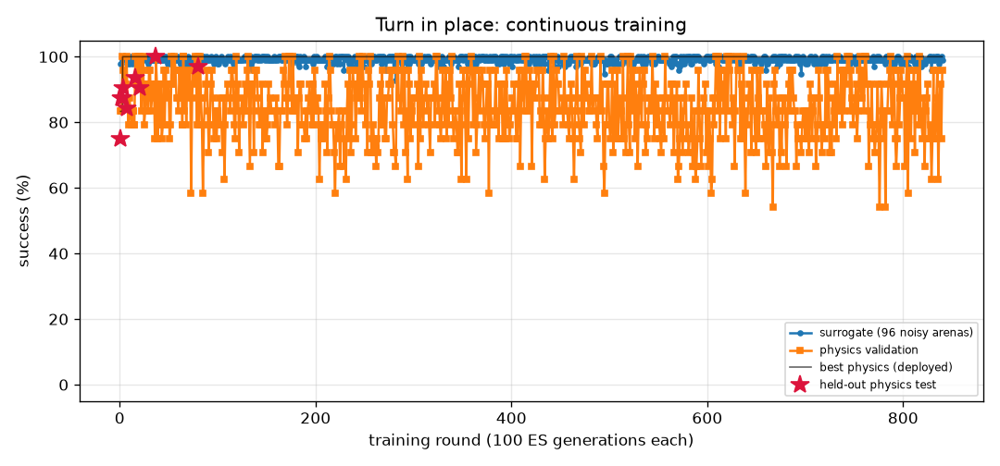

# Turn in place (`turn`) — training report

*Auto-generated by `train_brains.py`, last updated 2026-11-13T23:48:18.*

| | |
|---|---|
| rounds | 1039 |
| ES generations | 103900 |
| physics runs | 25182 |
| status | **optimal** |
| best brain | round 80: physics validation **100%** on 24 arenas, surrogate 100% |
| held-out physics test | **97%** on 32 unseen arenas (95% CI 84%-99%) (errors: [1.6, 3.3, 6.3, 3.7, 1.1, 0.4, 2.4, 2.9, 0.1, 2.6, 0.5, 2.7, 1.5, 3.1, 4.5, 0.2, 0.5, 1.1, 2.0, 4.4, 2.8, 3.2, 0.3, 2.2, 0.5, 3.0, 0.3, 5.4, 0.4, 1.0, 4.7, 10.7]) |

Physics error per arena: deg from target heading (< 20 = success).

| round | level | gens | sigma | surrogate | physics val | val errors | test | note |
|---:|---:|---:|---:|---:|---:|---|---:|---|
| 1000 | 3 | 100000 | 0.024 | 99% | 96% | [6.1, 4.4, 2.3, 0.6, 3.2, 0.1, 5.0, 3.6, 4.7, 1.0, 3.8, 0.9, 0.2, 3.7, 4.7, 0.3, 4.0, 1.2, 0.1, 1.2, 3.3, 2.1, 4.9, 6.4] |  | restart from best |
| 1001 | 3 | 100100 | 0.024 | 100% | 75% | [3.6, 1.8, 1.6, 0.9, 2.0, 3.8, 6.2, 6.3, 5.5, 1.9, 4.1, 0.5, 1.0, 1.3, 3.9, 0.8, 0.4, 2.7, 0.9, 1.3, 2.3, 0.5, 5.8, 6.1] |  |  |
| 1002 | 3 | 100200 | 0.024 | 100% | 79% | [2.5, 1.7, 1.7, 0.5, 0.5, 3.1, 4.9, 5.8, 7.5, 0.9, 5.0, 1.4, 0.9, 0.6, 4.5, 1.7, 1.4, 2.3, 3.0, 1.9, 2.3, 1.9, 6.9, 1.5] |  |  |
| 1003 | 3 | 100300 | 0.024 | 98% | 92% | [1.9, 3.6, 1.0, 2.0, 1.0, 0.2, 5.3, 6.4, 6.1, 0.5, 4.8, 1.2, 1.1, 0.8, 3.5, 2.5, 1.0, 0.7, 4.4, 0.9, 1.8, 2.8, 6.9, 4.5] |  |  |
| 1004 | 3 | 100400 | 0.025 | 100% | 83% | [0.8, 2.1, 0.9, 1.3, 0.3, 1.7, 6.8, 9.3, 4.9, 14.5, 5.2, 1.7, 1.6, 1.4, 6.0, 1.6, 2.3, 3.4, 1.6, 2.0, 2.9, 2.1, 4.8, 7.8] |  | restart from best |
| 1005 | 3 | 100500 | 0.024 | 99% | 71% | [5.0, 2.5, 2.2, 2.3, 1.8, 0.0, 5.9, 5.3, 7.4, 0.6, 5.9, 1.1, 0.1, 0.0, 5.5, 1.7, 0.7, 1.6, 0.8, 0.5, 2.2, 1.5, 8.0, 6.6] |  |  |
| 1006 | 3 | 100600 | 0.025 | 99% | 96% | [2.0, 7.9, 3.7, 3.5, 5.3, 3.5, 0.2, 4.7, 4.0, 1.8, 3.9, 0.2, 1.3, 3.6, 3.1, 0.9, 0.6, 0.8, 2.2, 2.1, 3.6, 1.1, 4.3, 1.4] |  |  |
| 1007 | 3 | 100700 | 0.025 | 99% | 67% | [10.0, 9.8, 3.7, 0.9, 3.3, 114.9, 3.0, 2.9, 2.1, 0.6, 2.7, 2.9, 2.0, 4.8, 3.1, 0.0, 3.4, 0.3, 2.5, 1.2, 5.4, 2.4, 4.6, 3.8] |  |  |
| 1008 | 3 | 100800 | 0.025 | 100% | 71% | [5.7, 2.9, 6.2, 1.1, 2.5, 123.4, 7.4, 9.7, 7.8, 0.6, 5.5, 1.2, 0.0, 0.9, 4.3, 3.7, 1.1, 2.0, 2.9, 2.3, 4.3, 1.7, 8.0, 6.5] |  | restart from best |
| 1009 | 3 | 100900 | 0.024 | 99% | 83% | [3.5, 2.2, 3.4, 0.8, 4.8, 2.3, 6.8, 5.3, 6.4, 14.8, 5.0, 0.7, 0.0, 2.1, 4.7, 6.8, 1.2, 3.5, 7.0, 1.5, 4.5, 4.4, 1.4, 7.4] |  |  |
| 1010 | 3 | 101000 | 0.025 | 100% | 75% | [5.9, 6.7, 1.3, 2.2, 5.1, 4.5, 3.8, 1.4, 2.9, 0.6, 5.4, 1.9, 0.9, 1.1, 4.3, 0.1, 1.4, 0.8, 0.4, 0.7, 6.6, 1.5, 4.9, 1.1] |  |  |
| 1011 | 3 | 101100 | 0.024 | 100% | 79% | [6.0, 3.4, 1.9, 2.5, 4.5, 4.7, 4.8, 3.7, 5.4, 14.5, 4.8, 2.0, 1.5, 1.2, 4.5, 1.2, 1.8, 3.2, 0.9, 0.4, 6.5, 0.2, 4.2, 5.5] |  |  |
| 1012 | 3 | 101200 | 0.024 | 99% | 83% | [8.3, 2.5, 5.3, 0.7, 13.8, 1.0, 7.5, 9.9, 9.3, 1.2, 5.3, 1.5, 0.5, 1.7, 5.7, 1.8, 1.2, 3.8, 1.5, 1.4, 4.5, 2.4, 6.5, 8.5] |  | restart from best |
| 1013 | 3 | 101300 | 0.024 | 100% | 79% | [7.7, 10.1, 4.8, 4.2, 8.7, 2.8, 3.0, 2.6, 2.9, 0.0, 2.1, 4.5, 1.6, 2.4, 1.4, 0.8, 4.4, 1.0, 2.8, 1.7, 6.4, 2.8, 3.9, 1.6] |  |  |
| 1014 | 3 | 101400 | 0.024 | 99% | 92% | [6.9, 6.0, 6.9, 3.7, 0.7, 2.3, 3.4, 2.5, 4.3, 0.1, 4.2, 0.0, 1.3, 1.3, 2.8, 8.2, 0.2, 0.6, 8.0, 2.4, 2.8, 0.1, 5.2, 5.1] |  |  |
| 1015 | 3 | 101500 | 0.025 | 99% | 79% | [5.6, 10.0, 2.2, 2.6, 11.5, 2.4, 4.2, 0.4, 4.4, 0.6, 3.5, 2.1, 1.1, 4.1, 3.7, 5.0, 1.8, 0.1, 1.1, 1.6, 7.8, 1.0, 2.7, 3.7] |  |  |
| 1016 | 3 | 101600 | 0.025 | 96% | 92% | [9.1, 8.3, 8.5, 3.4, 1.4, 0.6, 1.9, 0.5, 3.6, 0.9, 2.1, 1.9, 3.6, 4.1, 1.7, 2.4, 2.0, 1.3, 2.5, 2.1, 7.3, 1.5, 3.0, 3.5] |  | restart from best |
| 1017 | 3 | 101700 | 0.024 | 99% | 75% | [2.4, 3.0, 4.5, 0.5, 1.8, 3.1, 6.4, 4.4, 5.8, 0.7, 4.5, 0.7, 2.1, 2.2, 4.3, 1.9, 0.9, 2.4, 3.2, 1.8, 5.7, 0.7, 5.6, 4.7] |  |  |
| 1018 | 3 | 101800 | 0.025 | 100% | 83% | [0.8, 4.3, 8.9, 0.8, 16.6, 4.9, 8.1, 9.3, 9.0, 2.9, 5.9, 4.2, 3.8, 0.5, 5.1, 4.5, 3.8, 4.0, 4.7, 5.0, 3.1, 1.1, 7.3, 10.0] |  |  |
| 1019 | 3 | 101900 | 0.024 | 100% | 75% | [6.7, 2.9, 2.6, 0.9, 5.7, 3.0, 5.3, 0.6, 5.1, 0.3, 5.9, 0.4, 0.1, 0.4, 4.1, 2.7, 0.8, 2.1, 3.3, 2.8, 6.2, 0.2, 4.4, 6.6] |  |  |
| 1020 | 3 | 102000 | 0.024 | 97% | 71% | [9.0, 8.5, 0.2, 3.8, 0.0, 4.3, 4.1, 0.0, 3.9, 0.2, 2.1, 2.6, 0.6, 3.1, 2.2, 2.2, 1.5, 0.0, 1.5, 1.7, 7.9, 0.6, 2.4, 1.3] |  | restart from best |
| 1021 | 3 | 102100 | 0.024 | 98% | 79% | [2.7, 7.4, 0.9, 2.7, 1.5, 118.3, 4.0, 2.4, 3.3, 0.3, 2.7, 0.7, 1.6, 2.7, 2.8, 1.3, 1.6, 0.1, 0.0, 1.1, 4.2, 0.2, 2.9, 7.3] |  |  |
| 1022 | 3 | 102200 | 0.025 | 99% | 92% | [7.8, 10.8, 8.7, 2.1, 3.3, 1.8, 1.7, 2.6, 2.0, 1.4, 1.5, 2.5, 2.8, 2.8, 1.9, 0.2, 2.6, 2.6, 3.5, 3.3, 5.9, 1.0, 4.1, 8.1] |  |  |
| 1023 | 3 | 102300 | 0.025 | 98% | 79% | [4.8, 4.3, 4.7, 0.0, 3.2, 4.2, 7.7, 4.1, 6.4, 0.7, 5.5, 1.5, 0.1, 1.6, 5.7, 1.1, 1.5, 14.7, 4.2, 2.9, 4.4, 1.4, 7.3, 9.5] |  |  |
| 1024 | 3 | 102400 | 0.025 | 99% | 79% | [5.9, 4.9, 0.8, 1.5, 5.4, 3.1, 4.5, 4.0, 6.1, 1.3, 4.9, 0.6, 0.5, 1.6, 4.3, 0.1, 1.1, 1.2, 0.3, 0.3, 4.8, 3.8, 5.7, 3.6] |  | restart from best |
| 1025 | 3 | 102500 | 0.024 | 100% | 96% | [9.3, 10.1, 3.2, 4.4, 1.9, 3.5, 2.3, 4.6, 2.3, 2.0, 2.5, 4.2, 1.5, 6.6, 1.8, 3.5, 4.0, 1.1, 2.9, 1.2, 8.3, 2.4, 1.5, 0.9] |  |  |
| 1026 | 3 | 102600 | 0.024 | 99% | 96% | [7.7, 7.2, 3.1, 2.2, 1.7, 0.7, 3.8, 6.3, 4.9, 0.9, 3.5, 2.1, 3.3, 4.9, 2.9, 0.3, 2.0, 0.3, 1.8, 1.5, 4.5, 0.3, 3.3, 1.2] |  |  |
| 1027 | 3 | 102700 | 0.025 | 99% | 83% | [4.1, 0.6, 3.4, 2.6, 5.9, 4.9, 6.3, 9.0, 6.3, 2.2, 4.5, 2.1, 1.8, 0.3, 4.2, 1.2, 1.6, 4.3, 6.8, 2.1, 1.3, 1.8, 7.0, 7.4] |  |  |
| 1028 | 3 | 102800 | 0.025 | 99% | 79% | [8.7, 8.2, 8.7, 4.2, 11.0, 2.1, 3.6, 0.6, 4.8, 2.5, 3.0, 1.8, 2.8, 3.2, 3.9, 0.3, 1.8, 1.0, 0.8, 2.3, 6.8, 2.6, 2.5, 2.8] |  | restart from best |
| 1029 | 3 | 102900 | 0.024 | 100% | 79% | [6.8, 7.1, 1.8, 1.3, 2.9, 120.4, 4.1, 0.3, 1.8, 0.9, 4.2, 2.7, 2.2, 0.2, 2.9, 0.2, 2.5, 1.2, 1.3, 1.5, 5.5, 1.0, 3.9, 5.1] |  |  |
| 1030 | 3 | 103000 | 0.024 | 99% | 83% | [8.1, 12.2, 7.2, 3.5, 4.1, 1.4, 1.1, 1.2, 1.0, 2.4, 1.1, 4.2, 3.6, 6.2, 0.8, 4.0, 4.1, 3.2, 4.2, 3.8, 5.2, 2.5, 0.8, 4.9] |  |  |
| 1031 | 3 | 103100 | 0.025 | 99% | 100% | [5.9, 9.1, 7.6, 0.1, 1.0, 1.1, 2.5, 2.2, 3.6, 1.6, 2.7, 1.3, 0.4, 3.7, 2.8, 1.7, 0.8, 1.4, 1.9, 0.4, 8.2, 0.5, 3.7, 1.9] |  |  |
| 1032 | 3 | 103200 | 0.025 | 100% | 100% | [6.8, 8.7, 6.4, 1.7, 1.4, 0.4, 0.4, 0.1, 1.5, 3.1, 1.4, 2.4, 4.9, 5.0, 1.2, 2.7, 2.1, 3.7, 1.1, 0.7, 7.2, 0.7, 0.1, 3.5] |  | restart from best |
| 1033 | 3 | 103300 | 0.024 | 99% | 88% | [6.7, 9.5, 0.1, 3.5, 4.1, 0.8, 3.7, 0.5, 4.6, 0.2, 3.5, 2.1, 1.5, 4.9, 2.2, 1.7, 2.4, 0.3, 1.6, 0.1, 7.2, 1.0, 4.5, 0.5] |  |  |
| 1034 | 3 | 103400 | 0.025 | 99% | 88% | [6.0, 8.2, 2.4, 3.3, 2.2, 3.1, 5.7, 0.8, 4.6, 1.1, 4.1, 0.6, 0.4, 4.0, 4.6, 2.5, 2.4, 0.8, 0.1, 1.1, 6.6, 0.0, 4.9, 5.3] |  |  |
| 1035 | 3 | 103500 | 0.025 | 99% | 96% | [0.6, 4.8, 1.6, 2.2, 0.3, 0.7, 4.9, 6.4, 5.1, 0.1, 2.9, 0.9, 1.6, 1.1, 3.2, 0.6, 0.9, 0.2, 0.4, 0.2, 3.5, 1.2, 5.3, 2.5] |  |  |
| 1036 | 3 | 103600 | 0.025 | 100% | 88% | [2.7, 3.1, 4.8, 0.3, 0.6, 4.8, 7.0, 10.2, 7.5, 2.5, 4.0, 4.0, 0.7, 1.1, 3.9, 13.0, 4.2, 5.4, 4.3, 13.4, 3.0, 2.9, 7.4, 5.3] |  | restart from best |
| 1037 | 3 | 103700 | 0.024 | 99% | 92% | [7.7, 7.0, 1.4, 2.4, 15.4, 2.6, 3.8, 4.7, 3.3, 1.0, 3.5, 1.1, 1.7, 3.2, 3.1, 15.9, 0.8, 0.8, 0.4, 0.0, 4.8, 1.1, 5.3, 3.4] |  |  |
| 1038 | 3 | 103800 | 0.025 | 99% | 75% | [4.0, 4.1, 0.5, 2.9, 13.3, 2.3, 4.3, 7.1, 5.4, 0.1, 4.6, 0.1, 1.2, 1.5, 4.9, 0.3, 0.1, 0.5, 11.1, 1.7, 5.6, 1.3, 6.1, 5.3] |  |  |
| 1039 | 3 | 103900 | 0.025 | 99% | 79% | [6.5, 5.5, 0.2, 1.5, 0.3, 13.2, 5.2, 0.0, 3.4, 14.5, 4.8, 0.1, 0.4, 0.2, 3.6, 4.4, 0.1, 1.8, 2.9, 2.9, 6.7, 1.8, 5.9, 4.4] |  |  |
