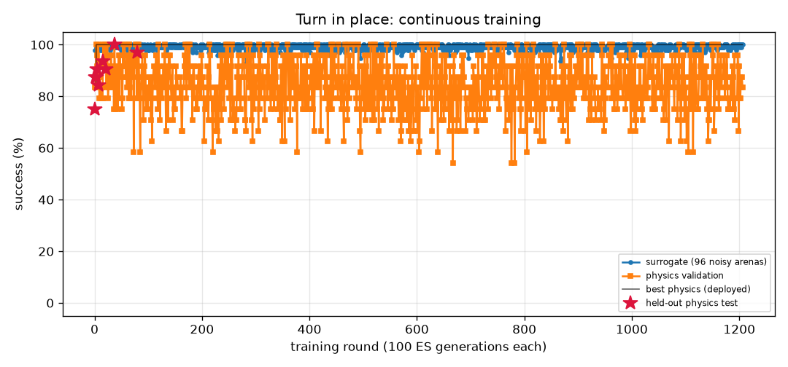

# Turn in place (`turn`) — training report

*Auto-generated by `train_brains.py`, last updated 2026-11-26T21:48:26.*

| | |
|---|---|
| rounds | 1398 |
| ES generations | 139800 |
| physics runs | 33798 |
| status | **optimal** |
| best brain | round 80: physics validation **100%** on 24 arenas, surrogate 100% |
| held-out physics test | **97%** on 32 unseen arenas (95% CI 84%-99%) (errors: [1.6, 3.3, 6.3, 3.7, 1.1, 0.4, 2.4, 2.9, 0.1, 2.6, 0.5, 2.7, 1.5, 3.1, 4.5, 0.2, 0.5, 1.1, 2.0, 4.4, 2.8, 3.2, 0.3, 2.2, 0.5, 3.0, 0.3, 5.4, 0.4, 1.0, 4.7, 10.7]) |

Physics error per arena: deg from target heading (< 20 = success).

| round | level | gens | sigma | surrogate | physics val | val errors | test | note |
|---:|---:|---:|---:|---:|---:|---|---:|---|
| 1359 | 3 | 135900 | 0.025 | 100% | 96% | [5.5, 1.9, 1.3, 2.6, 1.8, 2.1, 6.7, 6.6, 6.1, 1.4, 5.7, 3.8, 0.7, 1.4, 4.2, 2.5, 4.1, 2.8, 2.6, 2.7, 3.9, 2.4, 7.4, 4.0] |  |  |
| 1360 | 3 | 136000 | 0.024 | 99% | 100% | [4.3, 1.3, 2.7, 0.4, 2.2, 4.3, 4.5, 7.3, 3.1, 12.6, 4.0, 4.7, 1.1, 0.3, 3.7, 12.8, 4.5, 5.3, 12.5, 13.3, 2.9, 2.3, 6.4, 12.2] |  | restart from best |
| 1361 | 3 | 136100 | 0.024 | 100% | 67% | [2.6, 3.8, 15.2, 1.6, 0.0, 4.9, 6.2, 7.5, 6.6, 0.9, 5.7, 0.1, 0.5, 0.5, 4.6, 1.1, 0.3, 3.5, 1.2, 2.1, 3.0, 1.6, 8.1, 8.4] |  |  |
| 1362 | 3 | 136200 | 0.024 | 99% | 92% | [2.7, 6.3, 2.0, 0.6, 10.2, 2.1, 4.0, 0.8, 4.6, 0.2, 2.7, 0.8, 1.6, 1.5, 4.0, 0.2, 1.0, 0.6, 0.4, 0.6, 4.6, 0.9, 6.1, 5.3] |  |  |
| 1363 | 3 | 136300 | 0.025 | 99% | 79% | [2.1, 0.8, 2.9, 0.7, 10.8, 0.9, 5.8, 7.1, 7.6, 1.3, 3.9, 2.4, 0.6, 1.0, 5.5, 1.7, 2.7, 3.4, 1.4, 3.0, 0.2, 2.4, 8.3, 2.1] |  |  |
| 1364 | 3 | 136400 | 0.025 | 98% | 92% | [3.0, 1.3, 3.7, 1.1, 1.4, 3.9, 7.1, 8.7, 7.4, 1.1, 4.7, 2.5, 2.6, 0.5, 6.5, 2.6, 2.2, 2.6, 2.7, 2.8, 2.2, 1.2, 5.7, 12.7] |  | restart from best |
| 1365 | 3 | 136500 | 0.024 | 100% | 92% | [2.4, 2.8, 1.5, 1.8, 1.7, 19.8, 6.6, 0.8, 7.5, 0.9, 3.9, 1.3, 1.3, 0.2, 3.7, 13.4, 1.3, 4.3, 11.8, 3.7, 2.7, 2.0, 5.9, 5.7] |  |  |
| 1366 | 3 | 136600 | 0.024 | 97% | 71% | [11.0, 17.1, 11.0, 4.3, 2.2, 7.0, 11.2, 8.1, 10.6, 3.1, 5.7, 7.5, 4.9, 4.2, 6.6, 19.4, 7.8, 19.5, 5.8, 5.9, 2.2, 5.5, 9.7, 9.6] |  |  |
| 1367 | 3 | 136700 | 0.026 | 99% | 71% | [8.1, 1.5, 2.6, 1.1, 0.5, 2.8, 5.6, 2.1, 4.0, 1.4, 4.9, 1.8, 0.4, 1.2, 4.9, 0.5, 1.7, 4.9, 1.0, 1.1, 7.9, 1.1, 4.6, 1.8] |  |  |
| 1368 | 3 | 136800 | 0.025 | 99% | 92% | [0.2, 7.2, 8.4, 2.4, 3.1, 120.1, 15.3, 1.3, 8.4, 14.9, 5.5, 7.4, 3.0, 3.5, 5.8, 15.9, 7.4, 15.0, 16.1, 6.0, 2.1, 3.0, 8.4, 8.7] |  | restart from best |
| 1369 | 3 | 136900 | 0.024 | 100% | 75% | [7.7, 1.2, 6.8, 0.2, 15.8, 1.3, 7.0, 8.1, 6.8, 1.2, 4.2, 2.0, 1.7, 2.0, 4.8, 3.6, 2.9, 2.3, 4.5, 1.5, 3.5, 0.6, 6.7, 6.6] |  |  |
| 1370 | 3 | 137000 | 0.024 | 100% | 92% | [7.5, 0.0, 4.5, 0.5, 2.6, 1.8, 6.4, 1.0, 6.5, 14.5, 6.1, 1.0, 2.4, 1.4, 4.2, 4.5, 0.8, 3.5, 4.3, 3.2, 4.6, 0.0, 4.9, 6.7] |  |  |
| 1371 | 3 | 137100 | 0.024 | 96% | 67% | [5.4, 6.5, 7.8, 3.7, 14.1, 5.4, 8.4, 10.4, 6.2, 1.4, 6.5, 1.3, 5.5, 1.8, 6.5, 4.1, 0.6, 5.4, 4.2, 1.6, 7.1, 0.7, 8.3, 9.5] |  |  |
| 1372 | 3 | 137200 | 0.026 | 100% | 88% | [1.3, 7.1, 7.4, 3.3, 2.3, 2.4, 3.8, 2.4, 3.3, 0.2, 3.9, 0.7, 2.1, 0.7, 4.1, 0.3, 0.2, 0.6, 1.9, 4.6, 7.1, 0.3, 4.3, 0.5] |  | restart from best |
| 1373 | 3 | 137300 | 0.024 | 98% | 71% | [5.6, 4.0, 3.0, 0.1, 1.7, 0.9, 4.8, 6.3, 5.4, 13.5, 4.0, 0.7, 1.0, 3.1, 4.4, 0.4, 1.3, 2.1, 3.0, 0.5, 6.8, 0.5, 5.7, 4.1] |  |  |
| 1374 | 3 | 137400 | 0.025 | 100% | 75% | [2.1, 8.5, 1.6, 0.3, 0.3, 0.3, 3.6, 7.5, 3.1, 1.3, 3.9, 0.4, 0.7, 2.5, 5.0, 1.0, 0.8, 0.5, 0.6, 4.7, 5.2, 3.0, 6.0, 6.3] |  |  |
| 1375 | 3 | 137500 | 0.024 | 99% | 92% | [0.5, 2.8, 0.5, 1.7, 0.8, 3.3, 4.7, 6.8, 6.4, 1.0, 5.1, 0.7, 0.7, 0.3, 5.3, 2.7, 0.5, 0.9, 2.6, 2.1, 3.5, 2.4, 6.7, 7.1] |  |  |
| 1376 | 3 | 137600 | 0.025 | 100% | 79% | [3.4, 8.8, 0.1, 2.1, 3.4, 0.8, 4.6, 2.6, 2.9, 0.9, 2.7, 1.2, 0.8, 3.8, 2.9, 0.4, 0.8, 0.6, 0.7, 1.2, 3.8, 1.9, 4.9, 3.8] |  | restart from best |
| 1377 | 3 | 137700 | 0.024 | 100% | 88% | [3.9, 6.4, 1.0, 2.6, 12.5, 1.9, 5.1, 4.9, 4.3, 15.0, 3.4, 0.4, 0.4, 2.3, 4.4, 5.1, 0.2, 0.9, 6.0, 3.9, 3.8, 1.8, 4.3, 3.6] |  |  |
| 1378 | 3 | 137800 | 0.024 | 97% | 71% | [10.1, 10.3, 3.8, 0.9, 4.8, 3.4, 4.4, 8.4, 3.8, 2.2, 2.1, 3.7, 1.4, 1.3, 2.4, 3.3, 4.7, 0.4, 2.9, 5.7, 5.0, 1.1, 1.9, 2.0] |  |  |
| 1379 | 3 | 137900 | 0.026 | 100% | 96% | [0.1, 6.9, 0.5, 0.9, 3.7, 1.1, 5.9, 2.1, 5.0, 0.7, 4.3, 0.6, 1.5, 2.2, 3.9, 2.5, 0.6, 0.9, 1.4, 1.6, 3.3, 0.6, 5.3, 4.6] |  |  |
| 1380 | 3 | 138000 | 0.024 | 100% | 75% | [0.6, 2.8, 7.3, 0.7, 0.1, 0.6, 7.0, 2.4, 6.0, 1.1, 6.2, 0.8, 0.9, 1.9, 6.7, 1.4, 0.6, 1.9, 1.1, 1.6, 3.2, 0.6, 5.9, 8.5] |  | restart from best |
| 1381 | 3 | 138100 | 0.024 | 99% | 79% | [4.2, 8.0, 0.6, 1.9, 4.1, 2.4, 3.5, 5.4, 2.7, 1.1, 2.5, 1.5, 2.4, 4.3, 3.6, 1.3, 1.5, 0.4, 1.3, 0.8, 7.1, 0.6, 5.0, 1.7] |  |  |
| 1382 | 3 | 138200 | 0.025 | 100% | 92% | [0.3, 5.4, 1.3, 1.7, 1.5, 2.2, 5.6, 3.6, 5.8, 0.4, 4.0, 0.5, 2.7, 2.8, 4.3, 0.6, 0.9, 0.7, 0.1, 0.1, 1.9, 1.0, 0.4, 3.6] |  |  |
| 1383 | 3 | 138300 | 0.024 | 100% | 71% | [5.7, 4.1, 0.1, 2.0, 1.9, 1.6, 6.0, 5.9, 4.5, 0.1, 4.2, 0.4, 1.3, 3.8, 4.4, 1.5, 0.5, 1.5, 0.5, 0.1, 3.4, 1.6, 5.9, 5.7] |  |  |
| 1384 | 3 | 138400 | 0.024 | 99% | 79% | [4.2, 8.7, 1.2, 1.6, 2.6, 0.6, 3.4, 4.8, 4.3, 12.4, 4.0, 1.8, 0.4, 3.1, 3.1, 1.0, 1.9, 0.9, 3.6, 0.9, 4.6, 3.9, 3.5, 4.3] |  | restart from best |
| 1385 | 3 | 138500 | 0.024 | 99% | 79% | [9.8, 10.0, 8.9, 2.8, 8.7, 117.9, 4.5, 1.4, 4.7, 1.1, 3.1, 3.0, 2.7, 0.1, 2.8, 4.0, 3.2, 0.2, 0.5, 1.4, 8.2, 0.4, 2.5, 4.4] |  |  |
| 1386 | 3 | 138600 | 0.025 | 99% | 79% | [5.5, 4.7, 1.5, 1.6, 4.5, 3.6, 5.1, 7.4, 5.7, 14.9, 3.1, 1.3, 0.3, 0.3, 4.8, 1.5, 0.3, 1.1, 1.5, 1.9, 6.4, 2.3, 6.1, 4.1] |  |  |
| 1387 | 3 | 138700 | 0.025 | 97% | 83% | [7.6, 2.9, 4.3, 0.0, 14.8, 2.1, 4.5, 7.4, 5.0, 0.0, 5.0, 0.1, 1.4, 1.9, 4.8, 2.8, 4.5, 0.7, 2.6, 0.4, 3.9, 1.4, 4.4, 7.2] |  |  |
| 1388 | 3 | 138800 | 0.026 | 98% | 88% | [11.4, 12.1, 3.8, 3.9, 10.4, 0.8, 0.7, 6.8, 0.3, 3.2, 2.5, 4.5, 4.0, 4.0, 0.3, 3.2, 4.7, 1.9, 5.0, 4.4, 9.5, 0.0, 1.5, 2.6] |  | restart from best |
| 1389 | 3 | 138900 | 0.024 | 97% | 83% | [10.9, 11.6, 6.2, 5.1, 4.7, 5.3, 2.3, 9.4, 2.7, 1.1, 1.9, 4.7, 3.2, 3.2, 1.0, 3.4, 4.5, 2.8, 4.2, 3.6, 8.5, 1.1, 2.4, 7.1] |  |  |
| 1390 | 3 | 139000 | 0.026 | 99% | 83% | [2.1, 3.1, 2.1, 3.0, 0.7, 2.2, 6.8, 6.1, 7.0, 0.3, 4.8, 1.7, 1.3, 1.8, 5.8, 1.3, 1.6, 5.4, 1.7, 4.3, 4.0, 1.0, 7.4, 7.7] |  |  |
| 1391 | 3 | 139100 | 0.025 | 100% | 75% | [4.3, 2.7, 11.7, 1.0, 1.8, 2.3, 6.1, 9.0, 7.1, 0.3, 5.2, 0.4, 1.0, 3.3, 4.5, 1.2, 0.6, 2.9, 1.4, 1.7, 5.8, 1.4, 6.4, 7.5] |  |  |
| 1392 | 3 | 139200 | 0.024 | 99% | 79% | [6.3, 7.1, 10.8, 2.4, 5.0, 0.5, 3.7, 1.4, 3.3, 1.2, 3.9, 1.6, 1.7, 1.2, 3.3, 1.5, 1.1, 0.4, 1.3, 1.2, 5.0, 0.1, 4.8, 4.6] |  | restart from best |
| 1393 | 3 | 139300 | 0.024 | 99% | 71% | [7.7, 7.9, 3.7, 1.1, 1.2, 2.1, 5.1, 0.4, 5.1, 0.2, 5.2, 1.7, 1.4, 1.4, 5.1, 1.2, 1.8, 1.9, 0.3, 0.3, 6.9, 1.6, 5.1, 4.5] |  |  |
| 1394 | 3 | 139400 | 0.025 | 99% | 83% | [10.5, 3.2, 8.6, 1.9, 16.1, 5.0, 7.9, 9.1, 8.9, 1.5, 5.5, 2.4, 1.6, 2.3, 5.2, 0.5, 2.4, 4.5, 3.9, 4.1, 2.4, 2.2, 8.0, 8.5] |  |  |
| 1395 | 3 | 139500 | 0.025 | 99% | 88% | [1.9, 0.4, 5.6, 1.0, 12.4, 3.5, 5.8, 6.3, 4.8, 14.8, 6.3, 1.6, 1.3, 1.4, 3.7, 1.4, 1.5, 1.1, 11.7, 1.9, 1.3, 0.8, 7.0, 6.2] |  |  |
| 1396 | 3 | 139600 | 0.025 | 99% | 92% | [10.3, 11.6, 10.8, 5.3, 5.3, 2.5, 0.2, 9.1, 0.4, 3.7, 2.1, 5.1, 4.0, 6.4, 0.9, 4.3, 5.8, 3.9, 4.2, 6.1, 8.8, 1.8, 0.4, 8.6] |  | restart from best |
| 1397 | 3 | 139700 | 0.024 | 99% | 88% | [8.3, 8.3, 0.7, 3.5, 6.9, 2.8, 4.4, 1.9, 4.4, 1.5, 2.7, 1.4, 1.2, 4.4, 3.0, 1.1, 1.0, 0.8, 1.0, 1.4, 3.9, 0.3, 5.3, 0.3] |  |  |
| 1398 | 3 | 139800 | 0.025 | 100% | 88% | [1.0, 9.6, 3.9, 1.2, 0.1, 1.3, 2.0, 3.6, 2.0, 1.1, 2.8, 2.5, 0.5, 5.1, 2.1, 0.4, 2.6, 0.4, 0.4, 4.0, 5.4, 4.8, 2.9, 0.2] |  |  |
