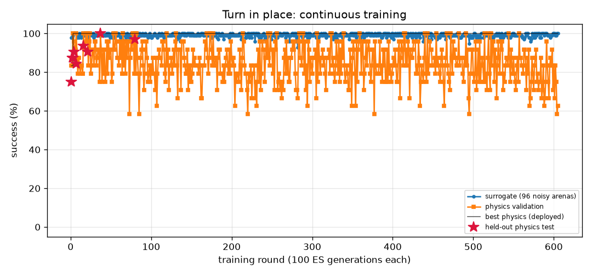

# Turn in place (`turn`) — training report

*Auto-generated by `train_brains.py`, last updated 2026-10-20T08:19:58.*

| | |
|---|---|
| rounds | 546 |
| ES generations | 54600 |
| physics runs | 13350 |
| status | **optimal** |
| best brain | round 80: physics validation **100%** on 24 arenas, surrogate 100% |
| held-out physics test | **97%** on 32 unseen arenas (95% CI 84%-99%) (errors: [1.6, 3.3, 6.3, 3.7, 1.1, 0.4, 2.4, 2.9, 0.1, 2.6, 0.5, 2.7, 1.5, 3.1, 4.5, 0.2, 0.5, 1.1, 2.0, 4.4, 2.8, 3.2, 0.3, 2.2, 0.5, 3.0, 0.3, 5.4, 0.4, 1.0, 4.7, 10.7]) |

Physics error per arena: deg from target heading (< 20 = success).

| round | level | gens | sigma | surrogate | physics val | val errors | test | note |
|---:|---:|---:|---:|---:|---:|---|---:|---|
| 507 | 3 | 50700 | 0.025 | 99% | 75% | [4.1, 2.4, 4.8, 2.6, 2.0, 3.9, 6.8, 7.1, 6.1, 0.3, 6.2, 1.1, 0.9, 0.1, 6.1, 1.4, 1.3, 2.3, 1.0, 2.7, 3.5, 1.5, 6.3, 4.7] |  |  |
| 508 | 3 | 50800 | 0.025 | 98% | 96% | [8.1, 8.7, 0.0, 1.2, 8.3, 1.6, 4.7, 1.0, 2.8, 1.9, 3.9, 1.1, 3.5, 2.8, 2.8, 2.2, 0.6, 1.2, 2.2, 2.0, 5.5, 0.6, 2.4, 3.8] |  | restart from best |
| 509 | 3 | 50900 | 0.024 | 98% | 75% | [8.0, 9.3, 3.4, 0.7, 2.4, 2.1, 4.0, 1.5, 3.5, 0.1, 3.6, 2.3, 1.3, 1.6, 2.6, 1.3, 2.2, 0.3, 1.8, 2.8, 7.2, 0.4, 2.9, 3.6] |  |  |
| 510 | 3 | 51000 | 0.025 | 100% | 83% | [6.0, 2.8, 1.4, 0.4, 2.9, 2.6, 5.9, 4.5, 5.9, 14.9, 4.1, 0.4, 0.8, 0.9, 4.3, 1.9, 0.8, 2.2, 2.3, 2.2, 3.5, 1.0, 5.7, 5.2] |  |  |
| 511 | 3 | 51100 | 0.024 | 100% | 88% | [4.6, 4.7, 2.6, 1.1, 5.2, 0.3, 4.0, 1.8, 5.1, 1.2, 3.8, 3.0, 0.6, 0.5, 4.1, 1.0, 1.0, 0.8, 1.4, 0.6, 4.4, 0.6, 4.9, 6.1] |  |  |
| 512 | 3 | 51200 | 0.024 | 100% | 83% | [7.0, 3.2, 1.2, 2.8, 4.8, 0.8, 4.5, 8.4, 5.8, 1.2, 5.8, 0.4, 1.9, 0.1, 4.0, 1.0, 0.4, 0.4, 3.9, 6.3, 2.9, 2.6, 6.0, 7.2] |  | restart from best |
| 513 | 3 | 51300 | 0.024 | 98% | 75% | [2.3, 1.2, 8.3, 0.6, 15.8, 0.4, 5.4, 8.7, 6.4, 1.0, 4.7, 0.6, 1.9, 2.2, 4.6, 4.9, 0.6, 3.7, 13.6, 11.4, 4.5, 1.4, 4.6, 9.3] |  |  |
| 514 | 3 | 51400 | 0.025 | 99% | 100% | [5.2, 7.3, 5.9, 1.5, 0.7, 1.1, 5.8, 4.1, 5.2, 1.6, 2.9, 0.5, 2.7, 3.1, 3.5, 1.6, 0.2, 1.6, 1.0, 2.3, 3.4, 1.2, 4.8, 1.9] |  |  |
| 515 | 3 | 51500 | 0.025 | 99% | 75% | [7.1, 8.0, 0.4, 0.7, 5.6, 2.4, 3.9, 3.1, 4.8, 0.4, 5.5, 2.5, 0.6, 0.0, 5.1, 0.1, 1.8, 1.2, 0.7, 0.3, 6.6, 1.1, 4.7, 5.3] |  |  |
| 516 | 3 | 51600 | 0.025 | 100% | 79% | [5.6, 2.8, 2.0, 0.5, 11.2, 0.8, 5.7, 7.4, 6.2, 1.9, 4.6, 1.1, 1.3, 1.8, 3.8, 10.8, 0.6, 1.3, 8.6, 1.8, 4.3, 1.7, 5.1, 2.3] |  | restart from best |
| 517 | 3 | 51700 | 0.024 | 99% | 71% | [7.7, 0.4, 7.2, 1.7, 4.6, 1.9, 5.9, 0.3, 7.5, 0.3, 5.7, 0.3, 2.1, 2.8, 4.9, 13.3, 0.0, 4.5, 0.3, 0.2, 4.5, 0.5, 5.3, 7.3] |  |  |
| 518 | 3 | 51800 | 0.025 | 99% | 88% | [5.4, 8.8, 4.6, 4.1, 2.7, 3.6, 4.2, 3.8, 3.4, 0.6, 3.6, 1.6, 3.3, 2.5, 3.3, 1.4, 1.8, 0.3, 0.2, 0.2, 4.1, 0.5, 4.2, 5.4] |  |  |
| 519 | 3 | 51900 | 0.025 | 99% | 100% | [8.5, 8.7, 8.6, 4.3, 2.3, 2.6, 1.6, 0.4, 3.0, 0.1, 1.9, 2.5, 4.9, 3.1, 2.1, 3.5, 2.8, 3.9, 3.0, 2.8, 5.6, 1.3, 2.7, 2.7] |  |  |
| 520 | 3 | 52000 | 0.025 | 98% | 79% | [9.3, 11.3, 9.4, 2.7, 2.4, 1.0, 2.8, 4.3, 3.5, 1.0, 1.5, 3.6, 1.2, 4.2, 0.9, 2.8, 3.5, 1.8, 1.8, 3.0, 7.6, 0.6, 3.8, 3.0] |  | restart from best |
| 521 | 3 | 52100 | 0.024 | 99% | 71% | [0.3, 1.2, 6.0, 0.3, 3.2, 118.3, 7.4, 9.8, 7.2, 1.4, 4.9, 2.0, 1.1, 1.1, 6.5, 1.6, 2.1, 3.0, 1.0, 1.9, 0.8, 2.4, 5.8, 5.2] |  |  |
| 522 | 3 | 52200 | 0.025 | 99% | 100% | [6.1, 8.1, 1.0, 0.9, 4.5, 0.7, 2.5, 2.1, 3.5, 0.1, 2.3, 0.4, 3.0, 2.2, 3.2, 1.1, 0.1, 0.8, 0.6, 1.8, 3.7, 0.5, 5.6, 2.6] |  |  |
| 523 | 3 | 52300 | 0.025 | 99% | 83% | [3.4, 9.0, 2.2, 3.1, 4.8, 1.3, 5.2, 1.5, 3.4, 1.5, 4.4, 0.7, 1.8, 3.6, 4.3, 1.6, 0.8, 1.4, 1.8, 1.0, 5.0, 0.4, 3.0, 3.8] |  |  |
| 524 | 3 | 52400 | 0.025 | 98% | 96% | [10.0, 10.4, 3.4, 2.5, 4.0, 0.5, 2.4, 4.6, 2.2, 2.8, 0.7, 3.4, 0.1, 6.2, 1.1, 2.2, 3.6, 2.6, 1.8, 3.6, 8.6, 0.9, 1.8, 3.8] |  | restart from best |
| 525 | 3 | 52500 | 0.024 | 98% | 96% | [7.3, 7.2, 0.2, 3.3, 5.0, 1.9, 2.3, 3.7, 3.2, 14.8, 4.3, 1.4, 1.6, 2.3, 4.0, 5.5, 1.6, 0.3, 2.3, 0.5, 5.7, 1.6, 5.0, 2.3] |  |  |
| 526 | 3 | 52600 | 0.025 | 99% | 75% | [3.4, 5.6, 0.5, 2.5, 3.1, 1.9, 3.1, 8.0, 6.6, 0.1, 3.8, 0.0, 1.3, 0.7, 4.9, 1.3, 0.1, 1.0, 0.0, 6.2, 3.8, 1.1, 5.3, 5.9] |  |  |
| 527 | 3 | 52700 | 0.025 | 99% | 92% | [6.0, 9.0, 6.9, 4.1, 2.2, 1.9, 3.5, 0.6, 4.0, 0.4, 3.4, 1.7, 2.0, 3.5, 2.1, 0.0, 1.8, 1.1, 2.2, 0.3, 6.2, 0.2, 3.4, 2.6] |  |  |
| 528 | 3 | 52800 | 0.025 | 99% | 88% | [2.8, 4.1, 4.3, 0.5, 5.6, 2.4, 6.1, 5.8, 6.1, 1.4, 3.9, 0.6, 1.2, 1.1, 4.1, 1.0, 2.5, 0.3, 0.4, 0.2, 3.4, 2.2, 6.7, 3.9] |  | restart from best |
| 529 | 3 | 52900 | 0.024 | 100% | 67% | [7.0, 9.4, 0.4, 0.3, 2.7, 5.3, 3.0, 5.3, 3.2, 0.7, 2.5, 3.7, 2.1, 1.3, 2.1, 2.7, 3.3, 0.7, 2.6, 3.2, 5.7, 1.0, 2.8, 6.1] |  |  |
| 530 | 3 | 53000 | 0.024 | 99% | 83% | [3.6, 6.3, 2.0, 0.1, 6.2, 1.1, 5.6, 2.3, 5.4, 15.2, 3.1, 1.5, 0.2, 3.3, 3.4, 1.6, 0.0, 0.8, 2.5, 0.6, 3.3, 1.2, 6.5, 5.7] |  |  |
| 531 | 3 | 53100 | 0.025 | 99% | 96% | [4.9, 7.1, 0.0, 3.6, 0.4, 1.3, 4.6, 2.3, 6.0, 1.0, 2.1, 0.5, 2.9, 3.5, 2.0, 1.7, 0.4, 0.5, 1.8, 0.6, 4.7, 0.2, 3.8, 2.6] |  |  |
| 532 | 3 | 53200 | 0.025 | 100% | 88% | [6.1, 5.5, 1.5, 0.9, 2.3, 2.0, 5.2, 5.1, 6.0, 0.6, 4.1, 1.2, 2.4, 1.5, 3.4, 1.5, 0.9, 0.3, 1.4, 0.8, 6.1, 0.1, 5.3, 2.5] |  | restart from best |
| 533 | 3 | 53300 | 0.024 | 99% | 79% | [5.1, 3.1, 2.2, 1.6, 2.3, 2.9, 5.5, 8.7, 4.7, 13.9, 4.5, 1.3, 0.3, 2.6, 4.9, 0.1, 0.5, 2.2, 0.2, 0.3, 6.0, 5.1, 6.1, 6.6] |  |  |
| 534 | 3 | 53400 | 0.025 | 98% | 96% | [9.8, 10.5, 4.6, 5.7, 4.6, 0.0, 1.8, 1.0, 1.3, 2.3, 1.5, 3.1, 0.2, 2.9, 1.8, 5.1, 3.2, 2.7, 3.3, 3.5, 8.6, 1.0, 0.6, 7.2] |  |  |
| 535 | 3 | 53500 | 0.025 | 100% | 92% | [3.4, 6.8, 1.5, 0.7, 0.6, 1.9, 4.6, 0.3, 3.7, 0.1, 2.8, 0.7, 0.8, 3.8, 2.6, 0.0, 0.5, 1.4, 0.1, 0.9, 3.1, 2.1, 2.8, 2.6] |  |  |
| 536 | 3 | 53600 | 0.024 | 99% | 96% | [5.5, 2.8, 1.7, 1.2, 15.9, 14.3, 2.8, 7.4, 6.2, 9.6, 3.8, 0.2, 1.3, 1.5, 3.4, 13.3, 0.1, 4.3, 13.2, 13.0, 3.0, 2.1, 5.4, 3.9] |  | restart from best |
| 537 | 3 | 53700 | 0.024 | 98% | 71% | [8.8, 9.6, 6.6, 2.9, 1.5, 2.7, 4.9, 0.0, 3.5, 0.1, 2.7, 3.3, 2.5, 4.2, 3.1, 0.3, 1.7, 0.0, 1.4, 1.1, 101.2, 0.1, 3.3, 3.0] |  |  |
| 538 | 3 | 53800 | 0.025 | 99% | 79% | [5.9, 4.0, 4.1, 0.8, 0.8, 0.6, 4.6, 6.2, 4.8, 1.0, 4.4, 1.7, 0.8, 2.7, 5.8, 2.5, 1.1, 1.4, 0.8, 0.1, 2.3, 0.1, 4.7, 4.9] |  |  |
| 539 | 3 | 53900 | 0.025 | 99% | 75% | [3.4, 8.3, 5.6, 1.1, 2.0, 2.6, 4.8, 3.9, 3.4, 1.0, 4.2, 0.9, 1.8, 1.4, 4.2, 1.5, 1.2, 0.2, 0.7, 0.8, 5.2, 2.1, 3.7, 3.9] |  |  |
| 540 | 3 | 54000 | 0.025 | 100% | 83% | [2.4, 3.4, 6.3, 1.3, 2.4, 0.9, 7.5, 5.6, 8.3, 1.4, 5.9, 3.2, 0.6, 0.7, 6.0, 4.4, 3.4, 5.7, 3.6, 3.6, 1.4, 2.3, 7.0, 3.3] |  | restart from best |
| 541 | 3 | 54100 | 0.024 | 100% | 88% | [2.4, 7.1, 5.8, 4.2, 1.1, 1.3, 3.2, 2.9, 5.9, 0.4, 4.2, 0.1, 1.7, 1.9, 2.3, 0.7, 0.4, 0.3, 0.3, 1.3, 3.5, 0.4, 5.9, 1.4] |  |  |
| 542 | 3 | 54200 | 0.024 | 99% | 88% | [5.6, 2.2, 6.7, 0.9, 13.4, 4.8, 7.0, 9.2, 8.2, 15.3, 4.5, 1.9, 0.7, 0.3, 0.3, 3.8, 2.9, 5.3, 4.0, 5.7, 3.7, 0.2, 7.4, 10.2] |  |  |
| 543 | 3 | 54300 | 0.025 | 98% | 83% | [10.5, 3.6, 5.7, 0.6, 17.5, 6.5, 7.8, 9.8, 8.6, 3.1, 5.7, 4.4, 3.0, 0.8, 5.3, 4.1, 4.4, 15.5, 14.5, 3.0, 5.0, 4.0, 8.4, 10.1] |  |  |
| 544 | 3 | 54400 | 0.025 | 99% | 100% | [8.7, 0.6, 3.5, 2.9, 3.0, 2.2, 9.9, 8.8, 8.6, 11.7, 5.3, 3.1, 1.0, 0.3, 3.9, 2.6, 2.7, 3.2, 2.7, 3.6, 6.5, 2.4, 5.2, 3.5] |  | restart from best |
| 545 | 3 | 54500 | 0.024 | 99% | 88% | [6.3, 2.0, 1.9, 1.2, 1.6, 11.4, 5.6, 5.2, 4.7, 1.9, 3.6, 0.6, 0.4, 2.2, 3.4, 2.7, 0.4, 1.4, 1.3, 1.7, 5.3, 2.0, 5.2, 3.6] |  |  |
| 546 | 3 | 54600 | 0.025 | 98% | 75% | [9.2, 5.9, 3.5, 1.6, 2.0, 1.3, 5.0, 1.4, 3.6, 0.8, 4.8, 1.2, 1.1, 3.4, 3.3, 2.0, 0.8, 1.5, 2.0, 3.5, 4.7, 0.2, 3.9, 4.8] |  |  |
