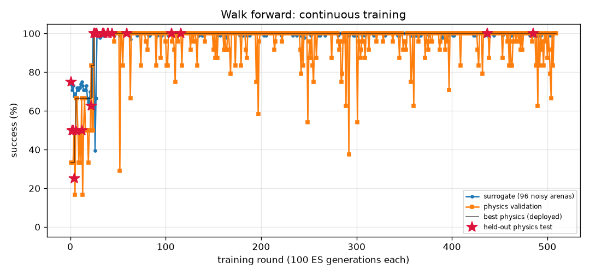

# Walk forward (`walk_forward`) — training report

*Auto-generated by `train_brains.py`, last updated 2026-11-17T23:27:18.*

| | |
|---|---|
| rounds | 411 |
| ES generations | 41100 |
| physics runs | 9878 |
| status | **optimal** |
| best brain | round 116: physics validation **100%** on 24 arenas, surrogate 100% |
| held-out physics test | **100%** on 32 unseen arenas (95% CI 89%-100%) (errors: [0.13, 0.16, 0.19, 0.16, 0.15, 0.2, 0.17, 0.18, 0.17, 0.19, 0.2, 0.14, 0.17, 0.19, 0.2, 0.2, 0.13, 0.19, 0.16, 0.2, 0.2, 0.16, 0.17, 0.2, 0.13, 0.15, 0.18, 0.14, 0.16, 0.15, 0.19, 0.12]) |

Physics error per arena: mm from target at the end (< 1.5 and standing still = success).

| round | level | gens | sigma | surrogate | physics val | val errors | test | note |
|---:|---:|---:|---:|---:|---:|---|---:|---|
| 372 | 3 | 37200 | 0.024 | 100% | 88% | [0.21, 0.24, 0.4, 0.05, 0.25, 0.6, 0.26, 0.07, 0.24, 0.1, 0.09, 0.06, 0.07, 0.08, 0.22, 0.1, 0.07, 0.24, 0.73, 0.23, 0.07, 0.13, 0.07, 0.07] |  | restart from best |
| 373 | 3 | 37300 | 0.024 | 100% | 100% | [0.17, 0.27, 0.16, 0.16, 0.27, 0.16, 0.27, 0.14, 0.27, 0.28, 0.17, 0.26, 0.14, 0.16, 0.2, 0.27, 0.15, 0.25, 0.14, 0.22, 0.14, 0.27, 0.25, 0.14] |  |  |
| 374 | 3 | 37400 | 0.024 | 100% | 96% | [0.06, 0.08, 0.08, 0.07, 0.08, 0.08, 0.07, 0.09, 0.07, 0.09, 0.07, 0.1, 0.08, 0.05, 0.07, 0.1, 0.05, 0.09, 0.07, 0.08, 0.1, 0.07, 0.1, 0.09] |  |  |
| 375 | 3 | 37500 | 0.024 | 100% | 92% | [0.08, 0.21, 0.21, 0.08, 0.21, 0.02, 0.23, 0.09, 0.22, 0.26, 0.15, 0.26, 0.4, 0.05, 0.07, 0.27, 0.08, 0.19, 0.1, 0.15, 0.07, 0.26, 0.26, 0.07] |  |  |
| 376 | 3 | 37600 | 0.024 | 99% | 100% | [0.24, 0.39, 0.28, 0.23, 0.39, 0.3, 0.4, 0.24, 0.38, 0.4, 0.31, 0.37, 0.25, 0.29, 0.27, 0.39, 0.23, 0.35, 0.24, 0.29, 0.24, 0.4, 0.37, 0.25] |  | restart from best |
| 377 | 3 | 37700 | 0.024 | 100% | 100% | [0.29, 0.38, 0.32, 0.29, 0.38, 0.33, 0.39, 0.32, 0.38, 0.42, 0.33, 0.44, 0.3, 0.33, 0.32, 0.43, 0.3, 0.35, 0.31, 0.32, 0.3, 0.43, 0.44, 0.31] |  |  |
| 378 | 3 | 37800 | 0.024 | 100% | 96% | [0.16, 0.2, 0.1, 0.16, 0.2, 0.09, 0.2, 0.11, 0.2, 0.2, 0.36, 0.18, 0.1, 0.09, 0.18, 0.19, 0.15, 0.19, 0.12, 0.18, 0.12, 0.19, 0.18, 0.11] |  |  |
| 379 | 3 | 37900 | 0.024 | 100% | 96% | [0.07, 0.09, 0.09, 0.08, 0.08, 0.06, 0.1, 0.06, 0.09, 0.12, 0.41, 0.17, 0.04, 0.08, 0.07, 0.14, 0.06, 0.12, 0.09, 0.09, 0.06, 0.12, 0.18, 0.05] |  |  |
| 380 | 3 | 38000 | 0.024 | 100% | 100% | [0.14, 0.17, 0.15, 0.14, 0.17, 0.1, 0.18, 0.14, 0.17, 0.18, 0.09, 0.19, 0.12, 0.1, 0.15, 0.19, 0.14, 0.17, 0.15, 0.15, 0.14, 0.18, 0.18, 0.13] |  | restart from best |
| 381 | 3 | 38100 | 0.024 | 100% | 100% | [0.31, 0.29, 0.25, 0.3, 0.29, 0.24, 0.29, 0.27, 0.29, 0.28, 0.23, 0.26, 0.26, 0.24, 0.31, 0.26, 0.29, 0.3, 0.27, 0.3, 0.27, 0.27, 0.25, 0.26] |  |  |
| 382 | 3 | 38200 | 0.024 | 100% | 100% | [0.19, 0.18, 0.13, 0.2, 0.17, 0.15, 0.2, 0.14, 0.15, 0.22, 0.18, 0.22, 0.18, 0.11, 0.21, 0.24, 0.16, 0.17, 0.17, 0.22, 0.13, 0.19, 0.18, 0.19] |  |  |
| 383 | 3 | 38300 | 0.024 | 100% | 100% | [0.23, 0.23, 0.2, 0.23, 0.22, 0.19, 0.23, 0.21, 0.22, 0.21, 0.18, 0.2, 0.21, 0.2, 0.22, 0.21, 0.22, 0.23, 0.22, 0.23, 0.22, 0.21, 0.2, 0.21] |  |  |
| 384 | 3 | 38400 | 0.024 | 100% | 100% | [0.21, 0.06, 0.17, 0.22, 0.05, 0.02, 0.15, 0.2, 0.08, 0.16, 0.33, 0.16, 0.2, 0.02, 0.09, 0.18, 0.22, 0.07, 0.2, 0.1, 0.21, 0.16, 0.15, 0.2] |  | restart from best |
| 385 | 3 | 38500 | 0.024 | 100% | 100% | [0.23, 0.33, 0.19, 0.23, 0.33, 0.2, 0.33, 0.18, 0.33, 0.33, 0.21, 0.31, 0.18, 0.2, 0.25, 0.32, 0.21, 0.3, 0.18, 0.27, 0.18, 0.33, 0.31, 0.18] |  |  |
| 386 | 3 | 38600 | 0.024 | 100% | 100% | [0.11, 0.2, 0.12, 0.11, 0.2, 0.14, 0.21, 0.12, 0.2, 0.25, 0.15, 0.25, 0.12, 0.14, 0.12, 0.25, 0.11, 0.17, 0.12, 0.14, 0.11, 0.26, 0.25, 0.11] |  |  |
| 387 | 3 | 38700 | 0.024 | 100% | 92% | [0.07, 0.1, 0.05, 0.06, 0.09, 0.06, 0.5, 0.05, 0.09, 0.06, 0.05, 0.08, 0.05, 0.06, 0.06, 0.06, 3.55, 0.07, 0.06, 0.07, 0.06, 0.07, 0.07, 0.05] |  |  |
| 388 | 3 | 38800 | 0.024 | 100% | 96% | [0.21, 0.19, 0.16, 0.06, 0.18, 0.18, 0.21, 0.16, 0.2, 0.26, 0.17, 0.25, 0.16, 0.17, 0.1, 0.26, 0.02, 0.14, 0.15, 0.1, 0.14, 0.27, 0.25, 0.17] |  | restart from best |
| 389 | 3 | 38900 | 0.024 | 100% | 100% | [0.3, 0.37, 0.26, 0.3, 0.36, 0.27, 0.35, 0.26, 0.37, 0.39, 0.27, 0.4, 0.26, 0.27, 0.32, 0.4, 0.28, 0.37, 0.27, 0.34, 0.27, 0.4, 0.39, 0.26] |  |  |
| 390 | 3 | 39000 | 0.024 | 98% | 100% | [0.16, 0.14, 0.24, 0.09, 0.13, 0.23, 0.19, 0.05, 0.14, 0.17, 0.04, 0.2, 0.23, 0.22, 0.09, 0.22, 0.1, 0.1, 0.05, 0.09, 0.09, 0.18, 0.19, 0.19] |  |  |
| 391 | 3 | 39100 | 0.025 | 100% | 100% | [0.36, 0.34, 0.33, 0.36, 0.34, 0.34, 0.34, 0.35, 0.34, 0.29, 0.33, 0.18, 0.35, 0.34, 0.35, 0.12, 0.35, 0.34, 0.36, 0.35, 0.36, 0.28, 0.07, 0.35] |  |  |
| 392 | 3 | 39200 | 0.024 | 100% | 100% | [0.24, 0.17, 0.22, 0.24, 0.16, 0.1, 0.15, 0.17, 0.15, 0.17, 0.11, 0.32, 0.21, 0.15, 0.22, 0.29, 0.22, 0.16, 0.18, 0.2, 0.15, 0.17, 0.31, 0.2] |  | restart from best |
| 393 | 3 | 39300 | 0.024 | 100% | 92% | [0.26, 0.06, 0.29, 0.26, 0.05, 0.35, 0.05, 0.09, 0.06, 0.08, 0.21, 0.18, 0.23, 0.3, 0.05, 0.18, 0.25, 0.04, 0.07, 0.06, 0.08, 0.09, 0.26, 0.17] |  |  |
| 394 | 3 | 39400 | 0.024 | 100% | 100% | [0.24, 0.3, 0.2, 0.24, 0.3, 0.2, 0.3, 0.2, 0.3, 0.29, 0.21, 0.27, 0.19, 0.2, 0.27, 0.27, 0.23, 0.3, 0.2, 0.28, 0.2, 0.28, 0.26, 0.19] |  |  |
| 395 | 3 | 39500 | 0.024 | 99% | 96% | [0.05, 0.11, 0.06, 0.17, 0.06, 0.13, 0.05, 0.13, 0.08, 0.2, 0.09, 0.13, 0.13, 0.13, 0.02, 0.13, 0.07, 0.07, 0.06, 0.08, 0.08, 0.07, 0.2, 0.13] |  |  |
| 396 | 3 | 39600 | 0.025 | 99% | 100% | [0.09, 0.15, 0.17, 0.09, 0.15, 0.14, 0.18, 0.13, 0.16, 0.21, 0.13, 0.28, 0.16, 0.03, 0.15, 0.22, 0.11, 0.21, 0.11, 0.14, 0.13, 0.27, 0.22, 0.17] |  | restart from best |
| 397 | 3 | 39700 | 0.024 | 100% | 71% | [0.06, 0.1, 0.46, 0.07, 0.06, 0.29, 0.1, 0.04, 0.09, 0.11, 0.62, 0.1, 0.27, 1.48, 0.07, 0.08, 0.06, 0.08, 0.44, 0.07, 0.04, 0.11, 0.12, 0.06] |  |  |
| 398 | 3 | 39800 | 0.024 | 100% | 100% | [0.12, 0.15, 0.13, 0.12, 0.15, 0.11, 0.16, 0.12, 0.16, 0.14, 0.1, 0.17, 0.11, 0.12, 0.11, 0.15, 0.07, 0.14, 0.07, 0.13, 0.09, 0.17, 0.15, 0.09] |  |  |
| 399 | 3 | 39900 | 0.024 | 100% | 100% | [0.28, 0.15, 0.24, 0.28, 0.15, 0.22, 0.13, 0.27, 0.13, 0.15, 0.07, 0.24, 0.26, 0.23, 0.3, 0.23, 0.29, 0.14, 0.27, 0.29, 0.28, 0.19, 0.25, 0.26] |  |  |
| 400 | 3 | 40000 | 0.024 | 100% | 100% | [0.14, 0.18, 0.13, 0.14, 0.2, 0.11, 0.19, 0.08, 0.18, 0.19, 0.11, 0.19, 0.11, 0.11, 0.14, 0.18, 0.13, 0.16, 0.11, 0.14, 0.12, 0.19, 0.2, 0.13] |  | restart from best |
| 401 | 3 | 40100 | 0.024 | 99% | 100% | [0.34, 0.36, 0.26, 0.33, 0.36, 0.25, 0.36, 0.29, 0.36, 0.35, 0.24, 0.33, 0.29, 0.26, 0.35, 0.34, 0.33, 0.35, 0.29, 0.35, 0.31, 0.35, 0.32, 0.29] |  |  |
| 402 | 3 | 40200 | 0.025 | 99% | 100% | [0.24, 0.18, 0.19, 0.24, 0.17, 0.18, 0.21, 0.22, 0.19, 0.3, 0.04, 0.24, 0.23, 0.2, 0.25, 0.25, 0.24, 0.23, 0.23, 0.24, 0.23, 0.22, 0.25, 0.22] |  |  |
| 403 | 3 | 40300 | 0.025 | 100% | 100% | [0.19, 0.23, 0.15, 0.19, 0.23, 0.05, 0.23, 0.16, 0.23, 0.24, 0.14, 0.23, 0.16, 0.15, 0.2, 0.23, 0.18, 0.23, 0.16, 0.2, 0.17, 0.24, 0.22, 0.16] |  |  |
| 404 | 3 | 40400 | 0.024 | 100% | 100% | [0.2, 0.26, 0.19, 0.2, 0.26, 0.21, 0.26, 0.19, 0.26, 0.28, 0.2, 0.27, 0.18, 0.21, 0.22, 0.29, 0.2, 0.26, 0.19, 0.23, 0.2, 0.28, 0.28, 0.19] |  | restart from best |
| 405 | 3 | 40500 | 0.024 | 100% | 100% | [0.21, 0.24, 0.14, 0.21, 0.24, 0.13, 0.23, 0.17, 0.24, 0.22, 0.11, 0.2, 0.16, 0.13, 0.22, 0.21, 0.2, 0.24, 0.17, 0.23, 0.19, 0.22, 0.19, 0.16] |  |  |
| 406 | 3 | 40600 | 0.024 | 100% | 100% | [0.31, 0.32, 0.26, 0.31, 0.32, 0.25, 0.31, 0.27, 0.31, 0.3, 0.23, 0.29, 0.27, 0.25, 0.31, 0.28, 0.31, 0.32, 0.27, 0.32, 0.28, 0.3, 0.28, 0.27] |  |  |
| 407 | 3 | 40700 | 0.024 | 100% | 100% | [0.23, 0.26, 0.18, 0.23, 0.26, 0.18, 0.26, 0.18, 0.26, 0.26, 0.17, 0.24, 0.18, 0.18, 0.25, 0.25, 0.23, 0.26, 0.19, 0.25, 0.2, 0.25, 0.23, 0.19] |  |  |
| 408 | 3 | 40800 | 0.024 | 100% | 100% | [0.31, 0.2, 0.08, 0.31, 0.32, 0.07, 0.23, 0.28, 0.31, 0.25, 0.04, 0.25, 0.13, 0.06, 0.33, 0.24, 0.3, 0.32, 0.27, 0.33, 0.08, 0.25, 0.29, 0.1] |  | restart from best |
| 409 | 3 | 40900 | 0.024 | 100% | 83% | [0.16, 0.25, 0.22, 0.05, 0.25, 0.05, 0.25, 0.75, 0.25, 0.25, 0.06, 0.24, 0.33, 0.24, 0.2, 0.25, 0.17, 0.23, 0.31, 0.2, 0.04, 0.25, 0.24, 0.41] |  |  |
| 410 | 3 | 41000 | 0.024 | 100% | 100% | [0.26, 0.26, 0.21, 0.26, 0.26, 0.2, 0.26, 0.23, 0.26, 0.24, 0.19, 0.22, 0.22, 0.2, 0.26, 0.23, 0.25, 0.26, 0.24, 0.26, 0.24, 0.24, 0.22, 0.22] |  |  |
| 411 | 3 | 41100 | 0.024 | 100% | 100% | [0.14, 0.13, 0.12, 0.14, 0.13, 0.12, 0.12, 0.13, 0.13, 0.12, 0.11, 0.13, 0.13, 0.11, 0.14, 0.12, 0.13, 0.14, 0.13, 0.13, 0.13, 0.12, 0.12, 0.13] |  |  |
