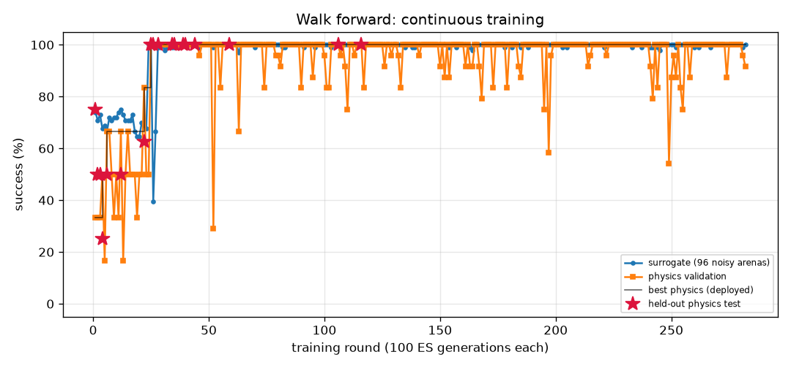

# Walk forward (`walk_forward`) — training report

*Auto-generated by `train_brains.py`, last updated 2026-11-13T22:59:27.*

| | |
|---|---|
| rounds | 382 |
| ES generations | 38200 |
| physics runs | 9182 |
| status | **optimal** |
| best brain | round 116: physics validation **100%** on 24 arenas, surrogate 100% |
| held-out physics test | **100%** on 32 unseen arenas (95% CI 89%-100%) (errors: [0.13, 0.16, 0.19, 0.16, 0.15, 0.2, 0.17, 0.18, 0.17, 0.19, 0.2, 0.14, 0.17, 0.19, 0.2, 0.2, 0.13, 0.19, 0.16, 0.2, 0.2, 0.16, 0.17, 0.2, 0.13, 0.15, 0.18, 0.14, 0.16, 0.15, 0.19, 0.12]) |

Physics error per arena: mm from target at the end (< 1.5 and standing still = success).

| round | level | gens | sigma | surrogate | physics val | val errors | test | note |
|---:|---:|---:|---:|---:|---:|---|---:|---|
| 343 | 3 | 34300 | 0.024 | 99% | 100% | [0.23, 0.2, 0.25, 0.22, 0.21, 0.24, 0.2, 0.24, 0.2, 0.18, 0.23, 0.17, 0.25, 0.25, 0.22, 0.18, 0.23, 0.21, 0.25, 0.21, 0.24, 0.19, 0.16, 0.25] |  |  |
| 344 | 3 | 34400 | 0.025 | 99% | 100% | [0.29, 0.29, 0.29, 0.3, 0.29, 0.27, 0.28, 0.31, 0.29, 0.27, 0.24, 0.26, 0.32, 0.29, 0.3, 0.26, 0.29, 0.29, 0.31, 0.3, 0.31, 0.27, 0.26, 0.32] |  | restart from best |
| 345 | 3 | 34500 | 0.024 | 99% | 88% | [0.13, 0.14, 0.09, 0.12, 0.1, 0.09, 0.12, 0.05, 0.08, 0.14, 0.08, 0.14, 0.07, 0.13, 0.12, 0.14, 0.22, 0.11, 0.06, 0.13, 0.06, 0.11, 0.14, 0.47] |  |  |
| 346 | 3 | 34600 | 0.025 | 100% | 100% | [0.03, 0.17, 0.08, 0.1, 0.22, 0.06, 0.22, 0.05, 0.21, 0.25, 0.16, 0.27, 0.07, 0.1, 0.14, 0.27, 0.1, 0.16, 0.06, 0.17, 0.08, 0.27, 0.25, 0.21] |  |  |
| 347 | 3 | 34700 | 0.024 | 100% | 100% | [0.43, 0.41, 0.32, 0.42, 0.42, 0.31, 0.4, 0.36, 0.41, 0.36, 0.3, 0.34, 0.36, 0.31, 0.42, 0.35, 0.41, 0.42, 0.36, 0.43, 0.39, 0.36, 0.33, 0.36] |  |  |
| 348 | 3 | 34800 | 0.024 | 100% | 100% | [0.23, 0.3, 0.21, 0.23, 0.3, 0.21, 0.3, 0.2, 0.3, 0.3, 0.23, 0.27, 0.19, 0.21, 0.25, 0.28, 0.21, 0.3, 0.19, 0.27, 0.19, 0.29, 0.26, 0.19] |  | restart from best |
| 349 | 3 | 34900 | 0.024 | 100% | 92% | [0.18, 0.12, 0.08, 0.18, 0.14, 0.06, 0.12, 0.16, 0.12, 0.15, 0.06, 0.17, 0.03, 0.06, 0.05, 0.09, 0.19, 0.08, 0.19, 0.05, 0.16, 0.15, 0.13, 0.06] |  |  |
| 350 | 3 | 35000 | 0.024 | 100% | 96% | [0.1, 0.17, 0.36, 0.1, 0.17, 0.38, 0.18, 0.04, 0.17, 0.19, 0.05, 0.19, 0.06, 0.53, 0.12, 0.2, 0.03, 0.15, 0.06, 0.13, 0.29, 0.19, 0.19, 0.05] |  |  |
| 351 | 3 | 35100 | 0.024 | 100% | 96% | [0.07, 0.24, 0.24, 0.06, 0.24, 0.05, 0.25, 0.04, 0.24, 0.27, 0.14, 0.27, 0.1, 0.13, 0.05, 0.26, 0.1, 0.23, 0.08, 0.11, 0.09, 0.27, 0.17, 0.1] |  |  |
| 352 | 3 | 35200 | 0.024 | 100% | 92% | [0.15, 0.2, 0.05, 0.15, 0.2, 0.05, 0.21, 0.07, 0.21, 0.23, 0.05, 0.22, 0.07, 0.08, 0.16, 0.22, 0.07, 0.2, 0.17, 0.17, 0.08, 0.23, 0.21, 0.28] |  | restart from best |
| 353 | 3 | 35300 | 0.024 | 100% | 100% | [0.2, 0.26, 0.15, 0.2, 0.26, 0.02, 0.25, 0.17, 0.26, 0.26, 0.03, 0.24, 0.17, 0.14, 0.22, 0.25, 0.19, 0.25, 0.17, 0.23, 0.18, 0.25, 0.24, 0.17] |  |  |
| 354 | 3 | 35400 | 0.024 | 100% | 100% | [0.22, 0.24, 0.17, 0.21, 0.24, 0.17, 0.24, 0.18, 0.24, 0.25, 0.16, 0.24, 0.18, 0.17, 0.22, 0.25, 0.21, 0.23, 0.19, 0.22, 0.19, 0.25, 0.24, 0.19] |  |  |
| 355 | 3 | 35500 | 0.024 | 100% | 100% | [0.34, 0.33, 0.35, 0.34, 0.33, 0.34, 0.32, 0.34, 0.33, 0.32, 0.33, 0.31, 0.35, 0.34, 0.34, 0.31, 0.34, 0.33, 0.34, 0.34, 0.34, 0.32, 0.31, 0.35] |  |  |
| 356 | 3 | 35600 | 0.024 | 100% | 100% | [0.25, 0.26, 0.21, 0.25, 0.26, 0.21, 0.26, 0.22, 0.27, 0.25, 0.2, 0.24, 0.22, 0.21, 0.27, 0.24, 0.24, 0.27, 0.23, 0.26, 0.23, 0.25, 0.24, 0.22] |  | restart from best |
| 357 | 3 | 35700 | 0.024 | 99% | 75% | [0.11, 0.02, 0.51, 0.05, 0.04, 0.36, 0.1, 0.25, 0.07, 0.08, 0.03, 0.09, 1.07, 0.31, 0.06, 0.1, 0.07, 0.09, 0.87, 0.04, 0.04, 0.08, 0.08, 0.69] |  |  |
| 358 | 3 | 35800 | 0.025 | 99% | 83% | [0.27, 0.28, 1.15, 0.27, 0.29, 0.52, 0.29, 0.19, 0.29, 0.06, 0.52, 0.06, 0.05, 0.96, 0.29, 0.08, 0.25, 0.29, 0.23, 0.29, 0.24, 0.06, 0.07, 0.03] |  |  |
| 359 | 3 | 35900 | 0.025 | 100% | 100% | [0.27, 0.28, 0.21, 0.26, 0.28, 0.21, 0.28, 0.22, 0.28, 0.26, 0.21, 0.25, 0.21, 0.21, 0.28, 0.25, 0.25, 0.28, 0.22, 0.28, 0.24, 0.26, 0.24, 0.21] |  |  |
| 360 | 3 | 36000 | 0.024 | 99% | 62% | [0.48, 0.21, 0.03, 0.65, 0.21, 0.32, 0.22, 0.27, 0.22, 0.24, 0.54, 0.24, 3.08, 0.28, 0.05, 0.24, 0.7, 0.19, 0.57, 0.08, 0.12, 0.25, 0.24, 0.38] |  | restart from best |
| 361 | 3 | 36100 | 0.024 | 100% | 100% | [0.3, 0.1, 0.27, 0.3, 0.05, 0.24, 0.06, 0.3, 0.07, 0.12, 0.23, 0.18, 0.3, 0.25, 0.29, 0.18, 0.31, 0.28, 0.31, 0.29, 0.32, 0.18, 0.22, 0.3] |  |  |
| 362 | 3 | 36200 | 0.024 | 99% | 100% | [0.09, 0.1, 0.21, 0.11, 0.08, 0.2, 0.12, 0.22, 0.1, 0.12, 0.19, 0.15, 0.21, 0.2, 0.08, 0.15, 0.11, 0.11, 0.23, 0.05, 0.22, 0.13, 0.15, 0.21] |  |  |
| 363 | 3 | 36300 | 0.025 | 99% | 100% | [0.24, 0.07, 0.24, 0.25, 0.08, 0.23, 0.06, 0.26, 0.08, 0.07, 0.21, 0.17, 0.27, 0.23, 0.23, 0.18, 0.25, 0.22, 0.26, 0.22, 0.26, 0.2, 0.18, 0.27] |  |  |
| 364 | 3 | 36400 | 0.025 | 100% | 100% | [0.32, 0.39, 0.4, 0.32, 0.38, 0.4, 0.43, 0.37, 0.4, 0.52, 0.4, 0.52, 0.38, 0.4, 0.31, 0.53, 0.33, 0.33, 0.37, 0.3, 0.35, 0.52, 0.52, 0.38] |  | restart from best |
| 365 | 3 | 36500 | 0.024 | 100% | 96% | [0.2, 0.25, 0.07, 0.21, 0.25, 0.06, 0.24, 0.18, 0.24, 0.24, 0.67, 0.22, 0.07, 0.06, 0.23, 0.24, 0.19, 0.24, 0.05, 0.23, 0.05, 0.24, 0.22, 0.41] |  |  |
| 366 | 3 | 36600 | 0.024 | 99% | 100% | [0.16, 0.22, 0.05, 0.17, 0.21, 0.04, 0.22, 0.04, 0.22, 0.22, 0.06, 0.2, 0.12, 0.05, 0.18, 0.22, 0.15, 0.21, 0.13, 0.19, 0.14, 0.22, 0.2, 0.02] |  |  |
| 367 | 3 | 36700 | 0.025 | 99% | 100% | [0.27, 0.3, 0.17, 0.26, 0.3, 0.17, 0.29, 0.2, 0.3, 0.26, 0.13, 0.08, 0.19, 0.17, 0.28, 0.25, 0.24, 0.29, 0.2, 0.28, 0.21, 0.25, 0.07, 0.19] |  |  |
| 368 | 3 | 36800 | 0.025 | 100% | 100% | [0.12, 0.19, 0.15, 0.17, 0.18, 0.15, 0.14, 0.16, 0.1, 0.13, 0.15, 0.13, 0.11, 0.14, 0.19, 0.21, 0.16, 0.19, 0.16, 0.1, 0.16, 0.13, 0.19, 0.08] |  | restart from best |
| 369 | 3 | 36900 | 0.024 | 100% | 100% | [0.38, 0.41, 0.32, 0.38, 0.41, 0.3, 0.41, 0.34, 0.41, 0.39, 0.28, 0.38, 0.34, 0.31, 0.4, 0.39, 0.37, 0.41, 0.34, 0.4, 0.35, 0.4, 0.38, 0.34] |  |  |
| 370 | 3 | 37000 | 0.024 | 100% | 100% | [0.15, 0.17, 0.12, 0.15, 0.16, 0.1, 0.17, 0.13, 0.17, 0.17, 0.1, 0.16, 0.13, 0.11, 0.15, 0.16, 0.15, 0.17, 0.13, 0.15, 0.13, 0.17, 0.16, 0.12] |  |  |
| 371 | 3 | 37100 | 0.024 | 100% | 100% | [0.2, 0.17, 0.07, 0.2, 0.17, 0.08, 0.22, 0.1, 0.2, 0.28, 0.05, 0.27, 0.07, 0.08, 0.2, 0.17, 0.17, 0.15, 0.11, 0.21, 0.11, 0.3, 0.21, 0.14] |  |  |
| 372 | 3 | 37200 | 0.024 | 100% | 88% | [0.21, 0.24, 0.4, 0.05, 0.25, 0.6, 0.26, 0.07, 0.24, 0.1, 0.09, 0.06, 0.07, 0.08, 0.22, 0.1, 0.07, 0.24, 0.73, 0.23, 0.07, 0.13, 0.07, 0.07] |  | restart from best |
| 373 | 3 | 37300 | 0.024 | 100% | 100% | [0.17, 0.27, 0.16, 0.16, 0.27, 0.16, 0.27, 0.14, 0.27, 0.28, 0.17, 0.26, 0.14, 0.16, 0.2, 0.27, 0.15, 0.25, 0.14, 0.22, 0.14, 0.27, 0.25, 0.14] |  |  |
| 374 | 3 | 37400 | 0.024 | 100% | 96% | [0.06, 0.08, 0.08, 0.07, 0.08, 0.08, 0.07, 0.09, 0.07, 0.09, 0.07, 0.1, 0.08, 0.05, 0.07, 0.1, 0.05, 0.09, 0.07, 0.08, 0.1, 0.07, 0.1, 0.09] |  |  |
| 375 | 3 | 37500 | 0.024 | 100% | 92% | [0.08, 0.21, 0.21, 0.08, 0.21, 0.02, 0.23, 0.09, 0.22, 0.26, 0.15, 0.26, 0.4, 0.05, 0.07, 0.27, 0.08, 0.19, 0.1, 0.15, 0.07, 0.26, 0.26, 0.07] |  |  |
| 376 | 3 | 37600 | 0.024 | 99% | 100% | [0.24, 0.39, 0.28, 0.23, 0.39, 0.3, 0.4, 0.24, 0.38, 0.4, 0.31, 0.37, 0.25, 0.29, 0.27, 0.39, 0.23, 0.35, 0.24, 0.29, 0.24, 0.4, 0.37, 0.25] |  | restart from best |
| 377 | 3 | 37700 | 0.024 | 100% | 100% | [0.29, 0.38, 0.32, 0.29, 0.38, 0.33, 0.39, 0.32, 0.38, 0.42, 0.33, 0.44, 0.3, 0.33, 0.32, 0.43, 0.3, 0.35, 0.31, 0.32, 0.3, 0.43, 0.44, 0.31] |  |  |
| 378 | 3 | 37800 | 0.024 | 100% | 96% | [0.16, 0.2, 0.1, 0.16, 0.2, 0.09, 0.2, 0.11, 0.2, 0.2, 0.36, 0.18, 0.1, 0.09, 0.18, 0.19, 0.15, 0.19, 0.12, 0.18, 0.12, 0.19, 0.18, 0.11] |  |  |
| 379 | 3 | 37900 | 0.024 | 100% | 96% | [0.07, 0.09, 0.09, 0.08, 0.08, 0.06, 0.1, 0.06, 0.09, 0.12, 0.41, 0.17, 0.04, 0.08, 0.07, 0.14, 0.06, 0.12, 0.09, 0.09, 0.06, 0.12, 0.18, 0.05] |  |  |
| 380 | 3 | 38000 | 0.024 | 100% | 100% | [0.14, 0.17, 0.15, 0.14, 0.17, 0.1, 0.18, 0.14, 0.17, 0.18, 0.09, 0.19, 0.12, 0.1, 0.15, 0.19, 0.14, 0.17, 0.15, 0.15, 0.14, 0.18, 0.18, 0.13] |  | restart from best |
| 381 | 3 | 38100 | 0.024 | 100% | 100% | [0.31, 0.29, 0.25, 0.3, 0.29, 0.24, 0.29, 0.27, 0.29, 0.28, 0.23, 0.26, 0.26, 0.24, 0.31, 0.26, 0.29, 0.3, 0.27, 0.3, 0.27, 0.27, 0.25, 0.26] |  |  |
| 382 | 3 | 38200 | 0.024 | 100% | 100% | [0.19, 0.18, 0.13, 0.2, 0.17, 0.15, 0.2, 0.14, 0.15, 0.22, 0.18, 0.22, 0.18, 0.11, 0.21, 0.24, 0.16, 0.17, 0.17, 0.22, 0.13, 0.19, 0.18, 0.19] |  |  |
